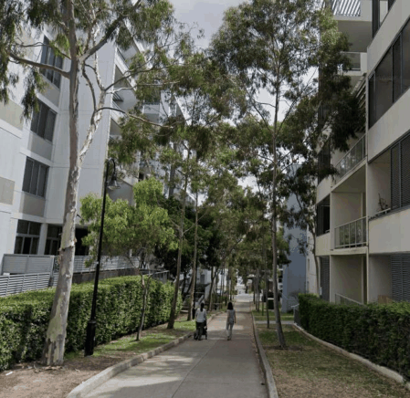

#### 9.3.1. Future character

Magill Street WLHA will evolve into a mid-rise residential precinct that offers convenient access to education, health and retail services, and public transport, while enhancing the landscape character of the precinct. The precinct will attract new residents through its proximity to major institutions and its potential for high quality urban living. Small-scale health services facilities or private medical clinics may be accommodated along Botany Street and Barker Street , complementing the area’s institutional context. The desired future character of the WLHA is for a consistent six story built form, with a two-storey transition to the lower scale residential neighbourhood to the west, generous setbacks to accommodate large canopy trees and private gardens, courtyard style development with buildings located around the perimeter of blocks, allowing for central communal green spaces, built form will defines key street frontages (Barker Street, Hospital Road and Magill Street) and reinforces the identity of street corners of the WLHA. Site consolidation will enable the delivery of communal open spaces with deep soil areas providing significant tree canopy cover and urban amenity.

Access The precinct will prioritise active transport with safe and convenient pedestrian and cycling access. Key features include proximity to bus stops and the light rail station supporting sustainable travel choices, future cycling infrastructure that connects directly to the broader Randwick LGA cycling network and a permeable street layout that supports pedestrian movement and integrates with surrounding streets and desire lines. Figure 23: Through site link

> [Picture on page 44: a picture, saved as a picture (images/part-d14-well-located-housing-area-page-44-8.gif, 150 dpi).]

Source: Randwick City Council 2022 The Magill Street WLHA will be designed to support a highly permeable and connected urban environment. The precinct will maintain existing street and laneway connections and respond to the various pedestrian desire lines by introducing new, safe and convenient through-block pedestrian pathways. This will create a cohesive and walkable neighbourhood that integrates seamlessly with surrounding areas. Private vehicular access will be provided via rear laneways and secondary streets with parking located at basement level to minimise disruption to the public domain and prioritise pedestrian movement. Built form The built form will consist of mid-rise residential apartment buildings with a maximum height of six storeys. Key design features include 6m setbacks from primary and secondary street frontages to accommodate private ground floor courtyard gardens for apartments and allow landscaping to permeate the WLHA. The block layout will support communal gardens with deep soil areas for tree planting, providing green, social spaces for residents and breaking up building mass. Enhanced street tree planting along Botany Street, Hospital Road, Barker Street, Hay Street, Norton Street and Magill Street with interplanting of new street trees, following a consolidated landscape theme. Mid-block gardens that include mature tree planting are encouraged to create a refuge from busy surrounding streets, such as Botany Street and Barker Street. Interface with sensitive surrounding areas The precinct will provide a transition in scale between surrounding land uses. Randwick Hospital Expansion Area, located immediately north of the WLHA, comprises institutional buildings up to 11 storeys in height. The new residential precinct will provide a transition in

height from the hospital and university buildings to the north, stepping down from six storeys along Botany Street and Barker Street, to two storeys adjacent to Norton Lane, aligning with the low density residential areas to the west and south of the WLHA. Generous setbacks and landscaped areas will be required to the west, north and east of the heritage-listed property at 4 Hay Street, ensuring an appropriate setting and respectful integration of the heritage item into the precinct.
