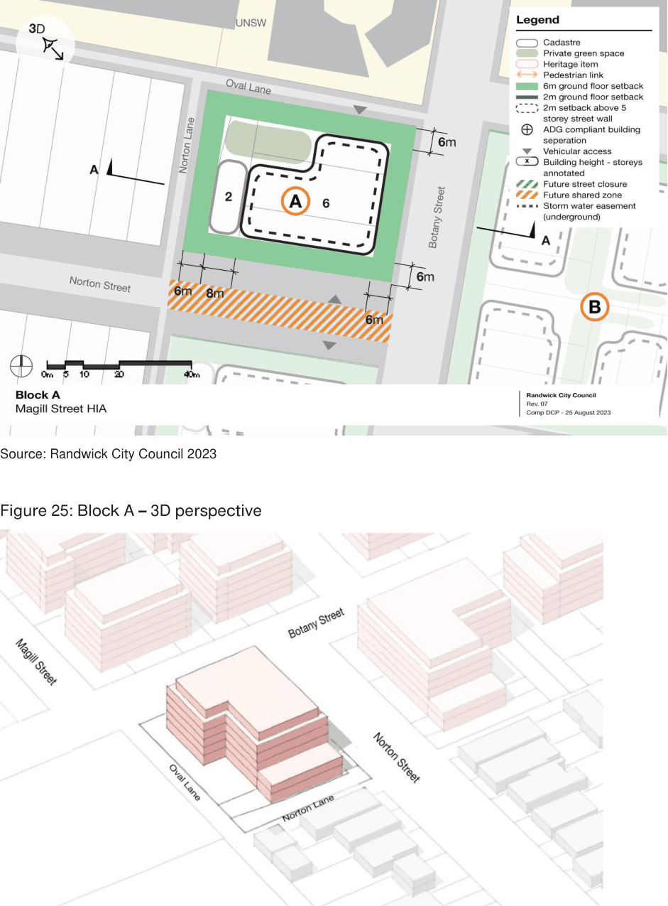
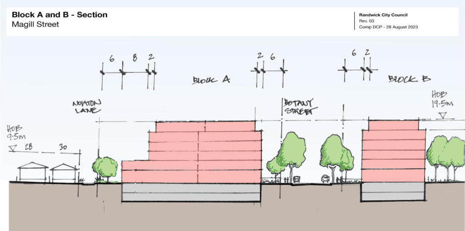
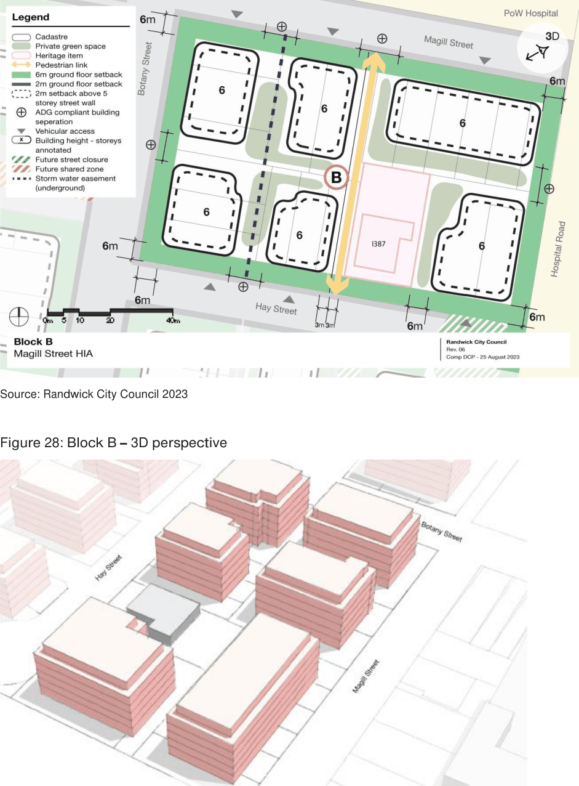
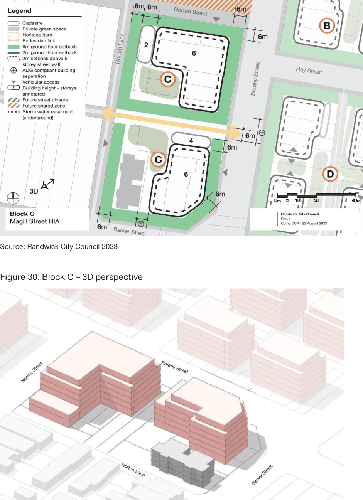
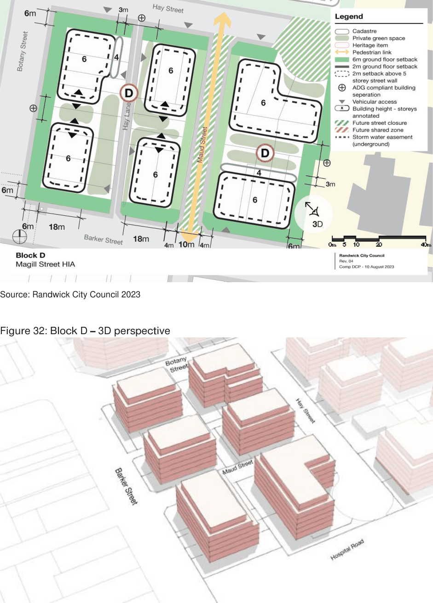

#### 9.3.5. Individual city block plans

Block A Figure 24: Block A control plan

> [Picture on page 47: a picture, saved as a picture (images/part-d14-well-located-housing-area-page-47-4.gif, 150 dpi).]

Source: Randwick City Council 2023

Figure 25: Block A

– 3D perspective

Source: Randwick City Council 2023

Figure 26: Typical cross section A-A

> [Picture on page 48: a picture, saved as a picture (images/part-d14-well-located-housing-area-page-48-2.gif, 150 dpi).]

Source: Randwick City Council 2023

Block B Figure 27: Block B control plan

> [Picture on page 49: a picture, saved as a picture (images/part-d14-well-located-housing-area-page-49-3.gif, 150 dpi).]

Source: Randwick City Council 2023

Figure 28: Block B

– 3D perspective

Source: Randwick City Council 2023

Block C Figure 29: Block C control plan

> [Picture on page 50: a picture, saved as a picture (images/part-d14-well-located-housing-area-page-50-3.gif, 150 dpi).]

Source: Randwick City Council 2023

Figure 30: Block C

– 3D perspective

Source: Randwick City Council 2023

Block D Figure 31: Block D control plan

> [Picture on page 51: a picture, saved as a picture (images/part-d14-well-located-housing-area-page-51-3.gif, 150 dpi).]

Source: Randwick City Council 2023

> Words printed on the picture (title and legend, copied from the PDF):
> – 3D perspective

Figure 32: Block D

Source: Randwick City Council 2023
