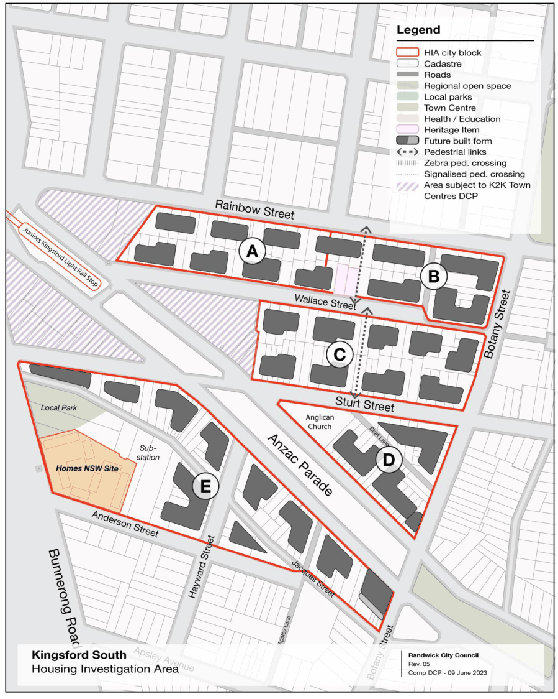
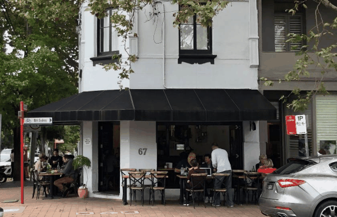

### 9.4. Kingsford South HIA

Figure 33: Kingsford South WLHA plan

> [Picture on page 53: a picture, saved as a picture (images/part-d14-well-located-housing-area-page-53-2.gif, 150 dpi).]

Source: Randwick City Council 2022 The Kingsford South Well Located Housing Area (WLHA) is centrally located within the LGA, in the suburb of Kingsford. The subject city blocks are illustrated in Figure 33 and are generally bounded by Rainbow Street, Botany Street, Anderson Street and Bunnerong Road. The HomesNSW site at 47-55 Bunnerong Road was rezoned in June 2025 as part of a State Significant pathway. The rezoning increased the residential density on the site to a maximum height of 28m (from 3 storeys to 8 storeys), and increased the maximum floor space ratio to 2.7:1 (from 0.75:1). Under cl 6.28 of the Randwick LEP, future redevelopment at the site must

include 50% social and affordable housing. The proposal will deliver 185 dwellings. Future character The WLHA will evolve into a renewed residential neighbourhood, that offers a variety of medium density housing types complemented by small-scale retail businesses that meet local needs. The proposed mid-rise typology will enhance the character of the area by promoting high quality outcomes in urban design, architectural and landscape design. The key features of the desired future character include:

• generous setbacks to support natural light, landscaping and residential amenity

• a permeable pedestrian network that responds to existing street patters and desire lines

• built form and building heights that transition appropriately to surrounding urban conditions

Given its accessible location, most of the Kingsford South WLHA is expected to undergo progressive redevelopment. The Anglican Church group of buildings at the corner of Anzac Parade and Sturt Street, and the electricity substation at 12-14 Anderson Street are expected to remain unchanged over the medium to long term. Access The precinct will prioritise active transport with safe and convenient pedestrian and cycling access supported by proximity to the light rail terminus and to public bus services operating along east-west and north-south corridors. Planned cycling infrastructure will provide direct connections into the broader Randwick LGA integrated cycling network. The WLHA benefits from access to major roads such as Anzac Parade, Bunnerong Road and Rainbow Street. The precinct will be highly permeable for pedestrians and cyclists, maintaining existing street connections and introducing new convenient and safe through-block pedestrian links aligned with desire lines. These will enhance and create a safe, integrated public domain. Private vehicle access will be via local streets with basement parking provided within new developments to minimise visual and spatial impacts at street level. Built form The proposed new built form of the precinct will be mid-rise in scale, with residential buildings up to five storey height. Key design elements include setbacks between buildings to allow for landscaping, natural light and cross ventilation. The block layout will support residential buildings with gardens on all sides of buildings, with deep soil zones for mature tree planting. A consistently of 6m setback from the primary and secondary street frontages will allow ground floor apartment courtyard gardens, communal open space and areas for mature tree planting. New apartment buildings will have generous front, side, and rear gardens. Small scale mixed-use buildings (with ground floor shops and apartments above) are proposed at the northwest and southwest corners of the Anzac Parade and Botany Street intersection (where shops are currently located). These new mixed-use buildings will also be of five storey height and built to the street edge, reinforcing the local character with active street frontages, will service the local community and provide apartment accommodation above. The mid-block areas will feature sunny private and communal gardens with mature tree plantings in deep soil conditions. These green spaces will provide a buffer from traffic along Anzac Parade and other busy streets contributing to a leafy, residential character and improved amenity.

Figure 34: Corner cafes in residential areas can provide a social focus and bring street activation

> [Picture on page 55: a picture, saved as a picture (images/part-d14-well-located-housing-area-page-55-3.gif, 150 dpi).]

Source: Randwick City Council 2022 Interface with surrounding areas The Kingsford South WLHA will provide a graduated transition in built form from the taller buildings of the Kingsford Town Centre situated to the northwest of the WLHA to the surrounding low-density residential areas. The built form will step down from the Juniors Kingsford Light Rail station of 9 and 17 storeys to a consistent five storey scale within the WLHA. This transition in scale will ensure a sensitive interface with the established low-density residential neighbourhoods to the south and east of the WLHA. There are currently many examples of three and four storey apartment buildings along the north side of Rainbow Street. New development on the south side of Rainbow Street will be built to five storeys, providing a balanced and appropriate scale for the streetscape and reinforcing the area’s evolving residential character .
