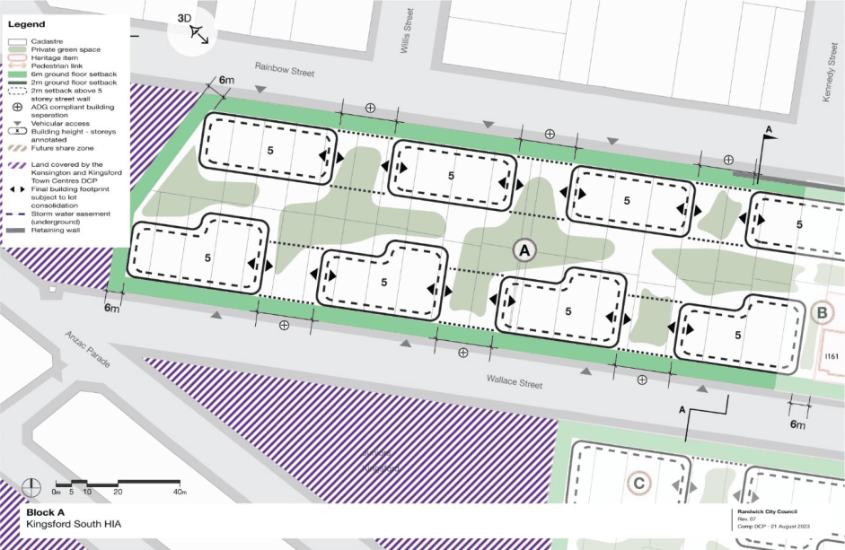
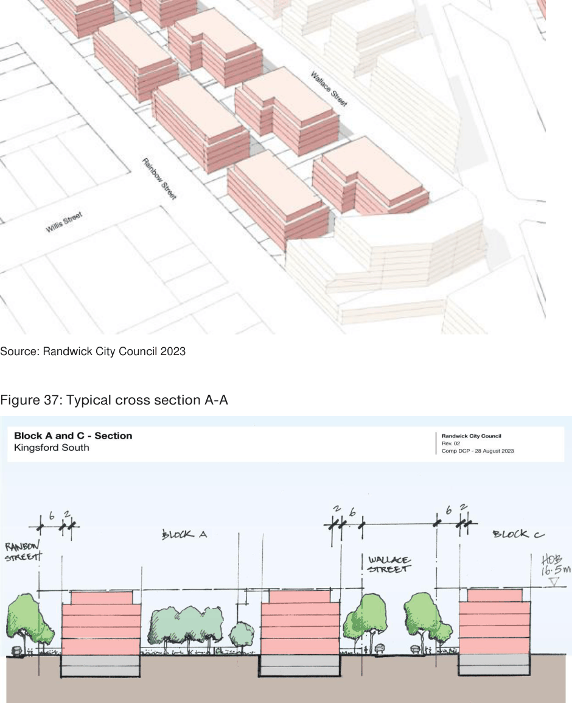
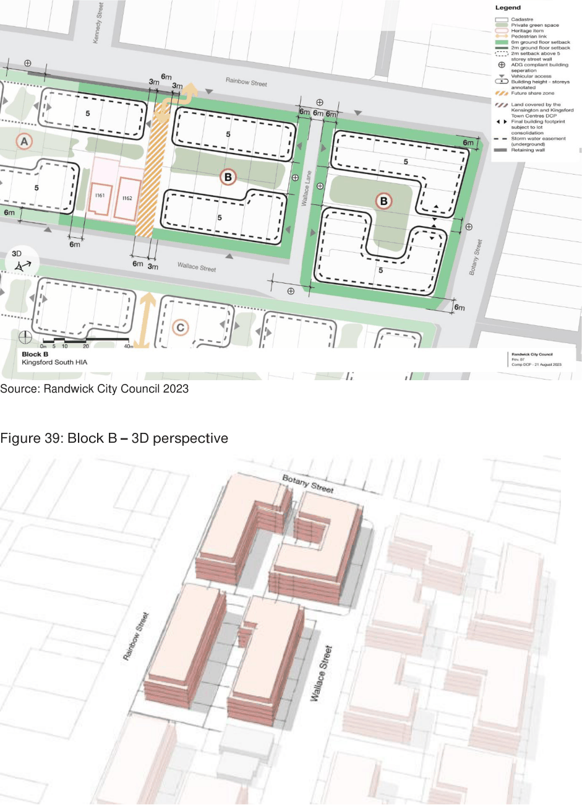
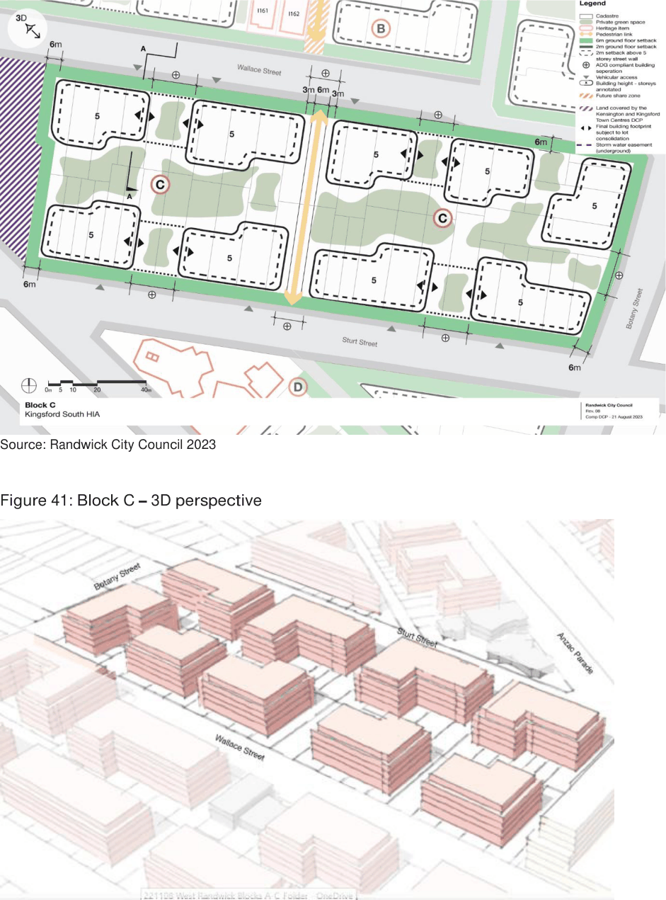
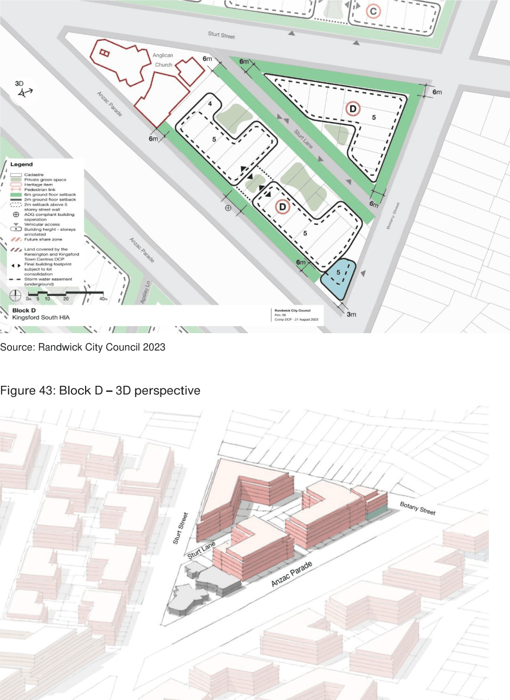
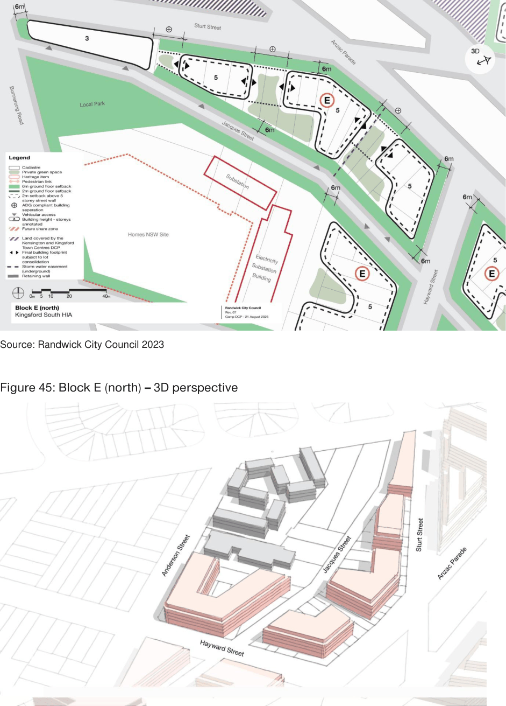
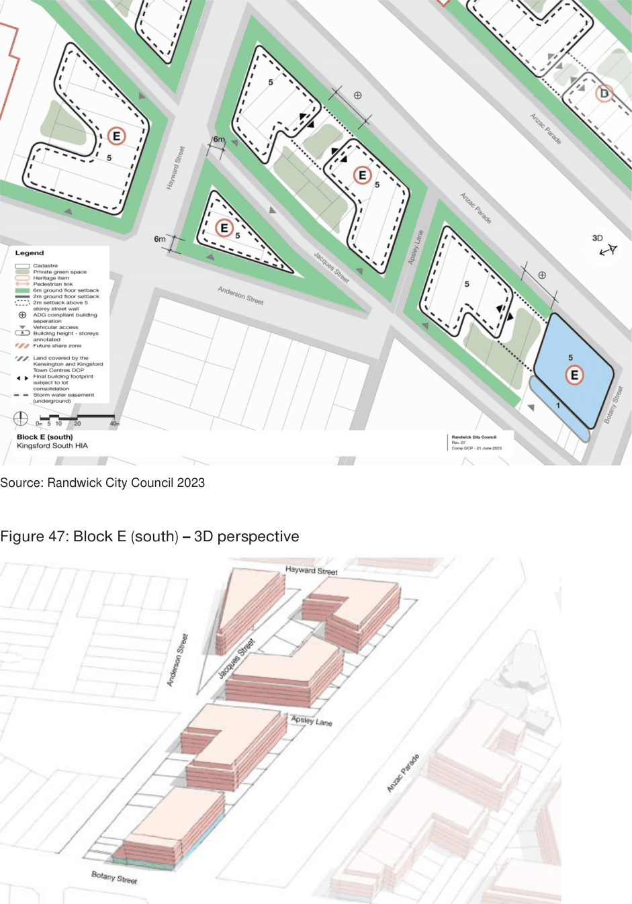

#### 9.4.4. Individual city block plans

Block A Figure 35: Block A control plan

> [Picture on page 57: a picture, saved as a picture (images/part-d14-well-located-housing-area-page-57-10.gif, 150 dpi).]

Source: Randwick City Council 2023

Figure 36: Block A

– 3D perspective

> [Picture on page 58: a picture, saved as a picture (images/part-d14-well-located-housing-area-page-58-3.gif, 150 dpi).]

Source: Randwick City Council 2023

Figure 37: Typical cross section A-A

Source: Randwick City Council 2023

Block B Figure 38: Block B control plan

> [Picture on page 59: a picture, saved as a picture (images/part-d14-well-located-housing-area-page-59-3.gif, 150 dpi).]

Source: Randwick City Council 2023

Figure 39: Block B

– 3D perspective

Source: Randwick City Council 2023

Block C Figure 40: Block C control plan

> [Picture on page 60: a picture, saved as a picture (images/part-d14-well-located-housing-area-page-60-3.gif, 150 dpi).]

Source: Randwick City Council 2023

Figure 41: Block C

– 3D perspective

Source: Randwick City Council 2023

Block D Figure 42: Block D control plan

> [Picture on page 61: a picture, saved as a picture (images/part-d14-well-located-housing-area-page-61-3.gif, 150 dpi).]

Source: Randwick City Council 2023

Figure 43: Block D

– 3D perspective

Source: Randwick City Council 2023

Block E Figure 44: Block E control plan (north)

> [Picture on page 62: a picture, saved as a picture (images/part-d14-well-located-housing-area-page-62-3.gif, 150 dpi).]

Source: Randwick City Council 2023

Figure 45: Block E (north)

– 3D perspective

Source: Randwick City Council 2023

Figure 46: Block E control plan (south)

> [Picture on page 63: a picture, saved as a picture (images/part-d14-well-located-housing-area-page-63-2.gif, 150 dpi).]

Source: Randwick City Council 2023

Figure 47: Block E (south)

– 3D perspective

Source: Randwick City Council 2023
