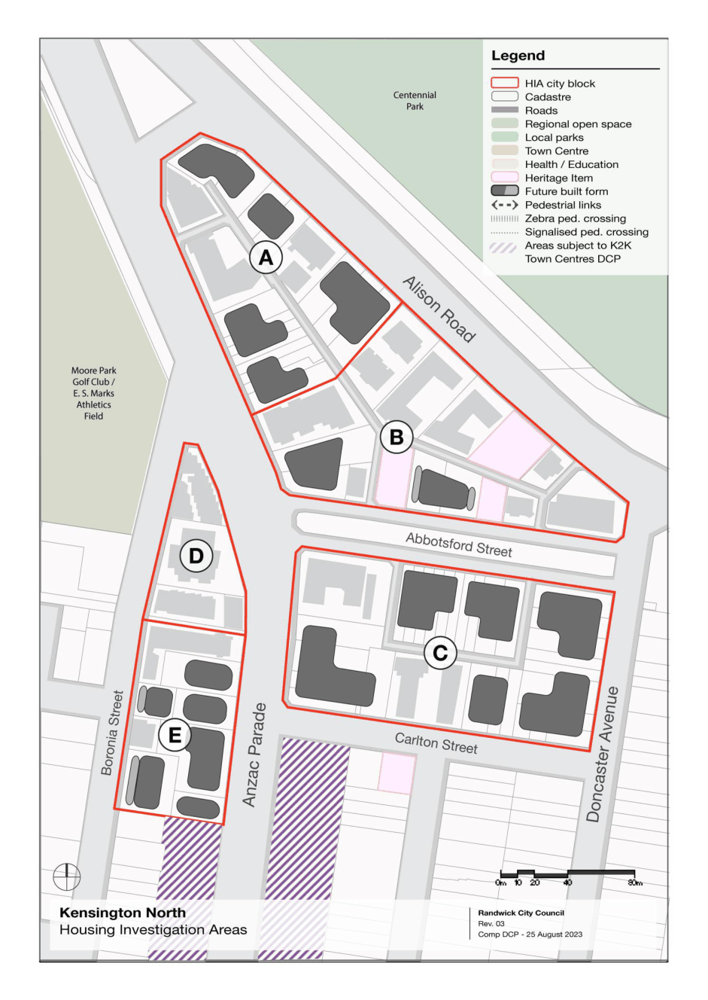

### 9.5. Kensington North HIA

Figure 48: Kensington North WLHA plan

> [Picture on page 65: a picture, saved as a picture (images/part-d14-well-located-housing-area-page-65-2.gif, 150 dpi).]

Source: Randwick City Council 2023

The Kensington North Well Located Housing Area (WLHA) is located in the northern part of the Kensington, generally bounded by Alison Road, Doncaster Avenue, Carlton Street, Boronia Street and Anzac Parade. The subject city blocks are Illustrated in Figure 48.
