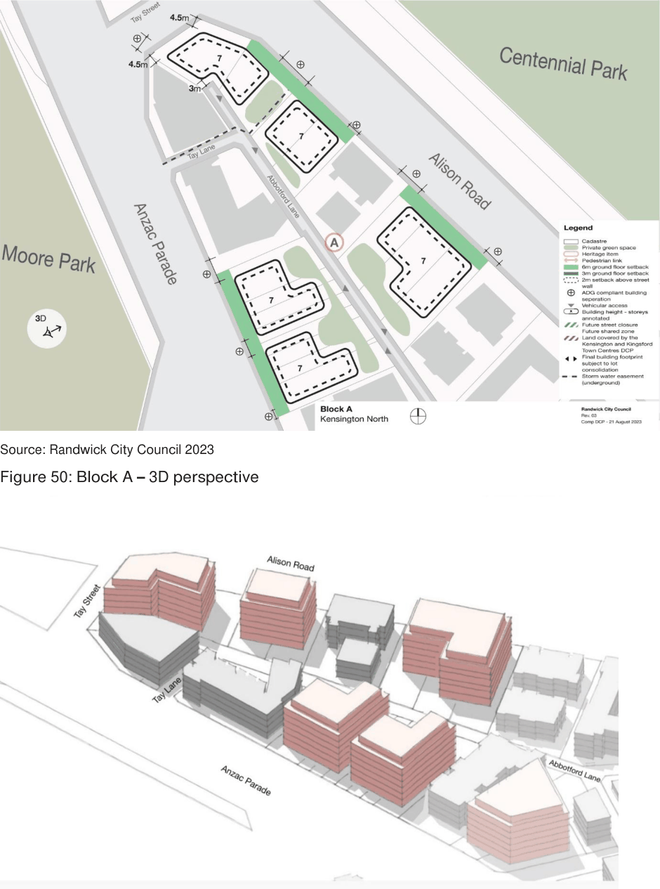
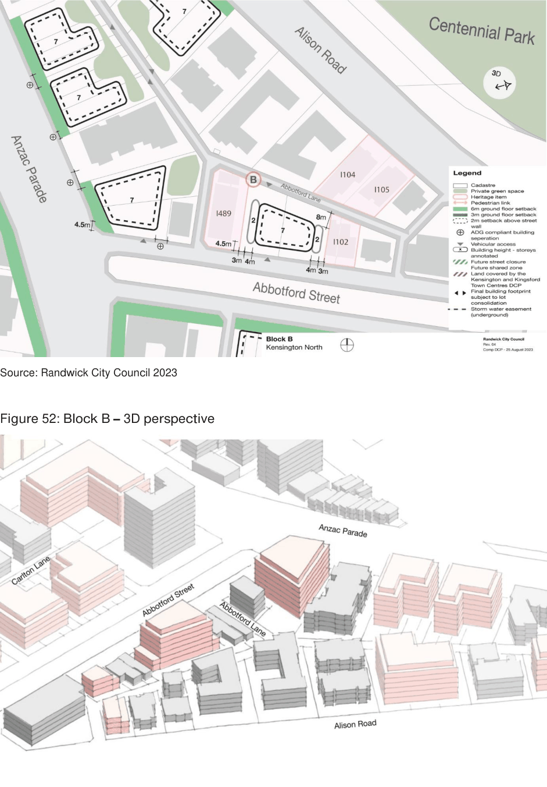
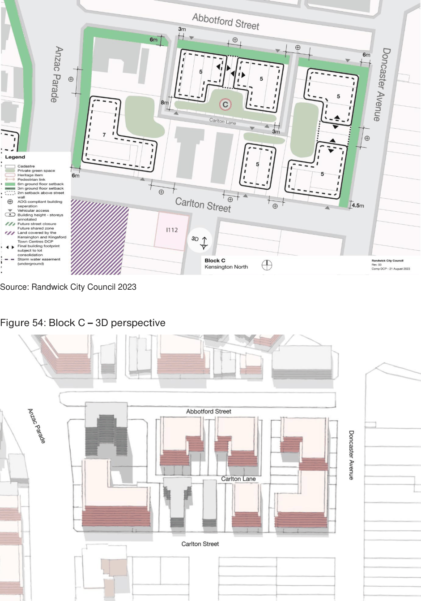
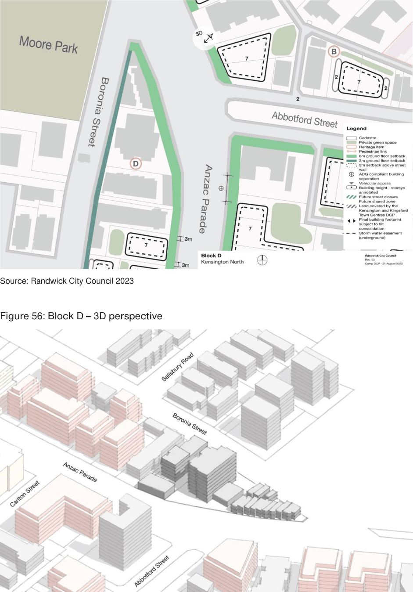
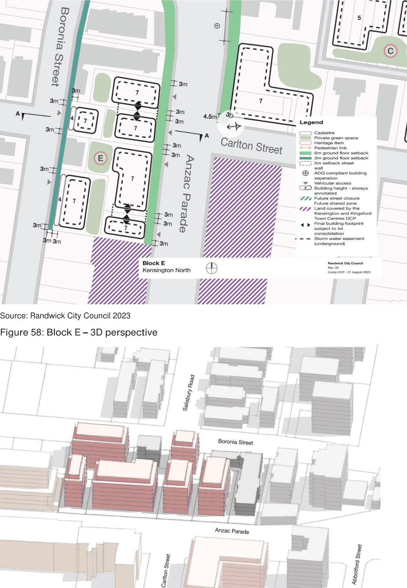
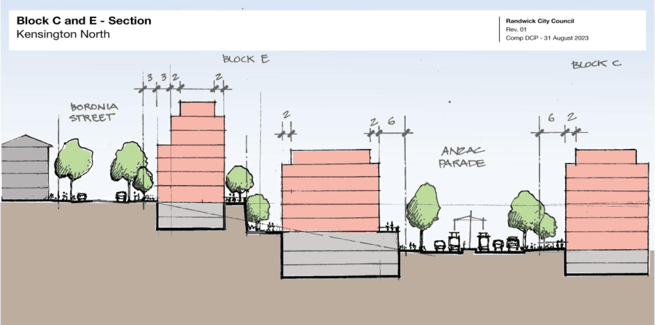

#### 9.5.5. Individual city block plans

Block A Figure 49: Block A control plan

> [Picture on page 69: a picture, saved as a picture (images/part-d14-well-located-housing-area-page-69-4.gif, 150 dpi).]

Source: Randwick City Council 2023 Figure 50: Block A

– 3D perspective

Source: Randwick City Council 2023

Figure 51: Block B control plan

> [Picture on page 70: a picture, saved as a picture (images/part-d14-well-located-housing-area-page-70-2.gif, 150 dpi).]

Source: Randwick City Council 2023

Figure 52: Block B

– 3D perspective

Source: Randwick City Council 2023

Figure 53: Block C control plan

> [Picture on page 71: a picture, saved as a picture (images/part-d14-well-located-housing-area-page-71-2.gif, 150 dpi).]

Source: Randwick City Council 2023

Figure 54: Block C

– 3D perspective

Source: Randwick City Council 2023

Figure 55: Block D control plan

> [Picture on page 72: a picture, saved as a picture (images/part-d14-well-located-housing-area-page-72-2.gif, 150 dpi).]

Source: Randwick City Council 2023

Figure 56: Block D

– 3D perspective

Source: Randwick City Council 2023

Figure 57: Block E control plan

> [Picture on page 73: a picture, saved as a picture (images/part-d14-well-located-housing-area-page-73-2.gif, 150 dpi).]

Source: Randwick City Council 2023 Figure 58: Block E

– 3D perspective

Source: Randwick City Council 2023

Figure 59: Typical cross section A-A

> [Picture on page 74: a picture, saved as a picture (images/part-d14-well-located-housing-area-page-74-2.gif, 150 dpi).]

Source: Randwick City Council 2023

Source: Randwick City Council 2023

Source: Randwick City Council

### Part C – Design detail
