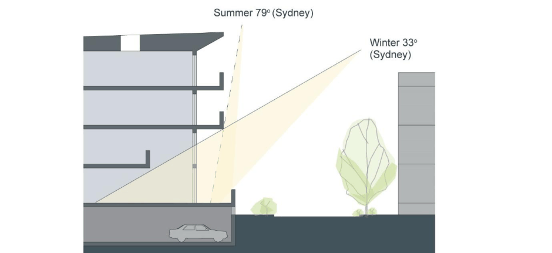

## 12. Solar and daylight access

Explanation Direct solar access to living spaces and open spaces is a key factor influencing residential amenity and is integral to achieving a good design outcome. Good solar access reduces the reliance on artificial lighting and heating, improves energy efficiency and environmental sustainability. Given the north-south orientation of many lots within the WLHAs, it is important to design new buildings that optimise sunlight access and achieve or exceed the minimum standards specified in the ADG. Solar access requirements for student accommodation and boarding houses will differ from the ADG as the bedroom layouts are more constrained in this building type. Figure 62: Solar access

> [Picture on page 78: a picture, saved as a picture (images/part-d14-well-located-housing-area-page-78-12.gif, 150 dpi).]

Source: Adapted from Apartment Design Guide Objectives The objectives for solar and daylight access are to:

1\. Achieve a high standard of solar access in residential apartments, co-living and boarding house developments

2\. Maximise solar and daylight access in mid-winter throughout open spaces, communal living areas and lounge rooms.

Controls

a) Developments must be designed and constructed to reduce the need for active heating and cooling systems by incorporating passive design measures through site planning and building design

b) Developments must be orientated to achieve optimum solar access and natural ventilation. To achieve this:

i. Shade north facing windows from direct summer sun with external horizontal shading devices such as awnings, upper floor balconies, eaves and overhangs

ii. Utilise vertical shading devices such as vertical louvres or fins on east and west facing windows that consider the oblique angles of the sun

c) Solar access is to be provided in accordance with the recommendations of the Apartment Design Guide (ADG)

d) Buildings must ensure that areas of private or public open space are oriented to achieve the ADG recommended level of solar amenity

e) In relation to Co-Living (or student accommodation) proposals:

i. The design is to ensure that at least 60% of rooms achieve solar access during mid-winter for sites that have a north-south orientation

ii. Common spaces such as lounge rooms or communal study areas are designed with a northerly aspect where possible

iii. Atriums, roof windows, skylights or slots in the façade are to be designed to maximise solar access to rooms.
