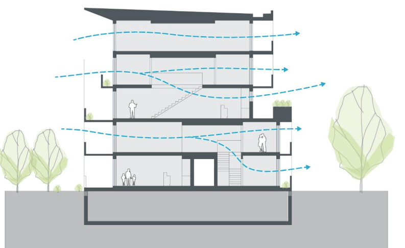

## 14. Natural ventilation

Explanation Passive buildings are designed so that windows, walls, and floors can collect, store, and distribute solar energy in the form of heat in winter and reject solar heat in summer. A passive house reduces the need for the use of mechanical and electrical (active heating and cooling) systems, saving energy and running costs. For more information on passive design refer to: http://www.yourhome.gov.au/passive-design Natural ventilation is the movement of fresh air through internal spaces enabled by the provision of suitable openings. Achieving adequate cross ventilation to habitable rooms is an essential building design criteria because it contributes to thermal comfort, allows for passive cooling and creates a comfortable and healthy indoor environment. Cross ventilation can be maximised by suitable building orientation, good apartment layout, suitable room depth, higher ceilings and appropriately located and sized window openings. Objectives The objectives for natural ventilation are to:

1\. Ensure that all habitable rooms are designed with direct access to fresh cross air flow to assist in promoting thermal comfort for occupants

2\. Provide occupants the choice and flexibility to manage natural ventilation of dwellings and avoid the need to use mechanical ventilation or air conditioning

3\. Provide natural ventilation to other spaces such as communal areas and basements

4\. Reduce energy consumption and contribute to sustainable building design. Controls

a) Building must be designed to comply with the ADG to maximise opportunities for natural ventilation by providing a combination of:

i. corner apartments

ii. dual aspect apartments

iii. shallow, single-aspect apartments

iv. openable windows and doors

v. other ventilation devices

b) Window placement, size, glazing selection and orientation are to maximise opportunities for cross ventilation and the capture of prevailing breezes in summer

c) Internal corridors, lobbies, communal circulation spaces and communal areas shall incorporate adequate natural ventilation

d) Basements levels, including spaces used for storage, garbage areas or commercial activities, are to be designed to include natural ventilation wherever possible

e) Apartment configuration and apartment depth is to be limited to maximise the opportunity for cross ventilation and airflow

f) Where mechanical ventilation is considered necessary, prioritise ‘low -

tech’ solutions,

such as ceiling fans, over more complex and high energy use air conditioning systems.

Figure 63: Showing cross flow ventilation

> [Picture on page 85: a picture, saved as a picture (images/part-d14-well-located-housing-area-page-85-2.gif, 150 dpi).]

Source: Adapted from Apartment Design Guide
