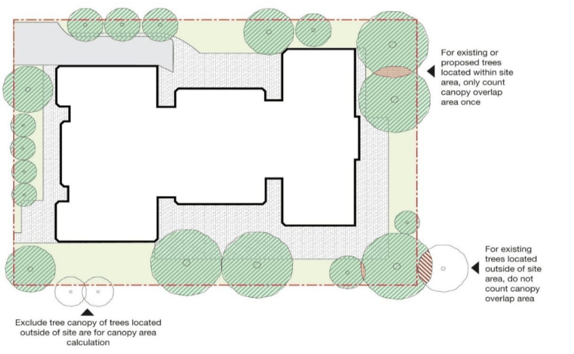
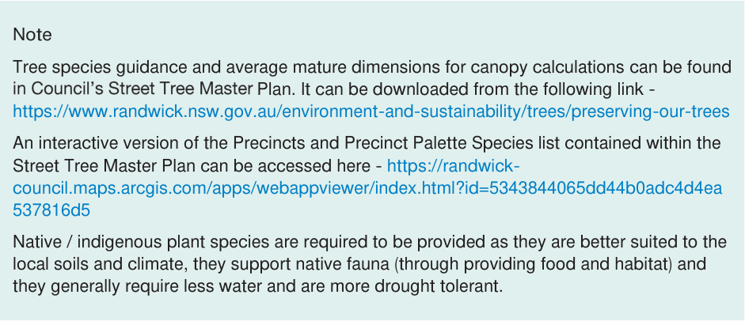
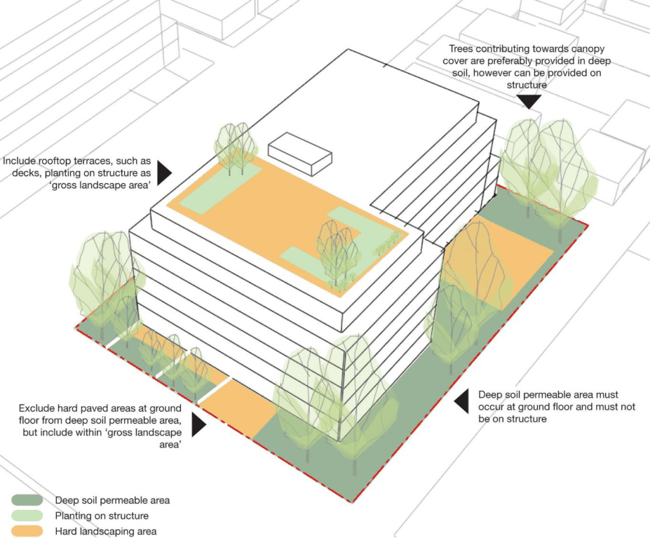

## 18. Landscape

Explanation Well-designed landscaping of open spaces, gardens, terraces, and rooftops of buildings contributes significantly to our quality of life and experience of spaces. It can also help to reduce the urban heat island effect, maintain a comfortable environment during hotter months and reduce stormwater run-off. In addition, as the WLHAs are located within established residential areas, landscaping will assist the WLHAs to integrate within their surroundings and to provide buffers and transitions in building scale, and to heritage items. Refer to Part C2 Medium Density Residential and B4 Landscaping and Biodiversity of the Randwick DCP for further explanation of landscaped area requirements. Objectives The objectives for landscaping are to:

1\. Enhance the quality of life and attractiveness of the WLHAs by providing landscaped spaces for shared amenity and green spaces for relief from urban environments

2\. Bring about environmental benefits such as mitigating the urban heat island effect, reducing flooding impacts and improving localised air quality

3\. Result in a net gain of vegetation and canopy cover with consideration for the existing vegetation within the WLHAs, whether provided horizontally or vertically.

Controls

a) The minimum Gross Landscape Area, Deep Soil Permeable Area and Tree Canopy Cover must be met for development proposals, as per Table 2 below.

Table 2: Gross landscape area, Deep soil permeable area and Tree canopy cover requirements

| WLHA | Gross landscape area | Deep soil permeable area | Tree canopy cover |
|---|---|---|---|
| West Randwick (E1) and Kingsford South (E1) | 50% | 7%* | 25% |
| High Street | 50% | 15% | 25% |
| West Randwick (R3), Magill Street (R3), Kingsford South (R3) and Kensington North (R3) | 60% | 35% | 25% |

\*Note – Minimum as required by ADG

b) Green walls can only contribute up to 10% of the total gross landscaped area and will be assessed on the merits of the proposal in terms of quality of green infrastructure and verification from a qualified landscape architect

c) Green walls require a Maintenance Plan to be provided by a qualified Landscape Architect and/or Horticulturalist at DA stage to identify the method of accessing the wall during the establishment period and ongoing life, including the maintenance regime for the plant

material, the ongoing maintenance of any irrigation system and plant media and the regular replacement of sick or dead plants as necessary

d) Deep soil permeable surfaces must have a width of not less than 900mm

e) Native species must comprise at least 50% of the plant schedule, incorporating a mix of locally indigenous trees, shrubs and groundcovers appropriate to the area

f) Rooftops may include communal food farms and food production areas

g) Technical, structural and ongoing maintenance arrangements of proposed roof top gardens and green walls are to be documented by a qualified Landscape Architect and incorporated into the Development Application (DA) documentation

h) Where green roofs and green walls are provided, these shall comply with requirements contained in Part B4

– Landscaping and biodiversity of the Randwick DCP

i) Despite the provision of a green wall, all facades are to meet design excellence requirements including building articulation and modulation specified in Part 15 of this E7 section of the DCP

Definitions Gross Landscape Area - is the sum of all landscaped areas within a development and may include (but is not limited to) ground plane, gardens, outdoor terraces, planter boxes, sky gardens, roof terraces, and green walls. Deep Soil Permeable Surfaces - include areas used for the growing of plants (including grasses, shrubs and trees) and areas occupied by loose gravels upon soil at the ground level of the site. Deep soil permeable surfaces do not include swimming and spa pools, paved areas, planter boxes, or planted areas above basements, podiums, roofs or slabs. Tree Canopy Cover - includes trees with a minimum mature height of 5m after 10 years from the completion of development, that have trunks located within the site area.

Figure 64: Calculating canopy cover - typical apartment development with 25% canopy cover

> [Picture on page 91: a picture, saved as a picture (images/part-d14-well-located-housing-area-page-91-28.gif, 150 dpi).]

Source: Randwick City Council 2022

j) In addition to the requirements of Section B4 Landscaping and Biodiversity of the Randwick DCP, all DAs for sites within the WLHAs must submit a Landscape Plan addressing the following requirements:

i. Quantity of landscaping provided on site

ii. Scaled drawings of all areas

iii. How landscaping would complement the architectural style of the building and assist in its presentation to the streetscape and surroundings

iv. Rainwater harvesting and other irrigation methods proposed

v. Full construction details of soil profile, method of attachment to the building, and drainage/waterproofing

vi. Engineering certification confirming the building can withstand planting and associated structures

vii. Where planting is proposed ‘on structure’ i.e. on that part of a basement which extends beyond the building footprint, roof tops or within planter boxes, the space must be designed and constructed to contain a minimum soil depth of:

- 450mm for grass and ground covers

- 600mm for shrubs

- 900mm for small trees

- 1200mm for large trees

k) A minimum of one indigenous canopy street tree that will attain a minimum mature height of 6m, must be planted at maximum spacing of 7.5m, at a minimum distance of 600mm from the kerb and/or footpath, and/or masonry fence or retaining wall. Street trees must be selected in accordance with Council’s Street Tree Masterplan .

> [Picture on page 92: a picture, saved as a picture (images/part-d14-well-located-housing-area-page-92-24.gif, 150 dpi).]
> Words printed on the picture (title and legend, copied from the PDF):
> in Council’s Street Tree Master Plan. It can be downloaded from the following link -

Note Tree species guidance and average mature dimensions for canopy calculations can be found

https://www.randwick.nsw.gov.au/environment-and-sustainability/trees/preserving-our-trees An interactive version of the Precincts and Precinct Palette Species list contained within the Street Tree Master Plan can be accessed here - https://randwick-council.maps.arcgis.com/apps/webappviewer/index.html?id=5343844065dd44b0adc4d4ea 537816d5 Native / indigenous plant species are required to be provided as they are better suited to the local soils and climate, they support native fauna (through providing food and habitat) and they generally require less water and are more drought tolerant.

Figure 65: Landscape area components

> [Picture on page 93: a picture, saved as a picture (images/part-d14-well-located-housing-area-page-93-2.gif, 150 dpi).]

Source: Randwick City Council 2022
