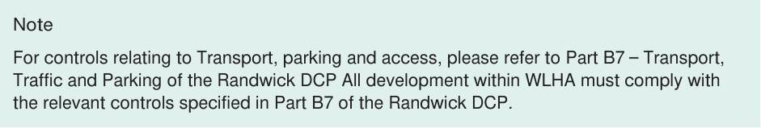

## 19. Transport, parking & access

Explanation An increase in sustainable transport use, decreases reliance on private vehicles, improves health and well-being outcomes and the efficiency of existing transport networks. It also importantly reduces environmental impacts associated with greenhouse emissions, improves localised air quality and reduces congestion. The strategic aim for the Well Located Housing Areas (WLHA) is to increase sustainable transport use, including walking, cycling, the use of public transport and car sharing initiatives. This aim brings benefits for the WLHAs and surrounding areas through reduced car use and the associated environmental benefits. Part B7

– Transport, Traffic, Parking and Access of the Randwick DCP contains relevant

objectives, controls and options for development proposals to investigate, design and manage parking demand, access and parking space allocation and provide for alternative modes of transport. In addition to Part B7, the following Objectives, Controls and parking rates apply to the WLHAs.

> [Picture on page 94: a picture, saved as a picture (images/part-d14-well-located-housing-area-page-94-17.gif, 150 dpi).]
> Words printed on the picture (title and legend, copied from the PDF):
> – Transport,

Note For controls relating to Transport, parking and access, please refer to Part B7 Traffic and Parking of the Randwick DCP All development within WLHA must comply with the relevant controls specified in Part B7 of the Randwick DCP.
