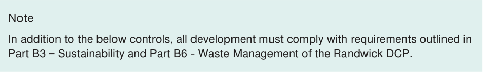
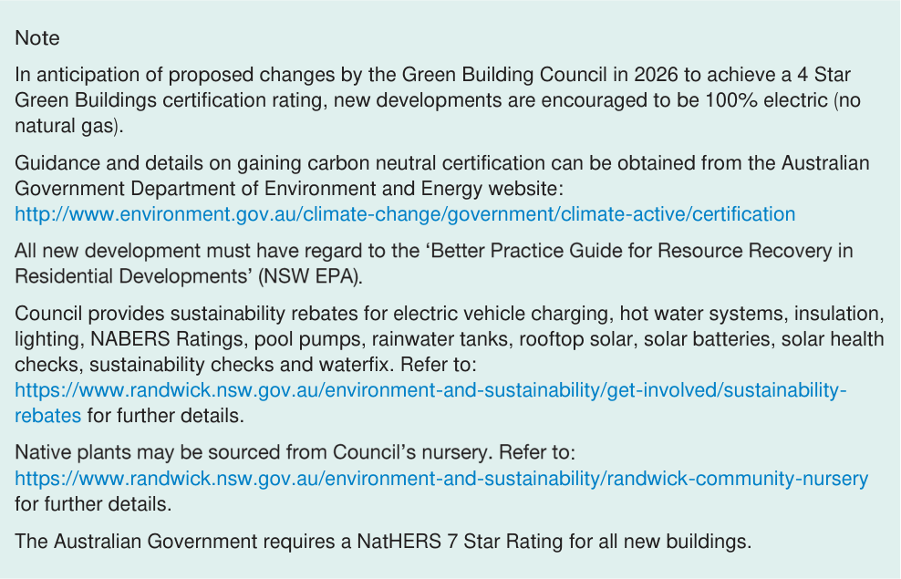

## 20. Sustainability

Explanation Environmental sustainability is a fundamental aspect of functional liveable urban areas, and the integration of precinct-wide sustainability initiatives and standards will provide for the physical, mental and social well-being of residents, workers and visitors. Buildings that are sustainable utilise environmentally friendly construction materials and fittings, are energy and water smart, have healthy and comfortable indoor environments, and yield considerable cost savings to property owners and tenants.

> [Picture on page 95: a picture, saved as a picture (images/part-d14-well-located-housing-area-page-95-9.gif, 150 dpi).]

Note In addition to the below controls, all development must comply with requirements outlined in Part B3

– Sustainability and Part B6 - Waste Management of the Randwick DCP.

Objectives The objectives for sustainability are to:

1\. Establish the WLHAs as model environmentally sustainable precincts demonstrating excellence in sustainable practices

2\. Encourage the design of buildings that go beyond current minimum sustainable standards to benefit residents and the broader Randwick community

3\. Adopt suitable design techniques in lighting, Water Sensitive Urban Design (WSUD), stormwater collection and re-use, and landscaping of the public realm

4\. Provide innovative best practice waste solutions capable of reducing residential and commercial waste and increasing reuse, recycling and recovery of waste.

Controls

General

a) All development must address the requirements of Part B3

– Sustainability of the

Randwick DCP

b) New development involving the construction of a new building or external alterations to an existing building is to meet the requirements of Clause 6.11 of the RLEP relating to design excellence, particularly sustainable design principles, renewable energy sources and urban heat island effect mitigation

Energy

c) New developments are to sign up to a minimum three-year 100% renewable power contract with an Australian Government endorsed energy provider and evidence of the future contract provided to Council at DA stage

d) New developments are encouraged to be 100% electric (no natural gas)

e) All development is encouraged to incorporate PV rooftop solar and battery storage for the capture and use of energy for lighting, ventilation and services within communal spaces and for residential apartments

f) Where photovoltaic (PV) panels are proposed it is desirable that the panels be parallel and incorporated into the design of the building

g) Efficient lighting (LED), rainwater tanks and building insulation are to be included in the design of buildings

h) New development must provide a screened outdoor area with an appropriate orientation for the purpose of communal clothes drying

i) All developments are to incorporate energy efficient fittings and systems for lighting including:

i. Natural lighting where possible

ii. Energy efficient lights such as LEDs

iii. Movement and lighting level sensors and timers to ensure lighting is only used when required

Waste

j) All development must address the requirements of Part B6 Waste Management of the Randwick DCP

k) All developments must provide a space for:

i. torage and sorting of problem waste such as E-waste, clothing, and residential hazardous waste

ii. FOGO (Food Organics and Garden Organics) household rubbish collection bin storage and handling

l) New developments must provide an internal bulky waste storage area of 10m2 with an additional 2m2 per additional 10 units for the temporary storage of periodic bulky waste collection. The internal bulky waste storage area must:

i. Be situated in a location that is easily accessed by external waste collection services

ii. Be weatherproof and screened from public areas

iii. Remain visible from general waste / bin storage areas to encourage re-use of items by other residents

Materials

m) New development construction is to be long-life, robust and use durable materials and finishes and utilise reduced carbon materials e.g. low carbon concrete, recycled aggregate, etc

n) Use of recycled materials, such as bricks, timber and concrete, are encouraged

o) All development must specify light coloured roof colours to reduce building heat load and energy use for cooling in summer months. Consideration is required of potential glare impacts on neighbours

Transport

p) Reduced car parking rates apply to the WLHAs to reduce basement parking structure and in recognition of the proximity to public transport. Refer to Section 19 Transport, parking and access of this DCP for applicable rates

q) Car share provision is strongly encouraged within a development and WLHA car parking rates can be further reduced when car share spaces are provided. Refer to Part B7 Transport, Traffic, Parking and Access of the Randwick DCP

r) Electric Vehicle (EV) and bike charging facilities and electrical infrastructure is required to be provided on common property and must include signage and a fixed bicycle rack or rail in accordance with Section 19 Transport, parking and access of this DCP section

Design and landscaping

s) ADG solar access and cross ventilation standards are to be met in the development

t) All development should incorporate passive and low-tech solutions to managing solar access and heat load and cross ventilation. These may include:

i. Appropriate shading of the building’s windows with fixed overhangs

ii. Shading blades for respectively north and east facing facades

iii. Limiting openings on the west facing facades of buildings

iv. Provision of ceiling fans to limit the need for air conditioning

u) Minimum tree canopy requirements apply to new developments to realise the Randwick City 22% tree canopy target for the LGA by 2040. Refer to Table 2 in Section 18 of this DCP.

> [Picture on page 97: a picture, saved as a picture (images/part-d14-well-located-housing-area-page-97-8.gif, 150 dpi).]
> Words printed on the picture (title and legend, copied from the PDF):
> All new development must have regard to the ‘Better Practice Guide for Resource Recovery in
> Residential Developments’ (NSW EPA) .
> Native plants may be sourced from Council’s nursery. Refer to :

Note In anticipation of proposed changes by the Green Building Council in 2026 to achieve a 4 Star Green Buildings certification rating, new developments are encouraged to be 100% electric (no natural gas). Guidance and details on gaining carbon neutral certification can be obtained from the Australian Government Department of Environment and Energy website: http://www.environment.gov.au/climate-change/government/climate-active/certification

Council provides sustainability rebates for electric vehicle charging, hot water systems, insulation, lighting, NABERS Ratings, pool pumps, rainwater tanks, rooftop solar, solar batteries, solar health checks, sustainability checks and waterfix. Refer to: https://www.randwick.nsw.gov.au/environment-and-sustainability/get-involved/sustainability-rebates for further details.

https://www.randwick.nsw.gov.au/environment-and-sustainability/randwick-community-nursery for further details. The Australian Government requires a NatHERS 7 Star Rating for all new buildings.
