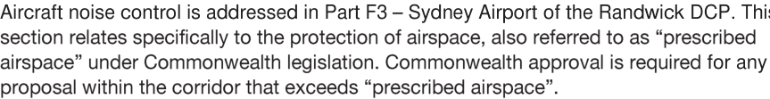

## 22. Aircraft operations

Explanation The proximity of Sydney’s Kingsford Smith Airport and the high frequency of aircraft movements over the area, triggers the need for development to consider aircraft safety, during the construction phase in relation to cranes and like structures.

> [Picture on page 99: a picture, saved as a picture (images/part-d14-well-located-housing-area-page-99-6.gif, 150 dpi).]
> Words printed on the picture (title and legend, copied from the PDF):
> section relates specifically to the protection of airspace, also referred to as “prescribed
> airspace” under Commonwealth legislation. Commonwealth approval is required for any
> proposal within the corridor that exceeds “prescribed airspace”.

Aircraft noise control is addressed in Part F3

– Sydney Airport of the Randwick DCP. This

Note For controls relating to Aircraft operations, please refer to Part C11 – Sydney Airport.
