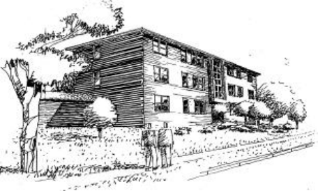
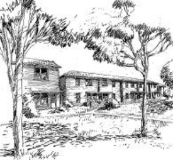
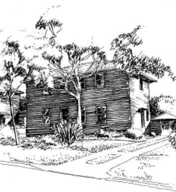

## 2. Coral Sea Park Estate, Maroubra

Explanation The Coral Sea Park Estate is a distinctive and historically important precinct. It is in Maroubra and generally bounded by Fitzgerald Avenue, Malabar Road, Beauchamp Road and Anzac Parade. The Estate is characterised by a mixture of single storey bungalows and low to medium rise multi-unit housing, most of which harmonises with the single storey detached bungalows. The relative scale, placement and configuration of buildings in the Estate is testimony to careful urban design and how low scale residential precincts can sustain increased density and housing choice. The Estate was developed by the then NSW Housing Commission in the early to mid 1950's. It is an early example of a planned neighbourhood in Australia. Subsequent private development has occurred, also within the low-medium rise scale of the original development. The significant characteristics of the Estate are:

• It is a neighbourhood made up of a balanced combination of dwelling types, housing a diverse population demographic ranging from young families to aged persons.

• The provision and spatial arrangement of facilities whereby open space, schools, shops and community facilities are centrally located on the Estate.

• The arrangement and mix of cottages, duplexes and blocks of flats. An important feature is the open rear gardens of cottages and flats which provide quality access to sunlight and maintain high levels of privacy.

• The curvilinear street pattern responding to the local topography forming an amphitheatre type effect to the central open spaces.

Objectives

1\. Ensure new development reflects the scale and massing of existing development in the Estate

2\. Ensure new development maintains the characteristics of building setbacks and garden areas prevalent throughout the Estate

3\. Maintain the planned neighbourhood and garden suburb characteristics of the Estate.

Controls

a) Building materials and external finishes are to be consistent with the dominant themes in the Estate

b) Site area and dimensions, particularly width, are of sufficient size to allow and maintain the existing themes of large rear garden areas and open spaces between buildings to continue

c) Sites have a minimum frontage of 20m for development of more than two dwellings.

d) Open spaces in front of buildings are not fenced off from the street. Where fencing is proposed it is no more than 1m high

e) Front setbacks of development must consider consistency with the surrounding buildings. Front façade design must consider compatibility with the form, massing and articulation of existing development.

Figure 1: Built form example

> [Picture on page 6: a picture, saved as a picture (images/part-d15-specific-sites-page-6-2.gif, 150 dpi).]

Residential flat buildings with similar form, roof pitch, material finishes and colour as other housing of the estate

Source: Randwick City Council

Figure 2: Built form example

> [Picture on page 6: a picture, saved as a picture (images/part-d15-specific-sites-page-6-8.gif, 150 dpi).]

Row housing with open front yards and grassed roadside verges

Source: Randwick City Council

Figure 3: Built form example

> [Picture on page 6: a picture, saved as a picture (images/part-d15-specific-sites-page-6-13.gif, 150 dpi).]

Source: Randwick City Council
