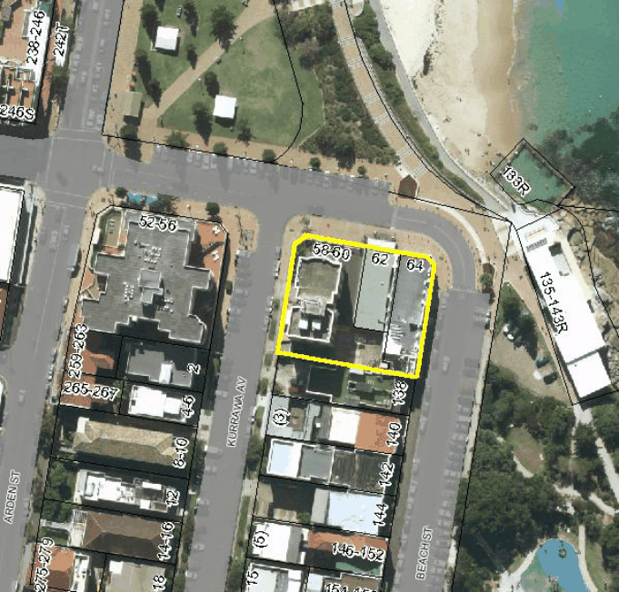
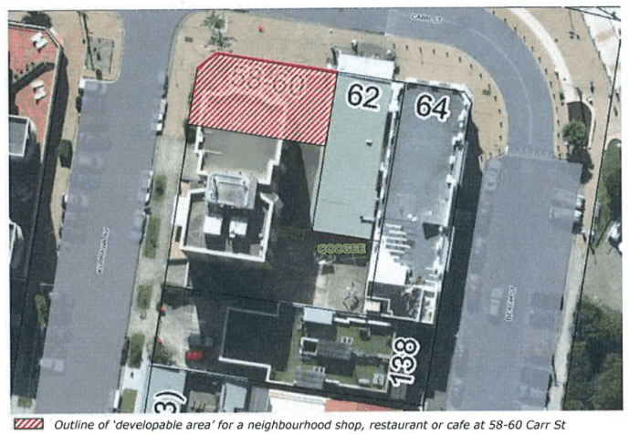

### 3. 58-64 Carr Street, Coogee

Explanation The land at 58-64 Carr Street, Coogee comprises three separate lots located between Kurrawa Avenue and Beach Street, Coogee. The sites are currently zoned for residential purposes and are developed with the following uses:

• 58-60 Carr Street: eight storey RFB, strata titled (with ground level parking)

• 62 Carr Street: two storey shop top building with café at ground floor and yoga studio on first floor

• 64 Carr Street: Private hotel (heritage listed) The subject sites form the southern end of the horseshoe shaped built form of the Coogee business centre and residences, opposite the foreshore reserve of Coogee Beach. The local context includes the north and east sections of the business centre providing an active street edge of commercial, retail and food related uses which services resident and visitor needs.

Figure 4: 58-64 Carr Street, Coogee

> [Picture on page 7: a picture, saved as a picture (images/part-d15-specific-sites-page-7-15.gif, 150 dpi).]

Source: Randwick City Council

Land uses immediately to the west of these sites include ground floor retail and café and visitor accommodation. Land uses to the south of the block along Kurrawa Avenue and Beach Street comprise multi-unit housing and some single dwellings. These sites are zoned R3 Medium Density Residential, while permitting restaurants or cafes, subject to development consent. The purpose of this section is to provide site specific controls

to ensure that any development of these sites for restaurant or cafe use does not adversely impact on residential amenity of surrounding residences. The zoning also permits other limited business premises including a neighbourhood shop for which these provisions are also relevant. Development for residential purposes must address other relevant parts of this DCP relating to medium density residential.

Objectives

1\. Enable ground level small scale neighbourhood shop, restaurant or cafe development whilst protecting the amenity of nearby residents

2\. Ensure any development improves the public domain of Carr Street

3\. Promote pedestrian activity and safety in the public domain

4\. Encourage high quality design and enhance the street frontage of buildings.

Control

a) Proposals for a neighbourhood shop, restaurant or café must be limited to the ground floor of these buildings and must present an active street front to Carr Street only

b) Any outdoor seating must be limited to the Carr Street frontage only

c) Business signage must address Carr Street only and must be limited to the ground or first floors

d) Proposals must specify likely sources of noise or odour generated from the premises and measures to be implemented in order to minimise these and other amenity impacts on adjoining residents

e) The standard hours of operation for non-residential uses will be limited to 7am – 10pm

f) Outdoor lighting must limit light spillage, including light emitted from signage to minimise impacts on residents, living on, or adjoining the subject sites

g) High quality awnings, complimentary to the adjoining building design shall be provided along Carr Street to achieve a continuous awning with adjoining properties

h) Awnings should be a minimum three metres deep and setback a minimum 600mm from the kerb

i) Cantilever awnings from the building must have a minimum soffit height of 3.5m

j) Colonnades along the street edge are inappropriate

k) Canvas blinds along the street edge may be suitable where they would assist in sun access/protection

l) Signage on canvas blinds is inappropriate

m) Ensure all awnings are structurally sound and safe and comply with relevant NCC requirements

n) The minimum floor to ceiling heights for the ground floor must be 3.5m

o) The loading and unloading of goods associated with a proposal for a neighbourhood shop, restaurant or café at 58-60 Carr Street shall be from Carr Street frontage only

p) Development including upgrading of existing buildings shall be designed to achieve high quality urban design and a high level of pedestrian amenity at street level having regard to the coastal context, adjoining heritage item and pedestrian traffic movement

Note Any proposal for 58-60 Carr Street will be referred to the Randwick Design Excellence Advisory Panel (DEAP). The ADG is relevant to development proposals for upgrading works to this building. Refer to: https://www.planning.nsw.gov.au/policy-and-legislation/housing/apartment-design-guide

q) New development including upgrading of buildings shall incorporate passive surveillance of public and communal spaces (including, but not limited to balconies over public spaces, effective lighting, landscaping to reduce opportunities for crime prevention, design with clear boundaries between private and public areas) and shall have regard to the principles of Crime Prevention Through Environmental Design (CPTED)

r) Any alterations and/or refurbishment proposals for 58-60 Carr Street must address the following:

i. Retain current side and rear building setbacks for residential uses onsite

ii. Minimise change to the size and location of balconies

iii. Minimise overlooking and privacy impacts on other balconies and adjacent dwellings.

s) Any proposal for a neighbourhood shop, restaurant or café at 58-60 Carr Street must be within the developable area as shown in Figure 5, subject to meeting all other site requirements including parking assessment, and:

i. Provide for a continuous street façade and zero lot line to Carr Street and extend to the corner of Carr Street and along Kurrawa Avenue, as shown in Figure 5

ii. Remove the existing driveway crossing along Carr Street to improve pedestrian amenity and safety

iii. The street facade should display proportions and detailing which respect the prevailing building facades of the sites at 62 and 64 Carr Street.

Figure 5: Developable area for proposed neighbourhood shop, restaurant or café

> [Picture on page 9: a picture, saved as a picture (images/part-d15-specific-sites-page-9-27.gif, 150 dpi).]

Source: Randwick City Council
