## 4. Barker Street / Willis Street, Randwick

Explanation This subject site is rectangular in shape, split in two by Kennedy Lane. It is bound by Barker Street to the north, Willis Street to the west, a five storey RFB to the east and four storey RFB as well as a single storey dwelling to the south. Kennedy Lane reduces in width as it passes through the block, facilitating pedestrian connections only. There are existing services located in Kennedy Lane. The block falls approximately 7m to 9m on either side of the ridge at Kennedy Lane (see the figures below on Building envelope – typical section). The site comprises six lots, with six single storey detached dwellings and a two storey flat building. The five storey strata titled RFB to the east of the site is unlikely to redevelop. There are excellent views from the block towards the city to the northwest and outlook to the southwest towards Botany Bay. Due to the topography of Barker Street, there is no direct pedestrian or vehicular connection from the block to Barker Street. There is a footpath along Barker Street adjacent to the block, accessed by Willis Street and Kennedy Street. Due to the steeply sloping topography, Willis Street is characterised by blank retaining walls with dwellings above. The sites have unique opportunities and constraints. A building envelope has been developed for the sites that respond to context, streetscape and the sites characteristics.

Objectives

1\. Encourage residential uses including affordable housing that reflect the needs of key workers and students in the adjacent Randwick Education and Health Specialised Centre

2\. Reinforce Kennedy Lane as part of the urban structure

3\. Maintain public pedestrian access and visual connection along Kennedy Lane

4\. Locate residential lobbies along Kennedy Lane

5\. Locate private open space at ground floor.

Controls

a) Building envelope plan: The building envelope plan shows the maximum envelope including balconies (while excluding the roof structure and roof envelope). DAs are to demonstrate that the proposed building fits within the envelope. Sites must be developed holistically as shown in the plan for Blocks A and B

b) Height: Randwick LEP identifies a maximum height of 15m. The building envelope illustrations show four storeys, excluding the roof envelope and structure. Between Willis Street and Kennedy Lane, with the building envelope is articulated as four equal forms, stepping with the sloping topography. Any habitable roof space provided above the maximum building envelope must be setback an additional 4m from the street front at Barker Street, Kennedy Street and Kennedy Lane

c) Building depth: Refer to setbacks

e) Setbacks:

Block A

| Barker Street | 5m | Ground floor and above |
|---|---|---|
| Kennedy Lane | 4m | Ground floor and above |
| Willis Street | 0m 5m | Ground floor First floor and above |
| Rear | 6m | All floors |

Block B

| Barker Street | 5m | Ground floor and above |
|---|---|---|
| Kennedy Lane | 5.5m 2.5m | Ground floor and above First floor and above |
| Willis Street | 0m 5m | Ground floor First floor and above |
| Rear | 6m | All floors |
| Side | 6m | Ground floor and above |

f) Form and articulation: For Block B, the built form envelope may comprise two separate buildings or demonstrate sufficient articulation. Vertical articulation is to be provided between stepped forms along Barker Street to reduce the apparent length of the facade to a proportion that is compatible with the surrounding built form

g) Building Uses: Residential only

h) Mix: The following residential mix is to be provided:

| Studio | 50% maximum. |
|---|---|
| 1 Bed | 50% maximum. |
| 2 Bed | 50% maximum. An additional 50% can be provided if they are dual key units. |
| 3 Bed | No requirement. |

i) Parking and access: Access to parking is to be provided from Willis Avenue. Depending on how these sites are amalgamated, there are two options:

i. Develop the two blocks concurrently and provide all parking in a basement within Block A, or

ii. Provide parking directly to each Block. At grade parking may be provided for Block B provided it is not visible from the public domain

j) Open Space:

Communal open space

15% of site area. Roof top communal open space is encouraged for Block A. Communal open space at first floor is encouraged.

Deep soil zone

25% of communal open space.

k) Public dedication: A public dedication is to be provided in the form of a 2.5m road widening to Kennedy Lane to provide better pedestrian amenity and visual connection along Kennedy Lane.

Figure 6: Existing site plan

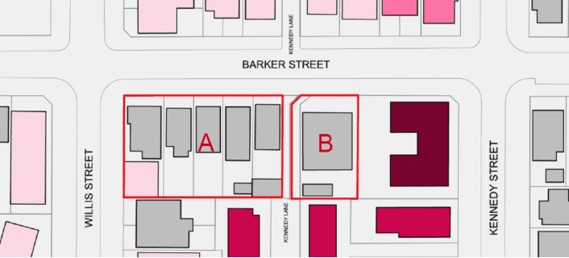

> [Picture on page 12: a picture, saved as a picture (images/part-d15-specific-sites-page-12-14.gif, 150 dpi).]

Source: Randwick City Council

Figure 7: Building envelope - plan

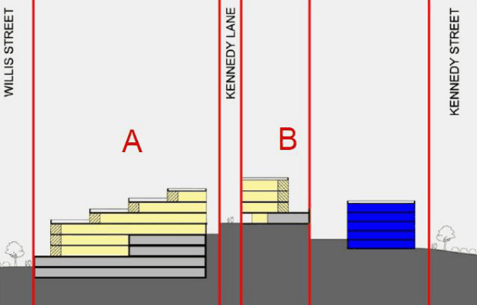

> [Picture on page 12: a picture, saved as a picture (images/part-d15-specific-sites-page-12-17.gif, 150 dpi).]

Source: Randwick City Council

Figure 8: Building envelope – typical section

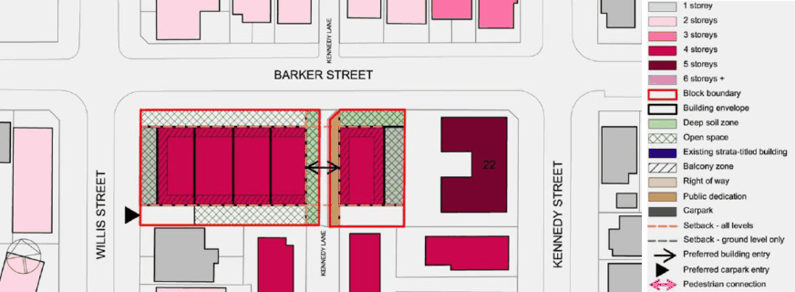

> [Picture on page 13: a picture, saved as a picture (images/part-d15-specific-sites-page-13-2.gif, 150 dpi).]

Source: Randwick City Council

Figure 9: Building envelope – 3D view from northeast

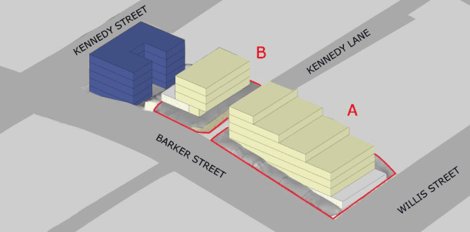

> [Picture on page 13: a picture, saved as a picture (images/part-d15-specific-sites-page-13-5.gif, 150 dpi).]

Source: Randwick City Council

Figure 10: Building envelope – 3D view from northwest

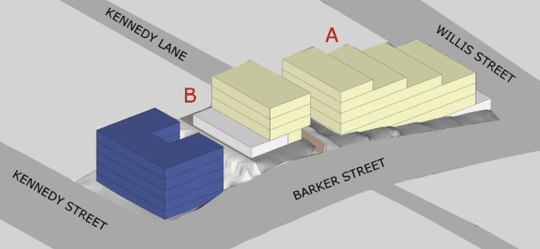

> [Picture on page 13: a picture, saved as a picture (images/part-d15-specific-sites-page-13-8.gif, 150 dpi).]

Source: Randwick City Council

Figure 11: Building envelope – 3D view from southwest

> [Picture on page 14: a picture, saved as a picture (images/part-d15-specific-sites-page-14-2.gif, 150 dpi).]

Source: Randwick City Council

15 Blenheim Street, Randwick

Explanation Located at 15 Blenheim Street is a single lot, rectangular in shape with a single frontage to Blenheim Street. It is bound by a four storey RFB to the west, single detached dwellings and a three storey RFB to the north. Immediately to the east is Blenheim House and its former stables building, listed as heritage items under Randwick LEP 2012. The site falls approximately 1m towards the west across the site. Most lots along Blenheim Street are strata titled, with only a few lots remaining in single ownership. Blenheim Street is lined with large street trees. Existing buildings within the block comprise single detached dwellings, attached dwellings and RFBs, ranging in size from one storey to four storeys. There are some health services facilities located within the block, but the predominant use is residential. Blenheim House (17 Blenheim Street) is Randwick’s oldest remaining house and was completed in early 1848 by Simeon Pearce who later became the first Mayor of Randwick. The two storey sandstone building is a fine example of simple Colonial Georgian design. Blenheim House was originally constructed on 1.6ha with its main façade and entrance facing west with a driveway providing access from Botany Street. Subdivisions of the original site of Blenheim House have resulted in Blenheim House having a Blenheim Street address to its south, and a west boundary with 15 Blenheim Street. Both Blenheim House and its stables building are well set back from Blenheim Street. A double carport at the front of the site encloses a private garden to the south of the dwelling. The height, length and setbacks of the existing RFB at 15 Blenheim Street have significantly impacted on the amenity and heritage curtilage of Blenheim House. The siting and envelope of the existing building affects sunlight and privacy to Blenheim House, blocks views towards its original front façade, and detracts from its setting. Redevelopment of the site presents the opportunity to improve the curtilage and amenity of Blenheim House and to allow it to be viewed in a more sympathetic setting. A building envelope has been developed for the sites that respond to the heritage context, streetscape and site characteristics, while retaining potential development floor space and improving amenity.

Objectives

1\. Improve the curtilage and amenity of Blenheim House

2\. Create a strong built edge to Blenheim Street

3\. Provide articulation to the built edge along Blenheim Street

4\. Manage stepping of built form with the topography behind the primary building line to Blenheim Street.

Controls

a) Building envelope plan: The building envelope plan shows the maximum envelope including balconies. DAs are to demonstrate that the proposed building fits within the envelope

b) Height: Four storeys along Blenheim Street and two storeys at the rear of the site

c) Building depth: Refer to building envelope plans

d) Setbacks:

| Blenheim Street | 3m | All levels |
|---|---|---|
| East boundary | 3m | All levels |
| Rear | 3m | All levels |
| For west boundary setbacks, refer to Building Envelope – Plan. |  |  |

e) Building uses: All levels

Residential

f) Mix: If residential units are provided the following mix is to be provided:

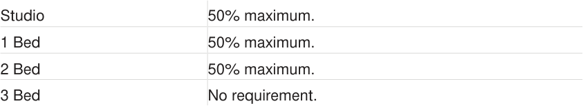

> [Picture on page 16: a picture, saved as a picture (images/part-d15-specific-sites-page-16-7.gif, 150 dpi).]

| Studio | 50% maximum. |
|---|---|
| 1 Bed | 50% maximum. |
| 2 Bed | 50% maximum. |
| 3 Bed | No requirement. |

g) Parking and access: If parking is provided, no parking is to be located within the front setback zone. There is no requirement for car parking on the site for studio or 1 bedroom units and their visitors

h) Open space

| Communal open space | 25% of site area |
|---|---|
| Deep soil zone | 25% of communal open space |

Figure 12: Site plan - existing

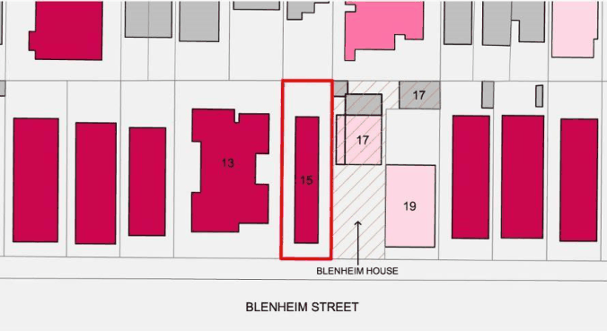

> [Picture on page 16: a picture, saved as a picture (images/part-d15-specific-sites-page-16-15.gif, 150 dpi).]

Source: Randwick City Council

Figure 13: Building envelope - plan

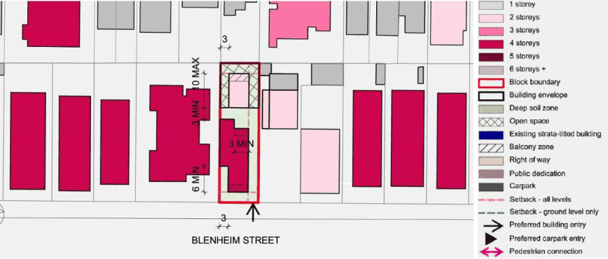

> [Picture on page 17: a picture, saved as a picture (images/part-d15-specific-sites-page-17-2.gif, 150 dpi).]

Source: Randwick City Council

Figure 14: Building envelope – section through Block A

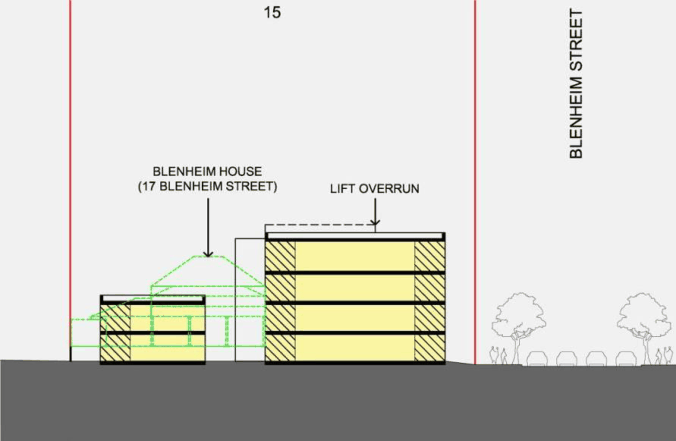

> [Picture on page 17: a picture, saved as a picture (images/part-d15-specific-sites-page-17-5.gif, 150 dpi).]

Source: Randwick City Council

Figure 15: Building envelope – 3D view from northeast

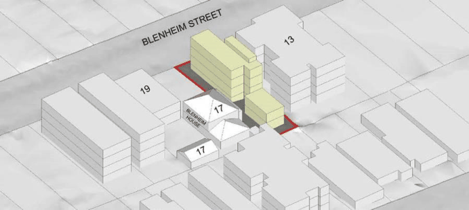

> [Picture on page 17: a picture, saved as a picture (images/part-d15-specific-sites-page-17-8.gif, 150 dpi).]

Source: Randwick City Council

Figure 16: Building envelope – 3D view from northwest

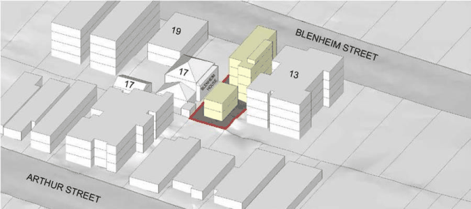

> [Picture on page 18: a picture, saved as a picture (images/part-d15-specific-sites-page-18-2.gif, 150 dpi).]

Source: Randwick City Council

Figure 17: Building envelope

– 3D view from southwest

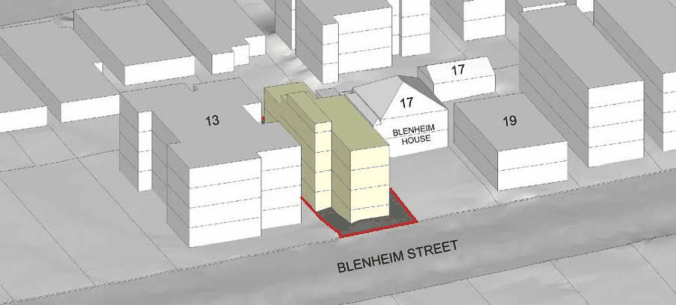

> [Picture on page 18: a picture, saved as a picture (images/part-d15-specific-sites-page-18-6.gif, 150 dpi).]

Source: Randwick City Council

Figure 18: Building envelope – 3D view from southeast

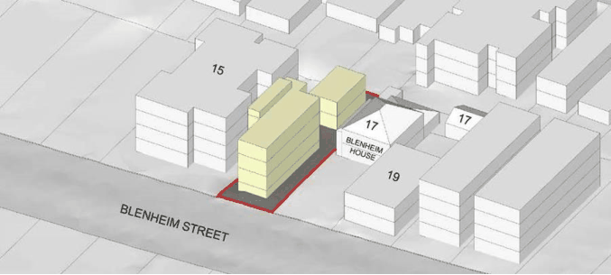

> [Picture on page 18: a picture, saved as a picture (images/part-d15-specific-sites-page-18-9.gif, 150 dpi).]

Source: Randwick City Council

Figure 19: Indicative layout plans

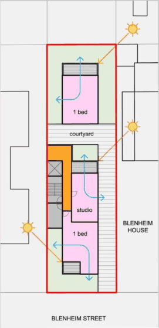

> [Picture on page 19: a picture, saved as a picture (images/part-d15-specific-sites-page-19-2.gif, 150 dpi).]

Indicative Layout – Plan (Residential)

Source: Randwick City Council

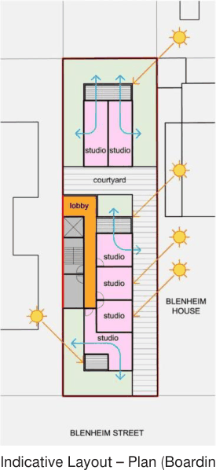

> [Picture on page 19: a picture, saved as a picture (images/part-d15-specific-sites-page-19-5.gif, 150 dpi).]
> Words printed on the picture (title and legend, copied from the PDF):
> Indicative Layout – Plan (Boarding Houses)
