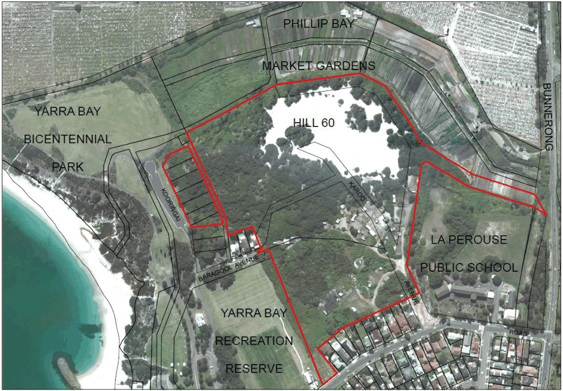

## 5. Hill 60, La Perouse

Explanation The land at known as Hill 60 has a total site area of approximately 12ha and comprises the following parcels:

• 9-23 Karoo Avenue (Lot 5300 DP 48768)

• 1-7 Karoo Avenue (Lot 5299 DP 48768)

• 42 Yarra Road (Lot 5235 DP 821317)

• 2-14 Kooringai Avenue (Lots 56-62 DP 752015), along with several Crown road reserves adjoining these parcels.

Figure 20: Aerial View of Hill 60

> [Picture on page 20: a picture, saved as a picture (images/part-d15-specific-sites-page-20-11.gif, 150 dpi).]

Source: Randwick City Council

Hill 60 is an undulating, predominantly vacant site and its topography has been greatly altered through its history of sand mining and landfill. There are pockets of remnant vegetation retained towards the south end of the site. The site is bounded by the Chinese Market Gardens to the north (which is listed on the State Heritage Register), the Yarra Bay Beach and Bicentennial Park to the west (a local heritage item and conservation area), La Perouse Public School to the east and a row of dwelling houses along Yarra Road to the south. The site also comprises internal unmade/informal access roads known as Karoo Avenue and its unnamed extension connecting to Baragool Avenue. The site may contain Eastern Suburbs Banksia Scrub (ESBS), listed as a critically endangered ecological community under the Biodiversity Conservation Act. This requires further investigation.

The site is owned by the La Perouse Local Aboriginal Land Council (LPALC) and has significant social and cultural significance for the Aboriginal community. The majority of the site has a residential zoning that permits low to medium density housing development as well as a range of community uses including child care centres, churches, schools and recreation facilities. A portion of the site on the southwest side is zoned for public recreation (along Kooringai Avenue). The Randwick LEP cl.6.12 requires that a site specific DCP must be prepared for large sites (over 10,000m2). This section of the DCP provides guidance on the key issues for any such future planning for the site.

Objective

1\. Ensure any future development on the site is planned in a holistic and orderly manner

2\. Ensure any identified biodiversity value of the site is protected and conserved

3\. Promote, recognise and protect the cultural and social significance of the site to the Aboriginal community

4\. Provide for appropriate and legible public access and open spaces through the site

5\. Maintain appropriate view corridors from surrounding development including the public domain

6\. Provide key design principles for any future planning and development of the site

7\. Encourage a diverse range of housing, including affordable and adaptable dwellings.

Controls

a) Prepare a site-specific DCP for the entire Hill 60 site to guide any future redevelopment in a holistic, suitably staged manner, and address (but not limited to) the following specific matters:

i. Overall vision and design principles for the site in the context of its significant Aboriginal history, social and environmental considerations

ii. Identification of and provision for the social and cultural needs of the Aboriginal community and consideration of Council’s La Perouse Needs Study

iii. A suitable and clearly dimensioned buffer zone to the adjacent Chinese Market Garden site

iv. Clarification of the existence and extent of Eastern Suburbs Banksia Scrub (ESBS) at the site, appropriate curtilage and future zoning and management measures to ensure its ongoing conservation

v. Provision for a minimum of 10% of the total site area as public open space that suitably connects with existing open space and serves the needs of the new and existing community. Open space provision should have regard to the existing open space zone boundary and extent of any identified biodiversity significance.

Note The 10% threshold requirement for public open space does not include any land identified for connections/pathways or environmental conservation purposes (e.g. ESBS).

vi. Clear street hierarchy and legible street network

vii. Strong pedestrian and cycle linkages through the site and connections to the surrounding street network

viii. Legible access and entry points to the site that aim to integrate the site with the surrounding neighbourhood

ix. Potential soil and groundwater contamination, potential flooding and stormwater management.

Note Variations to the existing zoned open space boundaries will require a rezoning application. When clarified, the specific ESBS locations should also be zoned for Environmental Conservation.

Randwick City Council 30 Frances Street Randwick NSW 2031

1300 722 542 council@randwick.nsw.gov.au www.randwick.nsw.gov.au
