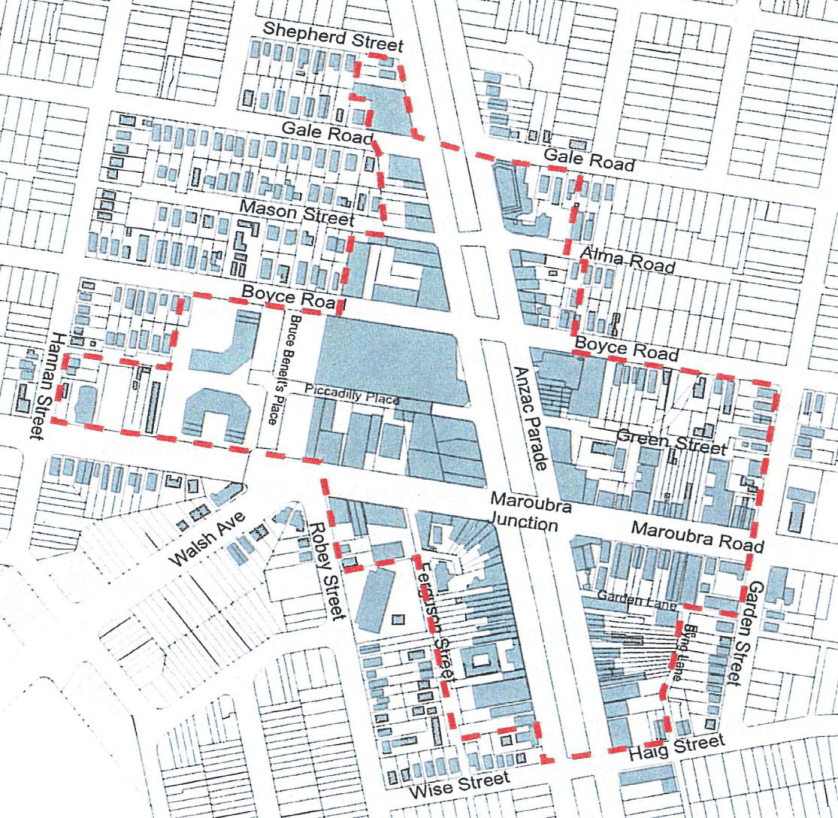

### 1.1. Land covered by this section

This section applies to all land zoned E2 Local Centre in the Maroubra Centre. The land covered by this section is generally bounded by Shepherd Street to the north, Wise Street to the south, Garden Street to the east and Hannan Street to the west. Figure 1: Maroubra Junction Town Centre

> [Picture on page 8: a picture, saved as a picture (images/part-d3-maroubra-junction-centre-page-8-6.gif, 150 dpi).]

Source: Randwick City Council
