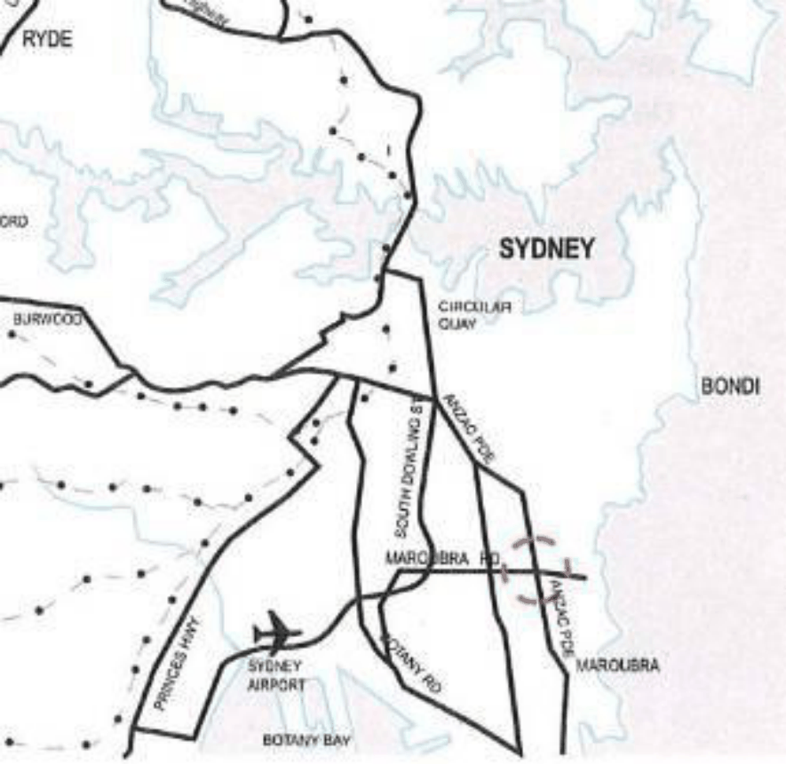
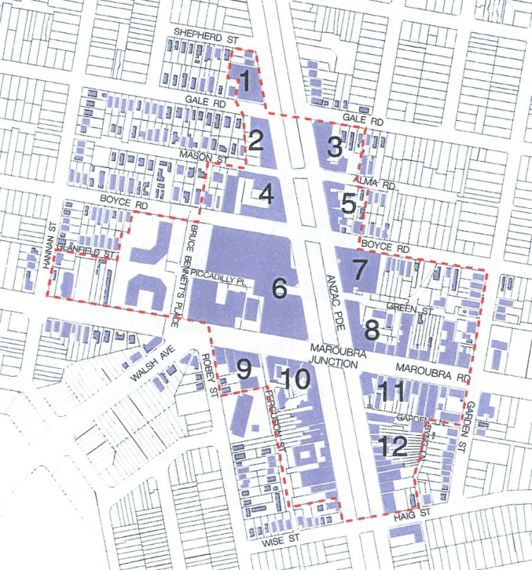
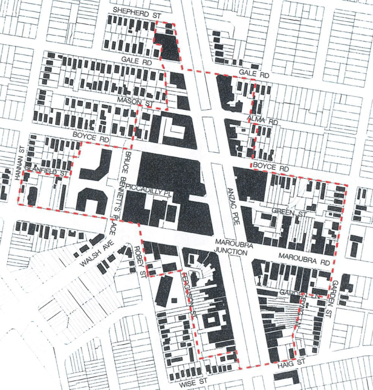
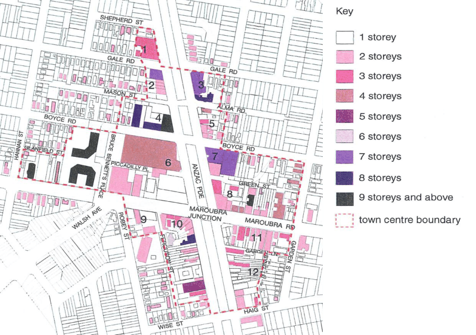
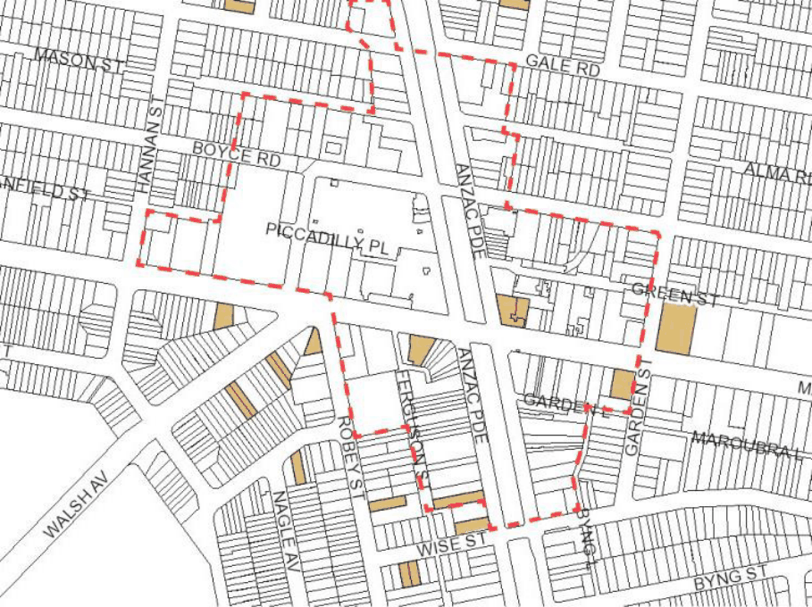
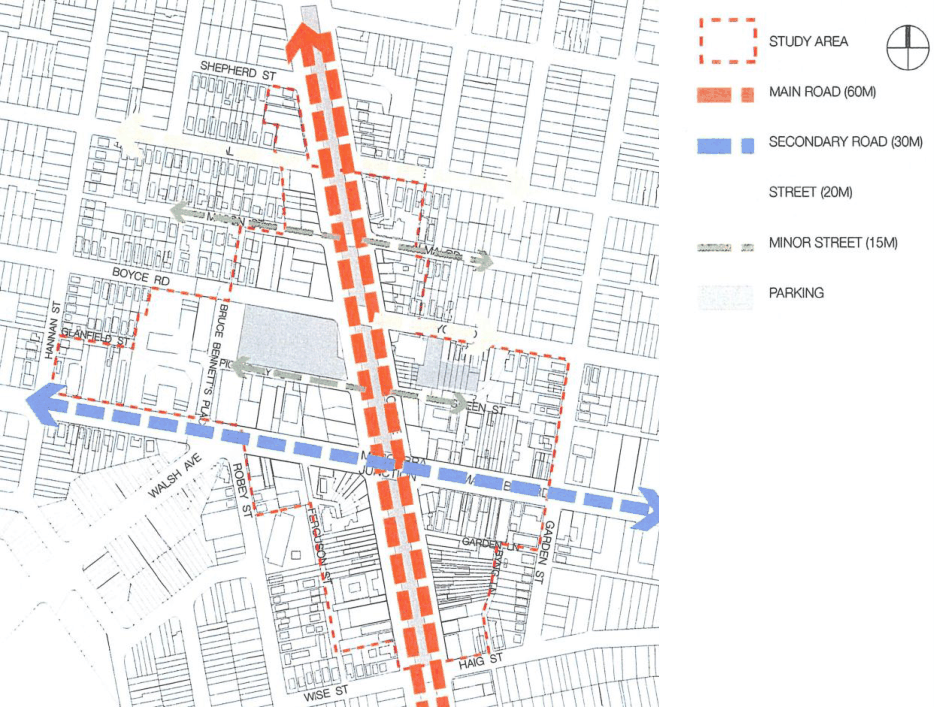
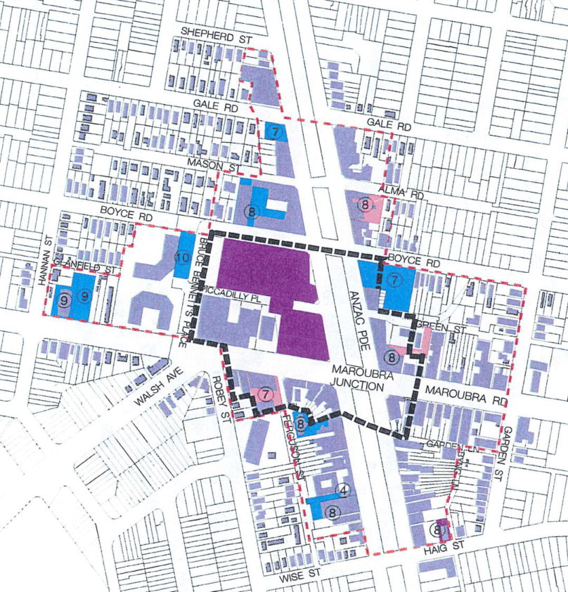
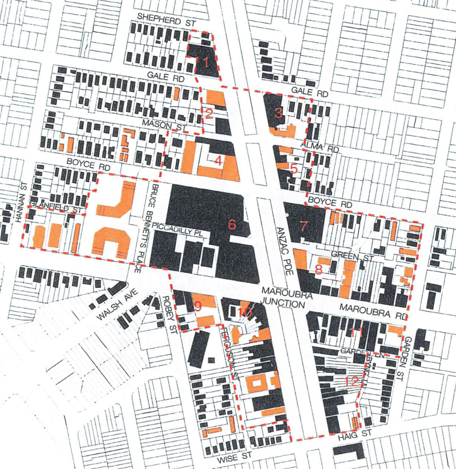
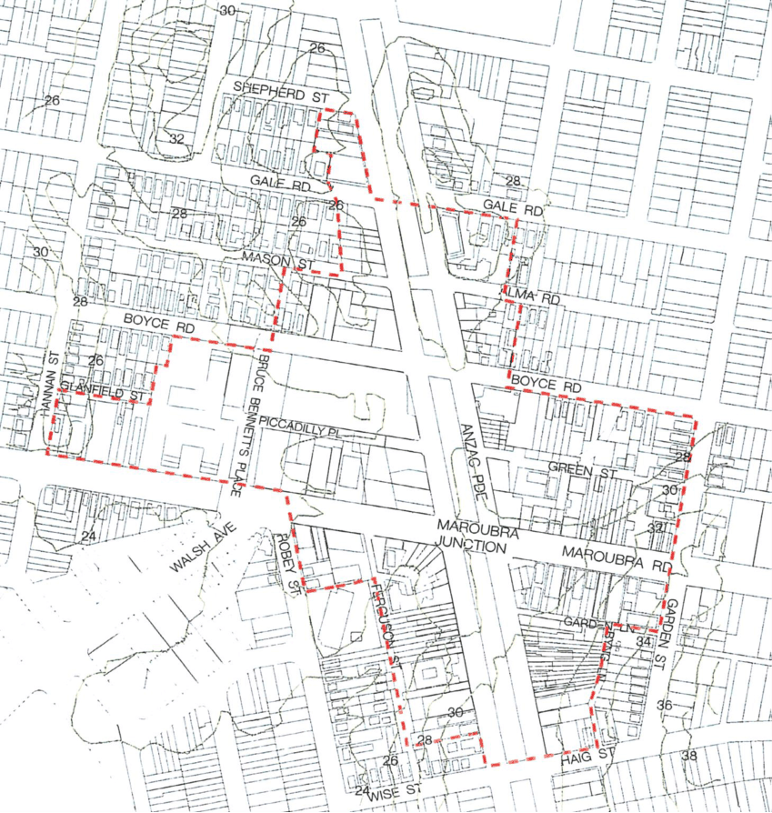

## 2. Background/urban structure

### 2.1. Introduction

This Section contains the background information and analysis on which the development controls in this document have been based. It also contains broad objectives and urban strategies for the centre, from which the block by block controls evolved. In addition, it contains desired future street sections and artist impressions of various areas in the centre, from which detailed public domain plans for the centre can evolve.

#### 2.1.1. Regional context

Maroubra Junction Centre lies approximately 8km south of Sydney CBD, 4.5km east of Sydney Kingsford Smith Airport and 2km from Maroubra Beach. The closest competitive commercial centre is located at Eastgardens, 1.5km to the southwest of Maroubra. Figure 2: Regional context

> [Picture on page 10: a picture, saved as a picture (images/part-d3-maroubra-junction-centre-page-10-13.gif, 150 dpi).]

Source: Randwick City Council

#### 2.1.2. Local context

Maroubra Junction is defined by the intersection of two wide roads: Anzac Parade and Maroubra Road. The Maroubra Junction Commercial Precinct has been defined as shown in Figure 3. It is generally bound by Shepherd Street to the north, Haig Street to the south, Garden Street to the east and Hannan Street to the west. The study area is approximately 163 000m2 or 16.3ha. The Maroubra Junction Centre includes both an enclosed mall and on-street strip shopping. In addition to commercial uses the centre is characterised by large scale residential developments. Figure 3: Local context

> [Picture on page 11: a picture, saved as a picture (images/part-d3-maroubra-junction-centre-page-11-10.gif, 150 dpi).]

Source: Randwick City Council

#### 2.1.3. Maroubra Junction study area

From its beginnings as vacant subdivided crown land, market gardens and army land, Maroubra Junction experienced its first boom around the turn of the century. While there are a few heritage items in the centre left today, some of the smaller scale commercial buildings exhibit Art Deco and Federation style features. The next boom experienced by the centre occurred in the 1980’s and 1990’s. Preceded by a period of gradual decline due to competition from Westfield Shopping Centre at Eastgardens, the late 1980’s and 1990’s saw the boom of apartment building within the ce ntre. The area surrounding the centre is characterised by low density residential development which is quite different to that of the centre. The built form surrounding the centre comprises a mix of post-World War II red brick bungalows, and two-three storey walk up flats. Other more recent

housing styles present include Spanish mission style houses, and 1960’s and 70’s style brick houses.

#### 2.1.4. Built form and open space

Building types A significant increase in the construction of residential apartments has occurred since the 1990s. These multi-unit developments ring the junction of Maroubra Road and Anzac parade and are characterised by large building footprints. Building condition The majority of residential buildings constructed in the 1990s are still in relatively good condition because of their recent construction. However, some of the large scale residential buildings which have used poor quality building materials have already begun to deteriorate. Most of the older shopfront buildings lining Anzac Parade and Maroubra Road are in reasonable condition. Open space Anzac Parade has a central reserve which makes it very wide by Sydney standards (approximately 60m). The central reserve area between Green Street and Maroubra Road is utilised as public open space. The remainder of the reserve is used for car parking. Figure 4: Figure/Ground analysis

> [Picture on page 12: a picture, saved as a picture (images/part-d3-maroubra-junction-centre-page-12-18.gif, 150 dpi).]

Source: Randwick City Council

Figure 5: Maroubra Junction heights (2001)

> [Picture on page 13: a picture, saved as a picture (images/part-d3-maroubra-junction-centre-page-13-2.gif, 150 dpi).]

Source: Randwick City Council

#### 2.1.5. Building heights and zoning

Zoning throughout the centre is E2

– Local Centre. To reinforce the junction of Maroubra Road

and Anzac Parade, it is suggested that the taller buildings should be in the core of the centre at the junction, gradually decreasing in height towards the periphery. This section uses a building envelope approach. Building envelopes have been designed for each block within the centre, recognising the need to have different building sizes, heights and setbacks in different parts of the centre. Building heights have been lowered at the edge of the centre to help create a more gradual transition between the centre and the surrounding residential areas.

#### 2.1.6. Vegetation

Significant vegetation occurs in strips of trees along Anzac Parade. Isolated trees and small groups of shrubs exist along the streets west and east of Anzac Parade. Maroubra Road lacks vegetation of any kind. There are small pockets of vegetation within the centre, but these are not well integrated nor consistent. Both Maroubra Road and Anzac Parade would benefit from more tree planting.

#### 2.1.7. Heritage

Heritage buildings within the centre are as follows:

Maroubra Junction Hotel

• An impressive 1920s Classical Revival building, notable for its decorative rendered bands over brickwork. The hotel features an excellent parapet with an impressive roof lantern. This building was one of the early commercial buildings in Maroubra Junction and has local historic and architectural interest, despite some alterations and recent renovations.

#### Dudley’s Corner

• One of the oldest surviving buildings in Maroubra Junction and one of the best known. This is a two-storey stuccoed brick Edwardian style commercial building. Despite substantial alterations, this building retains local historic interest.

237-245 Maroubra Road

• The building is recognised for its art deco architectural style, featuring distinctive elements such as curved corners, decorative brickwork, and geometric motifs. These design features reflect the aesthetics prevalent during the early 20th century and contribute to the building's historical value.

817 Anzac Parade

• A good example of an Art Deco style flat building (circa 1930s) with a simple symmetrical design with a hipped tile roof. This building has a typical central brick feature and pairs of double hung lead lights windows. It is considered to be one of the best examples in the Maroubra area.

Figure 6: Heritage items

> [Picture on page 14: a picture, saved as a picture (images/part-d3-maroubra-junction-centre-page-14-21.gif, 150 dpi).]

Source: Randwick City Council

#### 2.1.8. Street hierarchy

The widest streets form the intersection of Anzac Parade and Maroubra Road creating the ‘Junction’ and creating a very strong north -south axis. The east-west streets follow an interesting pattern: every second east-west street is 20m wide and the alternate street is 15m wide. The strong street grid of the centre facilitates easy vehicular movement. Figure 7: Street hierarchy

> [Picture on page 15: a picture, saved as a picture (images/part-d3-maroubra-junction-centre-page-15-8.gif, 150 dpi).]

Source: Randwick City Council

#### 2.1.9. Pedestrian circulation

Anzac Parade and Maroubra Road experience heavy pedestrian traffic. There are only two designated pedestrian crossings along Anzac Parade at the intersections of Boyce Road and Maroubra Road. The lack of frequent pedestrian crossings along Anzac Parade separates the eastern and western sides of the road.

#### 2.1.10. Colonnades and awnings

Continuous awnings cover most of the length of the commercial precinct along Anzac Parade and Maroubra Road. Colonnades exist in isolated areas. The north-west corner of the intersection between Maroubra Road and Anzac Parade would benefit from awning cover. Similarly, the south-eastern corner noticeably lacks awnings.

#### 2.1.11. Potential development

Many of the major developments in the last 5 years surround the main intersection of Maroubra Road and Anzac Parade. The development of Pacific Square has had a significant effect on the centre. Larger scale development associated with the Mall on the corner of Anzac Parade and Maroubra Road (north-west corner) acts to reinforce this important intersection. Anzac Parade, being the widest road, as well as the key commercial road, is better suited to higher development than Maroubra Road. The key commercial area of the Maroubra commercial area of the Maroubra Junction Centre (i.e. the area of study) is envisaged to have higher and denser development, which then scales down towards the periphery of the study area, into lower and less dense residential zones. A commercial centre study, undertaken as part of the centre review, recognised that sufficient commercial/retail space exists in the centre. Future commercial/retail development should focus within the ‘core ret a

il’ area.

Figure 8: Potential development

> [Picture on page 16: a picture, saved as a picture (images/part-d3-maroubra-junction-centre-page-16-17.gif, 150 dpi).]

Source: Randwick City Council

#### 2.1.12. Strata-Titled buildings

There are a number of strata-titled buildings in the centre, several of which are not likely to change in the next 5-10 years. These are to be considered as constrains whilst proposing building envelopes for specific blocks.

Figure 9: Strata-titled buildings

> [Picture on page 17: a picture, saved as a picture (images/part-d3-maroubra-junction-centre-page-17-6.gif, 150 dpi).]

Source: Randwick City Council

#### 2.1.13. Topography

Most of the study area is flat with a slight rise of 2m towards the north of Anzac Parade. Maroubra Road has a steeper rise of around 10m from east to west. There is a rise of 6m from Anzac Parade towards the west along Gale Road.

Figure 10: Topography

> [Picture on page 18: a picture, saved as a picture (images/part-d3-maroubra-junction-centre-page-18-2.gif, 150 dpi).]

Source: Randwick City Council
