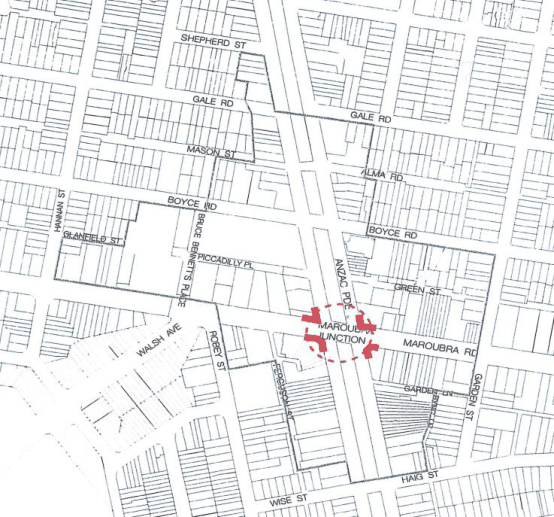
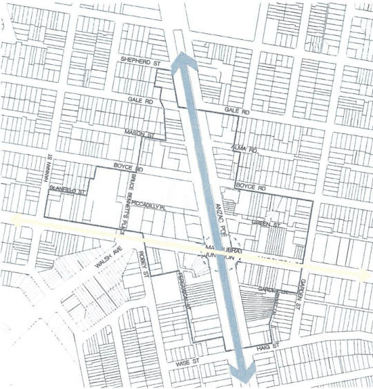
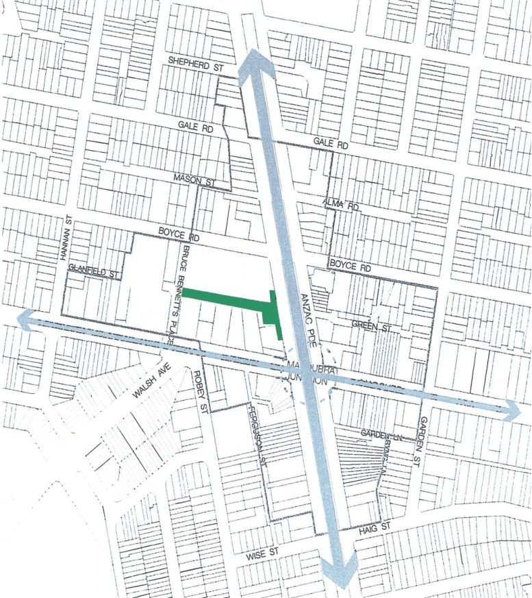
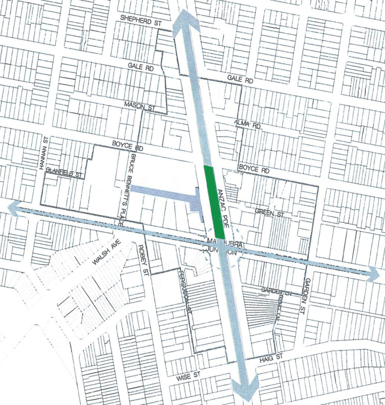
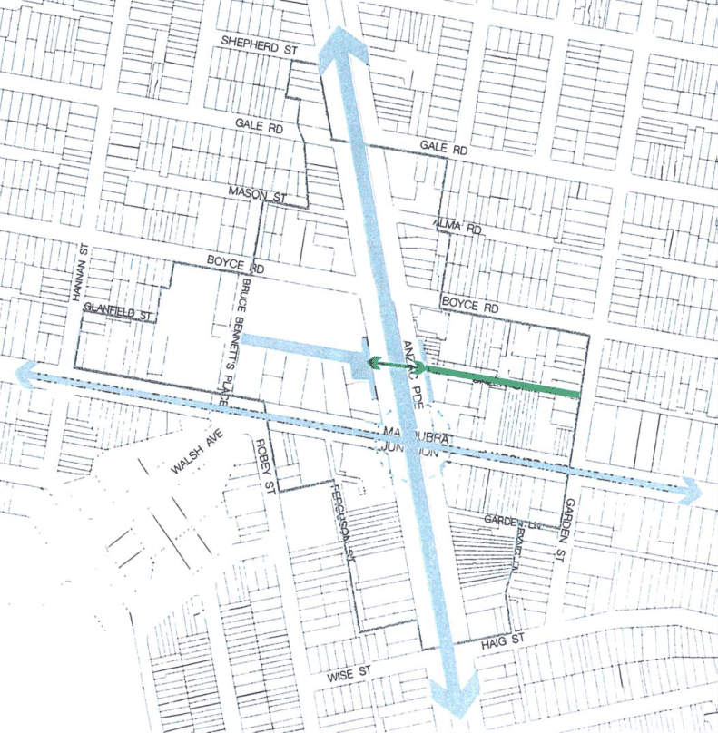

### 2.4. Urban strategy

#### 2.4.1. The Junction

The intersection of Anzac Parade and Maroubra Road has historically been and still is the main focus of the Maroubra Junction Centre. The junction of these two main roads will be reinforced/emphasised as much as possible by an increase in building heights (8 storeys).

Figure 11: The Junction

> [Picture on page 20: a picture, saved as a picture (images/part-d3-maroubra-junction-centre-page-20-2.gif, 150 dpi).]

Source: Randwick City Council

#### 2.4.2. The main street

The main north-south street is Anzac Parade. The extra width of this street (60m) created by the central tram reserve, contributes to its position as the most prominent and important street in the area. The extra width of this street also allows for taller buildings to edge the street (7 storeys). More street planting along the Anzac Parade and the median will strengthen the character and improve quality of the street environment. Figure 12: Main street and cross street

> [Picture on page 20: a picture, saved as a picture (images/part-d3-maroubra-junction-centre-page-20-11.gif, 150 dpi).]

Source: Randwick City Council

#### 2.4.3. The cross street

As the main east west street, Maroubra Road is less dominant than Anzac Parade, owing to its lesser width. Therefore, the building heights recommended along this street are lower than the ones recommended on Anzac Parade (6 storeys). This strategy reinforces the existing hierarchy of these two main streets.

#### 2.4.4. The town square

The introduction of a town square at the entrance to the Maroubra Mall facing Anzac Parade will provide a focus for the centre. The public square will provide public open space in the middle of the centre, away from the traffic noise, and surrounded by shopping activity. It is important that the square is of an adequate size to function effectively as an active and successful public space. Tree planting along Anzac Parade should be reinforced, giving the centre a more environment-friendly atmosphere, providing pedestrians with shelter from the sun, and creating green links to other centres.

Figure 13: Town square

> [Picture on page 21: a picture, saved as a picture (images/part-d3-maroubra-junction-centre-page-21-16.gif, 150 dpi).]

Source: Randwick City Council

#### 2.4.5. The median

The central median on Anzac Parade opposite the “town” square will be a green zone, and will form part of the ‘town square’. It is suggested that the car parking from this part of the median be relocated further north and south of the median. The median is envisaged to be a place for public events (music, buffets etc) to occur over the weekends. It is envisaged to have trees, fountains, greenery, and a place which would attract people to come to it and relax, socialise or gather.

Figure 14: The median

> [Picture on page 22: a picture, saved as a picture (images/part-d3-maroubra-junction-centre-page-22-9.gif, 150 dpi).]

Source: Randwick City Council

#### 2.4.6. Green Street

The activating of a smaller scale, more intimate street as a shopping strip would provide an alternative shopping environment. Green Street occupies a key position opposite the ‘town square’. This street presently lacks definition as a Council street -widening policy makes it difficult to determine property boundaries. This street is envisaged as having outdoor eating areas adjacent to restaurants and coffee shops, particularly on the southern side, as this has the best solar orientation. The development of the street as a tree-lined restaurant precinct interspersed with boutique shopping would provide a street environment that is presently lacking in the Maroubra Junction Centre.

Figure 15: Green Street

> [Picture on page 23: a picture, saved as a picture (images/part-d3-maroubra-junction-centre-page-23-2.gif, 150 dpi).]

Source: Randwick City Council

#### 2.4.7. Accessways

All traffic associated with the amalgamation and/or development of sites in Maroubra Junction shall be provided with access via 6m wide rear rights-of-carriageway linked to, and having entrance from, internal streets. This access arrangement is required because direct access from Anzac Parade and Maroubra Road to lots fronting these streets is not encouraged and is unlikely to be achievable under current RMS policy. Randwick City Council requires that any rear accessway for the purposes of amalgamation and/or development be created and maintained as rights-of-carriageway with the appropriate covenants for use and maintenance held on the property title.

#### 2.4.8. The whole

The overall strategy for the Maroubra Junction Centre is to develop a good quality mixed use precinct that will facilitate a potential increase in residential density without compromising amenity. The design strategy lays the foundation for a good long-term framework for the area which will deliver a highly desirable, quality urban neighbourhood.
