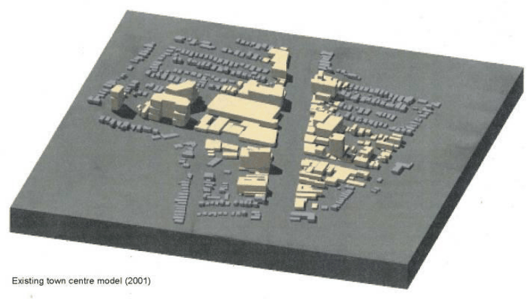
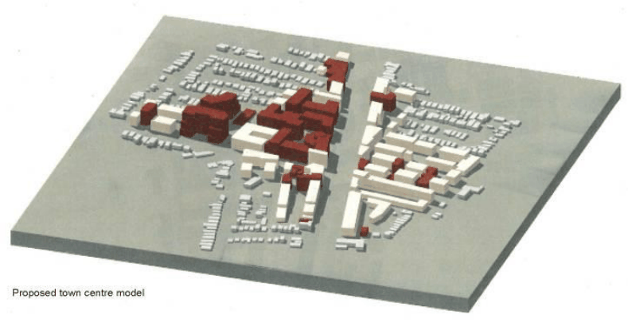

### 2.5. Centre models

#### 2.5.1. Existing centre model

Figure 16 is a 3D indication of the Maroubra Junction Centre as it currently exists as of 2004. The buildings in grey indicate those which fall outside the study area. Figure 16: Existing centre model

> [Picture on page 24: a picture, saved as a picture (images/part-d3-maroubra-junction-centre-page-24-6.gif, 150 dpi).]

Source: Randwick City Council

#### 2.5.2. Proposed centre model

Figure 17 is a 3D indication of the Maroubra Junction Centre as proposed. Buildings in maroon indicate strata-

titled buildings, heritage buildings and approved DA’s, which have been assumed

to remain unchanged. The hierarchy of the two main roads (Anzac Parade and Maroubra Road) has been clearly established by way of higher buildings along Anzac Parade and lower buildings along Maroubra Road. Maroubra Junction has been reinforced by the placement of tallest buildings on the Junction. The transition in scale from the commercial centre to the residential areas is evident by the lowering of scale in buildings towards the periphery of the study area. Figure 17: Proposed centre model

> [Picture on page 24: a picture, saved as a picture (images/part-d3-maroubra-junction-centre-page-24-18.gif, 150 dpi).]

Source: Randwick City Council
