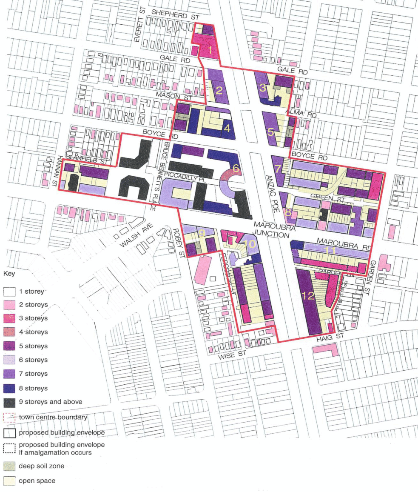

### 2.7. Building heights in centre

Figure 19: Building heights in centre

> [Picture on page 26: a picture, saved as a picture (images/part-d3-maroubra-junction-centre-page-26-3.gif, 150 dpi).]

Source: Randwick City Council
