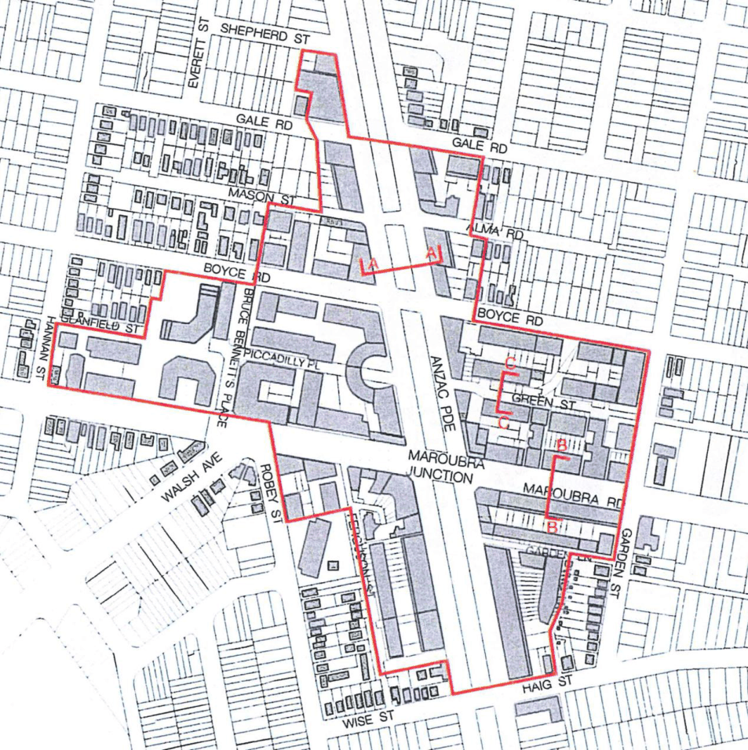
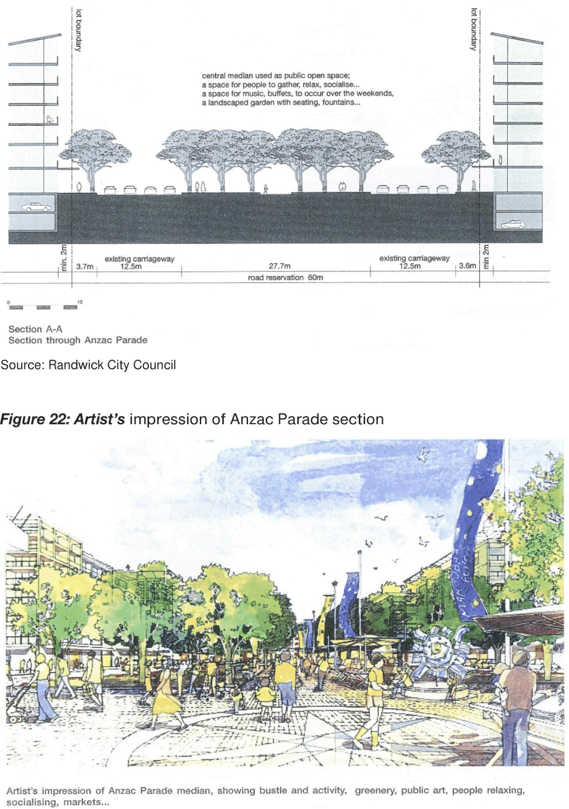
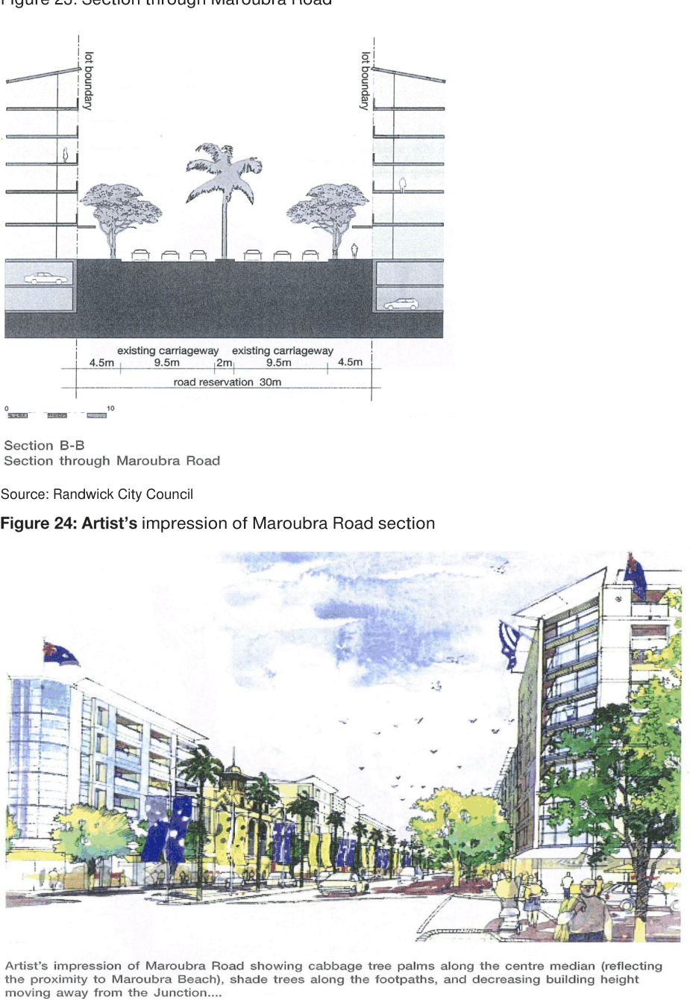
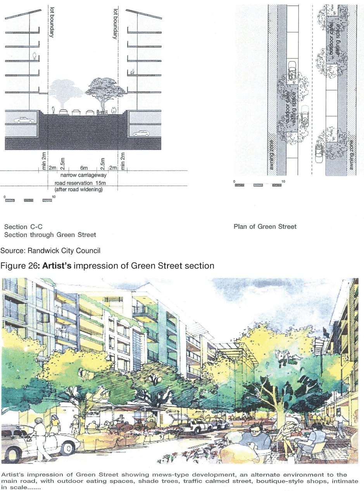

### 2.8. Indicative street sections

Figure 20: Indicative street sections

> [Picture on page 27: a picture, saved as a picture (images/part-d3-maroubra-junction-centre-page-27-3.gif, 150 dpi).]

Source: Randwick City Council The following street sections are illustrative of suggested approaches for improving the public domain. They are indicative only. Any proposals for public domain improvements are to be designed in detail and are required to include consideration of S7.12 Contributions and statutory requirements and be supported by traffic assessments and necessary approvals.

#### 2.8.1. Section through Anzac Parade

Figure 21: Section through Anzac Parade

> [Picture on page 28: a picture, saved as a picture (images/part-d3-maroubra-junction-centre-page-28-3.gif, 150 dpi).]

Source: Randwick City Council

Figure 22: Artist’s impression of Anzac Parade section

Source: Randwick City Council 2022

#### 2.8.2. Section through Maroubra Road

> [Picture on page 29: a picture, saved as a picture (images/part-d3-maroubra-junction-centre-page-29-2.gif, 150 dpi).]

Figure 23: Section through Maroubra Road

Source: Randwick City Council Figure 24: Artist’s impression of Maroubra Road section

Source: Randwick City Council

#### 2.8.3. Section through Green Street

Figure 25: Section through Green Street

> [Picture on page 30: a picture, saved as a picture (images/part-d3-maroubra-junction-centre-page-30-3.gif, 150 dpi).]

Source: Randwick City Council Figure 26 : Artist’s impression of Green Street section

Source: Randwick City Council
