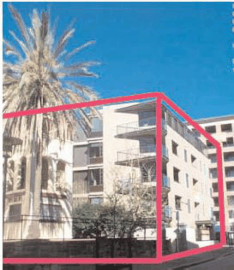
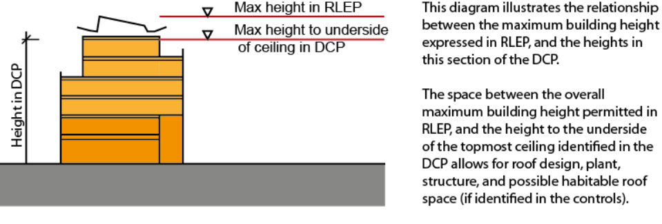

### 3.1. Primary development controls

#### 3.1.1. Amalgamation

Amalgamation is the combination of two or more lots for the purpose of redevelopment. When considering amalgamation, applicants are encouraged to seek advice from a land economist on the economic viability of a particular built form outcome. In cases where amalgamation is desirable but not possible, suitable evidence of discussions with/approaches to adjoining lot owners should be provided to Council.

Note The maximum allowable building depth/height on a block may not be achievable on small allotments.

Objectives The objectives for amalgamations are to:

1\. Ensure coherent redevelopment of the centre and avoid isolation of smaller land parcels

2\. Facilitate high quality residential amenity

3\. Minimise the number of driveway crossings and car park entries along a street.

4\. Maintain street rhythm and expression.

Controls

a) If a building/development requires vehicular access, then the site should:

i. Have a minimum street frontage of 20m; or

ii. Have dual street frontage, with vehicular access from the secondary street

b) Minimum lot widths are to be tested against the desired building types for each block to determine where amalgamation is necessary

c) When development/redevelopment/amalgamation is proposed, sites between and adjacent to developable properties are not to be limited in their future development potential.

#### 3.1.2. Subdivision

Subdivision is the division of larger land holdings into blocks and/or lots for the purpose of redevelopment.

Objectives The objectives for subdivision are to:

1\. Ensure the development parcel and the building type are compatible and promote good site design and amenity

2\. Accommodate the desired development in the precinct.

Controls

a) The following site design issues are to be addressed with any subdivision application:

i. Open space provisions (including deep soil zones)

ii. Pedestrian access, vehicular access and parking

iii. Residential amenity: light, air, and privacy

b) New blocks are to relate to the existing street hierarchy and promote a permeable block pattern

c) Underground infrastructure is to be located along the street or between lot boundaries within easements.

#### 3.1.3. Building envelope

Explanation A building envelope is a three dimensional space which defines the maximum extent of a building in any direction, that is: maximum building height, maximum building length, and maximum building depth. Buildings are to be designed to fit within the applicable building envelopes. The building envelopes shown in the Block-by-Block controls vary throughout the centre. The envelopes have been designed in response to lot size, position within the centre, relationship to adjacent buildings (such as heritage items, residential buildings outside the centre, and strata buildings unlikely to change), the desired future character of the centre, and street pattern and width, all of which vary throughout the centre. Existing strata-titled buildings are considered unlikely to change and as such controls for these allotments have not been reflected in the proposed envelope plans for each block. If redevelopment of these sites does occur, then controls consistent with controls for neighbouring allotments and the urban strategy proposed in this section of the DCP will be used for consideration by Council. The building separation requirements in 3.1.6, the setback requirements (particularly rear setback) in the Block-by-Block controls in 3.2, and the communal open space requirements in

4.1.4 of this DCP may reduce the maximum allowable building envelope. Where there is conflict, these controls override the maximum allowable building envelope.

Figure 27: Building envelope

> [Picture on page 33: a picture, saved as a picture (images/part-d3-maroubra-junction-centre-page-33-2.gif, 150 dpi).]

Source: Randwick City Council

A building envelope is not a building. It defines a three dimensional space within which a building can occur. The building envelopes shown in the Block-by-Block controls illustrate the absolute maximum envelope allowed on a site, provided that all other criteria are satisfied.

Objectives The objectives for building envelopes are to:

1\. Define the bulk, height and scale of development throughout the centre

2\. Create a transition between the centre and the surrounding residential area.

Controls

a) Residential floors: All developments are to demonstrate that the gross floor area achieved occupies not more than 70% of the maximum building envelope for residential floors

b) Commercial floors: All developments are to demonstrate that the gross floor area achieved occupies not more than 80% of the maximum building envelope for commercial floors above the ground floor.

#### 3.1.4. Building height

Explanation Height is an important control because it has a major impact on the physical and visual amenity of a place. It can also reinforce an area’s existing character or relate to an area’s desired character.

• Storeys mean the number of habitable floors, including mezzanines, and excluding underground car parking

• Height in this Part of the DCP is calculated as the distance measured vertically from existing ground level taken from each point on the boundary of the site to the underside of the ceiling of the topmost floor.

Note: In RLEP 2012 - Maximum building height is defined as: The vertical distance between resultant ground floor height and the highest point of the building, including plant rooms, lift overruns, but excluding communication devices, antennae, satellite dishes, masts, flagpoles, chimneys, flues and the like.

The relationship between these two height measurements is explained in the diagram below:

Figure 28: Height diagram

> [Picture on page 34: a picture, saved as a picture (images/part-d3-maroubra-junction-centre-page-34-11.gif, 150 dpi).]

Source: Randwick City Council

Objectives The objectives for building height are to:

1\. Ensure future development within the centre responds to the desired scale and character of the street and the centre

2\. Ensure development at the edges of the centre responds to the scale and character of development and the streets surrounding the centre

3\. Allow reasonable daylight and solar access to all developments and the public domain.

Controls

a) Developments are to be appropriately scaled with consideration to the broader urban structure principles on which the centre is based

b) Development is to comply with the building heights shown in colour in the block by block diagrams in 3.2 Block-by-Block Controls

c) The prominence of certain street corners should be reinforced by concentrating the tallest portion of the building on the corner, both the overall building height, and predominant street wall height (e.g. higher buildings on Maroubra Junction)

d) The maximum allowable height on Anzac Parade is 7 storeys, unless otherwise specified in 3.2 Block-by-Block Controls

e) The maximum allowable height on Maroubra Road is 6 storeys, unless otherwise specified in 3.2 Block-by-Block Controls

f) Maximum allowable building heights in metres [calculated as the distance measured vertically from ground level taken from each point on the boundary of the site to the underside of the ceiling of the topmost floor] are as follows:

| i. | 1 storey | 4.5m |
|---|---|---|
| ii. | 2 storeys | 9.0m |
| iii. | 3 storeys | 12.0m |
| iv. | 4 storeys | 15.0m |
| v. | 5 storeys | 18.0m |
| vi. | 6 storeys | 21.0m |
| vii. | 7 storeys | 24.0m |
| viii. | 8 storeys | 26.7m |

g) For existing buildings shown as 9 storeys or more in 3.2: Block-by-Block Controls, any redevelopment of these sites will be limited to the current maximum height of the existing building on the site.

Note: Refer to Block by Block controls in Section 3.2 for Maximum Building Heights throughout the Centre.

#### 3.1.5. Building depth

Explanation Building depth is the horizontal cross section dimension of a building. It generally refers to the dimension measured from front to back (from the street to the inside of the block). Where buildings are oriented differently, the depth will be the dimension of the shorter axis. The depth of a building will have a significant impact on residential amenity for the building occupants. In general, narrow cross-section buildings have the potential for dual aspect apartments with natural ventilation and optimal daylight to internal spaces. Building depth is also related to building use. Mixed-use buildings may have wider commercial/retail floors and narrower residential floors, to maximise the amenity of living spaces. Different site conditions (such as orientation, surrounding development) will require different design solutions for building depth. For example, shallow sites may require slim buildings to protect the amenity of neighbouring uses.

Note Refer to Section 3.2 indicative sections of this DCP for diagrams illustrating maximum building depth and glass line to glass line depth. The maximum building depths set out in Section 3.2 have been designed in response to site conditions.

Objectives The objectives for building depth are to:

1\. Ensure that the bulk of the development is in scale with the existing and desired future context

2\. Provide adequate amenity for building occupants in terms of sun access and natural ventilation

3\. Provide for dual aspect apartments.

Controls

a) Maximum allowable depth of residential building envelopes is 22m (max 18m glass line to glass line), unless otherwise specified in 3.2 Block by Block Controls

b) Maximum allowable depth of commercial/retail building envelopes is 25m (max 23m glass line to glass line above the ground floor), unless otherwise specified in 3.2 Block by Block Controls.

#### 3.1.6. Building separation

Explanation Buildings which are too close together can create internal amenity problems both for the proposed new building, its neighbours, and the space between buildings. These problems include lack of visual and acoustic privacy, loss of daylight access to apartments and to private and shared open spaces. Building separation controls work in conjunction with height controls and controls for private/communal open space and deep soil zones. They are measured in metres, from balcony to balcony or from external wall to external wall.

Objectives The objectives for building separation are to:

1\. Ensure that the scale of new development is consistent with the desired character of the area as identified in this DCP (refer to Sections 2 and 3 of this DCP)

2\. Provide visual and acoustic privacy for existing and new residents

3\. Control overshadowing of adjacent properties and private and shared open space

4\. Allow for the provision of usable open space between buildings

5\. Provide deep soil zones for stormwater management and tree planting, where site conditions allow.

Controls

a) Building separation is to increase in proportion to building height to ensure appropriate urban form, adequate amenity and privacy for building occupants. The following building separation requirements apply to all new development:

| Building height | Building separation requirements |
|---|---|
| Up to 4 storeys/15 metres | • 12m between habitable rooms and balconies • 9m between habitable rooms and balconies/non- habitable rooms • 6m between non-habitable rooms |
| 5 to 8 storeys/18-27 metres | • 18m between habitable rooms and balconies • 13m between habitable rooms and balconies/non- habitable rooms • 9m between non-habitable rooms |

#### 3.1.7. Articulation

Explanation Articulation of building facades can result in interesting buildings and greater amenity for occupants. Buildings can be articulated through the use of architectural elements such as balconies and building entries. Provision for building articulation is included within the building envelopes in the Block- by- Block controls. These elements may extend into the building envelope beyond the maximum glass line to glass line depth.

Objectives The objectives for articulation are to:

1\. Promote articulated building facades that contribute to the character of the street

2\. Provide active, continuous commercial retail frontages

3\. Promote buildings with high quality amenity and usable private outdoor spaces

4\. Ensure buildings respond to environmental conditions such as noise, sun, breezes, privacy and views

5\. Promote integration of building and private open space.

Controls

a) All buildings are to be articulated to a minimum depth of 1m at the rear and the front, above any ground floor commercial/ retail

b) Balconies may extend beyond the maximum building envelope by a maximum of 600mm (to further encourage facade articulation) but must not extend beyond the property boundaries.

#### 3.1.8. Street setbacks

Explanation Street setbacks establish the front building line. They help create the proportions of the street and can contribute to the public domain by enhancing streetscape character and the continuity of street facades. Street setbacks can also be used to enhance the setting for the building. They provide for landscape areas, entries to ground floor apartments and deep soil zones.

Definition Street setbacks are measured from the street boundary to the outside face of the external wall of the building.

Objectives The objectives for street setbacks are to:

1\. Establish the desired spatial proportions of the street and define the street edge

2\. Create a clear threshold by providing a transition between public and private space

3\. Assist in achieving visual privacy to apartments from the street

4\. Create good quality entry spaces to lobbies, foyers or individual dwelling entrances

5\. Allow an outlook to and surveillance of the street

6\. Allow for street landscape character.

Controls

a) No setback is required from Anzac Parade and Maroubra Road, in order to maintain an urban street edge on the major streets, unless otherwise specified in Section 3.2 Block-by-Block controls of this DCP

b) All development is to comply with the street setbacks outlined in Section 3.2 Block- by- Block controls of this DCP.

#### 3.1.9. Side and rear setbacks

Explanation Side and rear setbacks help ensure that the height and distance of the building from the boundaries maintains the amenity of neighbouring sites and the amenity of new development. Setbacks vary according to the building context and type. Side and rear setbacks can be used to create usable space, which contributes to the amenity of the side and rear of the buildings through landscape design.

Objectives The objectives for side and rear setbacks are to: Side setbacks

1\. Minimise the impact of development on light, air, sun, privacy, views and outlook for neighbouring properties, including future buildings

2\. Retain or create a pattern of development that positively defines the streetscape so that the area between buildings is not just “left over” space

Rear setbacks

3\. Maintain deep soil zones to maximise natural site drainage and protect the water table

4\. Maximise the opportunity to retain and reinforce mature vegetation

5\. Optimise the use of land at the rear and surveillance of the street at the front

6\. Maximise building separation to provide visual and acoustic privacy.

Controls

a) All development must comply with the building separation requirements in Section 3.1.6; and the side and rear setback requirements in Section 3.2: Block-by-Block controls

b) Development fronting Anzac Parade and Maroubra Road may have a zero side setback unless otherwise specified in the Block-by-Block controls.

#### 3.1.10. Rights of carriageway

Explanation The Roads and Maritime Service has advised that new vehicular access to developments fronting Anzac Parade and Maroubra Road will not be allowed from these streets, and vehicular access must be via side streets. Most blocks within the centre can be accessed via side streets, however where access from a side street is not possible, access may be provided via a Right of Carriageway. The locations where Rights of Carriageways may be required are shown on the proposed building envelope diagrams for each block within the centre. Where a Right of Carriageway is required, the timing and order of development of land will depend on market forces and the ability of landowners to successfully negotiate with adjoining property owners to achieve reciprocal Rights of Carriageway created under Schedule 8 of the

Conveyancing Act 1919. These Rights of Carriageway will allow access across adjoining properties for owners, residents, staff, visitors, customers and service vehicles. Applicants should note that if an individual owner within a development block refuses to grant a Right of Carriageway to benefit adjoining properties, then a legal avenue exists under Section 88K of the Conveyancing Act 1919 for an aggrieved land owner to commence proceedings in the Supreme Court to seek an order of that Court granting a right of access across an adjoining property in circumstances where such access is necessary for the reasonable development of such land.

Objectives The objectives for carriageways are to:

1\. Facilitate vehicle access to properties fronting Anzac Parade and Maroubra Road

2\. Maximise pedestrian safety and maintain traffic flow.

Controls

a) Where Rights of Carriageway are required:

i. They are to be a minimum of 6 metres wide. For larger developments, a carriage way width greater than 6 metres wide may be required.

ii. Applicants are to negotiate Rights of Carriageway with adjoining property owners

iii. Evidence of adjoining property owners’ agreement to a Right of Carriageway is to be submitted as part of the DA

iv. If agreement cannot be reached, applicants are to submit evidence that an action under Section 88K of the Conveyancing Act 1919 has commenced in the Supreme Court

b) Doors and windows of habitable rooms are not to be located next to accessways.

Note Locations of required rights of carriageway are identified in Building envelope plans in Section 3.2: Block-by-block controls of this DCP.
