### 3.2. Block by block controls

Introduction The centre has been divided into twelve blocks as shown in the key map. The following pages contain Block-by-Block controls for each block in the centre, comprising building envelopes and written controls.

Note The primary development controls in Section 3.1 and the design controls in Section 4.0 of this DCP also apply to each block.

Existing plan The existing plan shows what currently exists on the block including existing building heights, strata titled buildings unlikely to change and approved DAs. [Disclaimer: Existing buildings and their scale as shown on blocks have been mapped approximately only].

Building envelope plan The building envelope plan shows the permitted building envelopes (maximum building depth and height) on the block. It also shows rights of carriageways that are to be provided, deep soil zone locations and open space locations. Existing strata-titled buildings are considered unlikely to change and as such controls for these allotments have not been reflected in the proposed envelope plans for each block. If redevelopment of these sites does occur, then controls consistent with controls for neighbouring allotments and the urban strategy proposed in this section of the DCP will be used for consideration by Council.

Note Refer to Section 5: Flooding in Part B8: Water Management of the DCP for further information.

Indicative sections Indicative generic block section diagrams are provided on the following pages. The configuration of basement and sub-basement parking shown in sections is indicative only. The design of basement and sub-basement parking will need to take into account flooding and other site constraints and is subject to Council’s flood mitigation requirements. Applicants are advised to contact Council prior to submitting a DA to determine whether flooding may be an issue, and whether a flood study may be required. Figure 29: Block by Block indicative sections

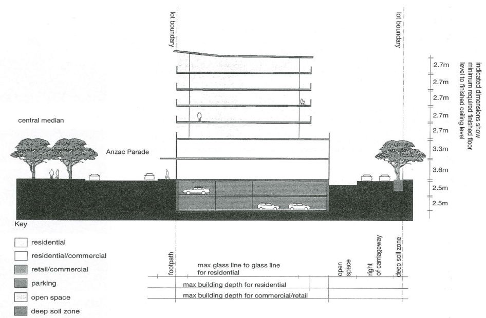

> [Picture on page 40: a picture, saved as a picture (images/part-d3-maroubra-junction-centre-page-40-21.gif, 150 dpi).]

Source: Randwick City Council

Figure 30: Block by block indicative sections 2

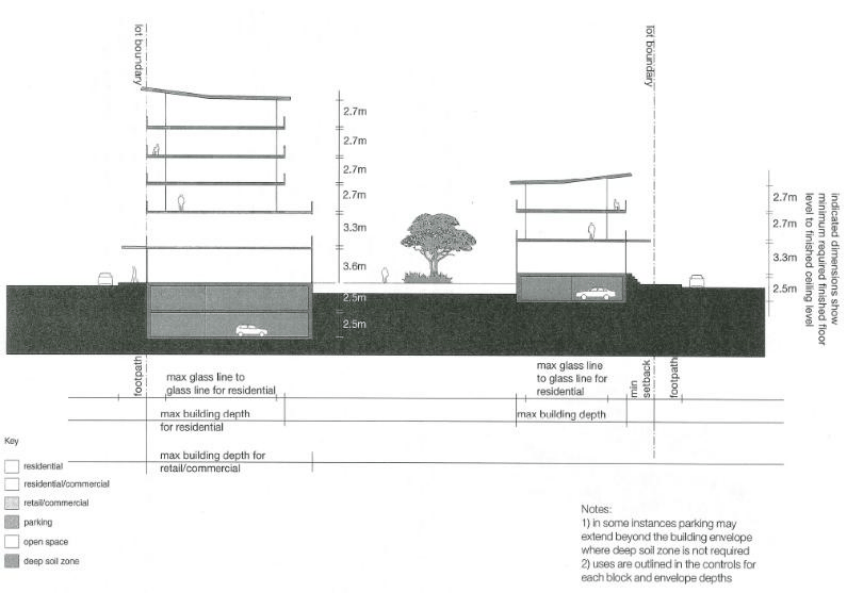

> [Picture on page 41: a picture, saved as a picture (images/part-d3-maroubra-junction-centre-page-41-2.gif, 150 dpi).]

Source: Randwick City Council

Note In some instances, parking may extend beyond the building envelope where a deep soil zone is not required. Uses are outlined in the controls for each block and envelope depths.

Note Any variation to building uses should be accompanied by an assessment of the economic impact on existing commercial development in the town centre. In addition to the setback requirements in the table, the requirements in Section 3.1.6: Building Separation of this DCP also apply. If any inconsistency between the maximum building envelope and setbacks arises, the setback requirements (tabled) and the requirements in Section 3.1.6 override the maximum building envelope.

3.2.1. Block 1

Description Block 1, which marks the northern boundary of the centre, is bound by Shepherd Street to the north, Gale Road to the south and Anzac Parade to the east. It contains the Bowen Library which is owned by Randwick Council. The existing library building is three storeys high, and there is an approved DA for the site which is six storeys. There are one and two storey residential buildings north of the library. To its immediate west is a three storey residential building. All lots in this block front Anzac Parade.

Figure 31: Block 1 images

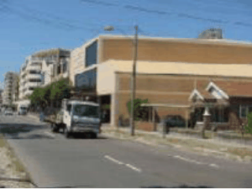

> [Picture on page 42: a picture, saved as a picture (images/part-d3-maroubra-junction-centre-page-42-2.gif, 150 dpi).]

Source: Randwick City Council

Objectives The objectives for Block 1 are to:

1\. Reinforce Anzac Parade as the main street

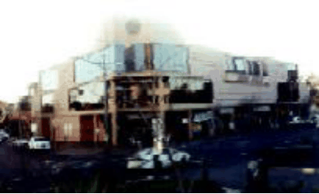

> [Picture on page 42: a picture, saved as a picture (images/part-d3-maroubra-junction-centre-page-42-7.gif, 150 dpi).]

2\. Provide a transition in scale from the centre to the lower scale residential buildings on its periphery

3\. Maintain the amenity of the residential buildings by providing a green buffer between the busy commercial/retail activities and any low scale residential uses on properties adjacent.

Controls

a) Building envelope plan

| Location | Building envelopes |
|---|---|
| Anzac Parade (north of library) | Four storeys |

b) Building use

| Location | Building use |
|---|---|
| Anzac Parade | Two storeys retail/commercial; residential above |

c) Setbacks

| Location | Setback |
|---|---|
| Side setback |  |
| Along Anzac Parade and Shepherd Street | 0m |
| Along Gale Road | Minimum 3m |
| Rear setback |  |
| Lots fronting Anzac Parade | Minimum 10m |

Deep soil zone

d) Provide a min 1.5m wide deep soil tree planting strip along rear boundary Vehicle access

e) All lots fronting Anzac Parade are required to provide vehicle access via a minimum 6m wide right of carriageway.

Figure 32: Block 1

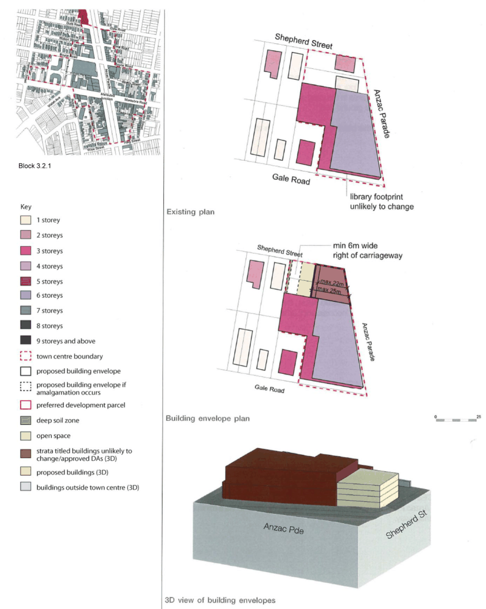

> [Picture on page 43: a picture, saved as a picture (images/part-d3-maroubra-junction-centre-page-43-2.gif, 150 dpi).]

Source: Randwick City Council

3.2.2. Block 2

Description Block 2 is bound by Gale Road to the north, Mason Street to the south and Anzac Parade to the

east. It contains a relatively new six storey strata-titled building which is unlikely to change in the

next 10-15 years. The buildings to the south of this apartment building are one and two storeys high.

Objectives The objectives for Block 2 are to:

1\. Reinforce Anzac Parade as the main street

2\. Provide a transition in scale from the centre to the lower scale residential buildings on its periphery

3\. Maintain the amenity of the residential buildings by providing a green buffer between the busy commercial/retail activities on Anzac Parade and low scale residential uses on

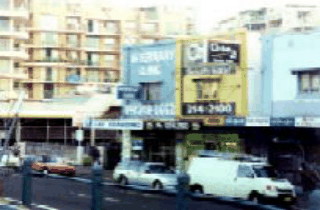

> [Picture on page 44: a picture, saved as a picture (images/part-d3-maroubra-junction-centre-page-44-10.gif, 150 dpi).]

properties adjacent.

Figure 33: Block 2 images

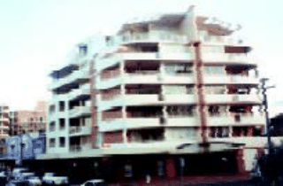

> [Picture on page 44: a picture, saved as a picture (images/part-d3-maroubra-junction-centre-page-44-13.gif, 150 dpi).]

Source: Randwick City Council

Controls

a) Building envelope plan

| Location | Building Envelopes |
|---|---|
| Anzac Parade | Seven storeys |
| b) Building use |  |
| Location | Building Use |
| All buildings | Two floors retail/commercial; residential above |
| c) Setbacks |  |

| Location | Setback |
|---|---|
| Side setback |  |
| Along Anzac Parade | 0m |
| Rear setback |  |
| All lots | Minimum 10m |

Deep soil zone

d) Provide a min 1.5m wide deep soil tree planting strip along rear boundary Vehicle access and road widening

e) All lots fronting Anzac Parade are required to provide vehicle access via a minimum 6m wide right of carriageway

f) Lots with frontage to Mason Street are to comply with Part B11 Development in laneways nominated for widening.

Figure 34: Block 2

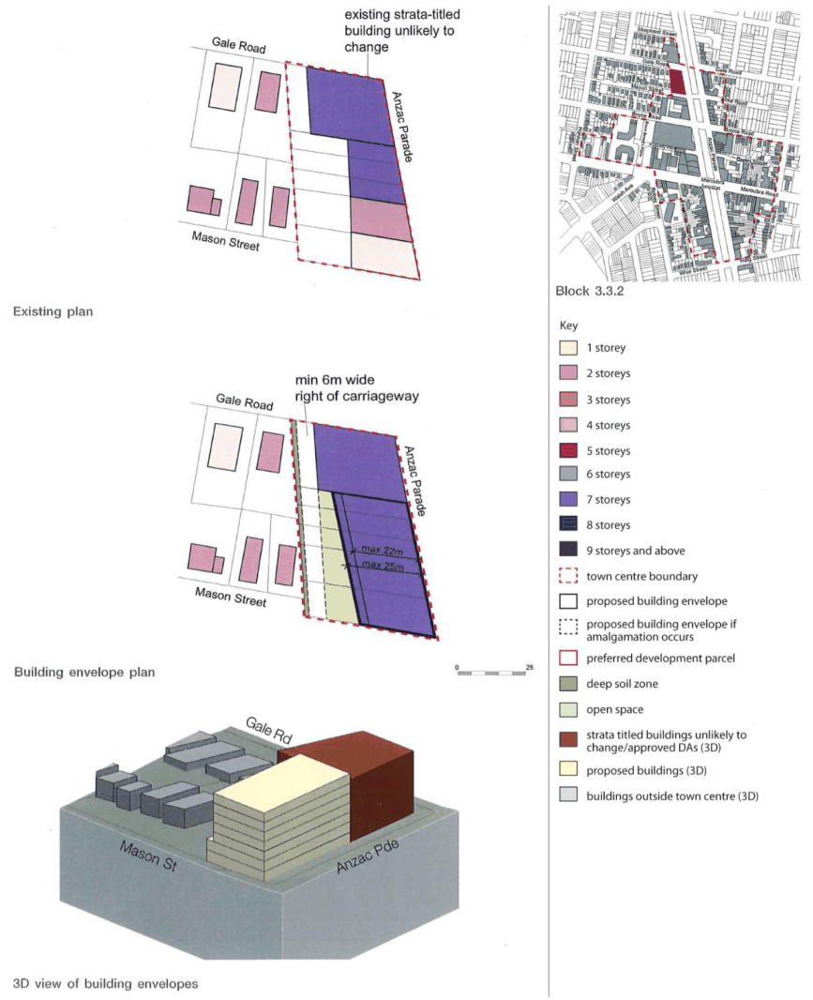

> [Picture on page 45: a picture, saved as a picture (images/part-d3-maroubra-junction-centre-page-45-2.gif, 150 dpi).]

Source: Randwick City Council

3.2.3. Block 3 Block 3, on the eastern side of Anzac Parade, is bound by Gale Road to the north, Alma Road to the south and Anzac Parade to the west. There are existing buildings which are 7-8 storeys high along Anzac Parade, including one fully commercial building and 1-2 storey buildings along Gale Road. There are one and two storey residential buildings east of the centre boundary.

Objectives The objectives for Block 3 are to:

1\. Reinforce Anzac Parade as the main street

2\. Provide a transition in scale from the centre to the lower scale residential buildings on its periphery

3\. Maintain the amenity of residential buildings by providing a green buffer between busy commercial/retail activities on Anzac Parade and adjacent low scale residential uses.

Controls

a) Building envelope plan

| Location | Building envelopes |
|---|---|
| Anzac Parade | Seven storeys |
| Gale Road | Five storeys |

b) Building use

| Location | Building use |
|---|---|
| Anzac Parade | Two floors retail/commercial; residential above |
| Gale Road and Alma Road | One level of commercial with residential above (home office uses are encouraged) |

c) Setbacks

| Location | Setback |
|---|---|
| Front setback |  |
| Along Gale Road and Alma Road | Minimum 3m |
| Side setback |  |
| Along Anzac Parade | 0m |
| Along Gale Road and Alma Roads | Minimum 3m from properties outside the centre boundary |
| Rear setback |  |
| Along Anzac Parade | Minimum 10m |
| Along Gale Road and Alma Roads | Minimum 6m |

Deep soil zone

d) For lots fronting Anzac Parade, provide a min 1.5m wide deep soil tree planting strip along rear boundary

e) For lots fronting Gale Road and Alma Road, provide a min 6m wide deep soil zone along the rear boundary

Other controls

f) Road widening: lots on Alma Road are to comply with Part B11: Laneway widening of this DCP for development in laneways nominated for widening.

Figure 35: Block 3

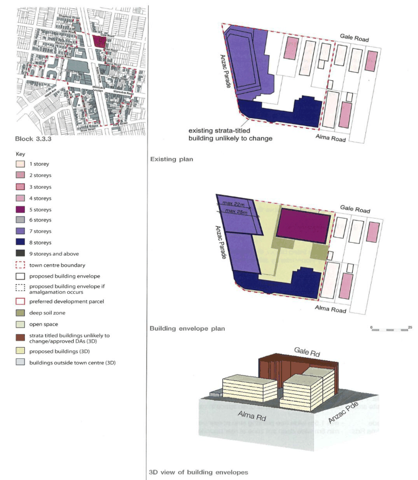

> [Picture on page 47: a picture, saved as a picture (images/part-d3-maroubra-junction-centre-page-47-2.gif, 150 dpi).]

Source: Randwick City Council

3.2.4. Block 4 Block 4 is bound by Mason Street to the north, Boyce Road to the south and Anzac Parade to the east. There are existing strata-titled buildings which are 8 storeys high along Anzac Parade and Boyce Road, which are unlikely to change in the next 10-15 years, and one storey buildings (shops) on the corner of Anzac Parade and Mason Street. There are balconies on the northern side of the apartment block on Anzac Parade which makes it impossible for the lots on the north to build to the boundary, and reduces the development potential of these lots.

Objectives The objectives for Block 4 are to:

1\. Reinforce Anzac Parade as the main street

2\. Provide a transition in scale from the centre to the lower scale residential buildings on its periphery

3\. Maintain the amenity of residential buildings by providing a green buffer between busy commercial/retail activities on Anzac Parade and adjacent low scale residential uses

4\. Facilitate development of the corner of Anzac Parade and Mason Street in the context of the existing strata buildings on its southern boundary.

Controls

a) Building envelope plan

| Location | Building envelopes |
|---|---|
| Anzac Parade | Seven storeys |
| Mason Street and Boyce Road | Five storeys |
| Corner of Mason Street and Anzac Parade | Three storeys (to accommodate difficulties resulting from the strata block to the immediate south) |

b) Building use

| Location | Building use |
|---|---|
| Anzac Parade | Two floors retail/commercial; residential above |
| Mason Street and Boyce Road | One level of commercial with residential above (home office uses are encouraged) |

c) Setbacks

| Location | Setback |
|---|---|
| Front setback |  |
| Along Mason Street and Boyce Road | Minimum 3m |
| Side setback |  |
| Corner lot (Anzac Parade and Mason Street) | 6m from existing strata building and 0m from Mason Street |
| Along Mason Street and Boyce Road | Minimum 3m |
| Rear setback |  |
| All lots | Minimum 6m |

Deep soil zone

d) Along Anzac Parade: Provide a min 1.5m wide deep soil tree planting strip along rear boundary

e) Along Mason Street and Boyce Road: min 6m wide deep soil zone along rear boundary with substantial tree planting

Other controls

f) Road widening: lots on Alma Road are to comply with Part B11: Laneway widening of this DCP for development in laneways nominated for widening.

Figure 36: Block 4

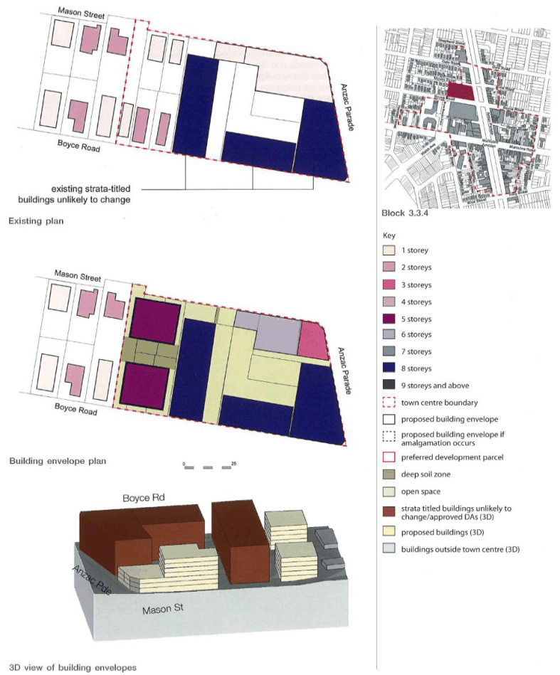

> [Picture on page 49: a picture, saved as a picture (images/part-d3-maroubra-junction-centre-page-49-2.gif, 150 dpi).]

Source: Randwick City Council

3.2.5. Block 5 Block 5 is bound by Alma Road to the north, Boyce Road to the south and Anzac Parade to the

west. Existing building heights range from one to four storeys.

Objectives The objectives for Block 5 are to:

1\. Reinforce Anzac Parade as the main street

2\. Provide a soft transition in scale from the centre along Alma Road and Boyce Road to the lower scale residential buildings on the periphery

3\. Maintain the amenity of residential buildings by providing a green buffer between busy commercial/retail activities on Anzac Parade and adjacent low scale residential uses.

Controls

a) Building envelope plan

| Location | Building Envelopes |
|---|---|
| Anzac Parade | Seven storeys |
| Alma Road and Boyce Road | Five storeys |

b) Building use

| Location | Building Use |
|---|---|
| Anzac Parade | Two floors retail/commercial; residential above |
| Alma Road and Boyce Road | One level of retail/commercial with residential above (home office uses are encouraged) |

c) Building depth

| Location | Max Building Depth |
|---|---|
| Anzac Parade (southern lots) and Alma Road | 18m (15m glass line to glass line) |

d) Setbacks

| Location | Front Setback |
|---|---|
| Front setback |  |
| Alma Road and Boyce Road | Minimum 3m |
| Side setback |  |
| Anzac Parade | 0m |
| Alma Road and Boyce Road | Min 3m to lots outside centre boundary; 0m to lots fronting Anzac Parade |
| Rear setback |  |
| All lots | Minimum 6m |

e) Deep soil zone

| Location | Deep Soil |
|---|---|
| Anzac Parade | Min 1.5m wide deep soil tree planting strip along rear boundary |
| Alma Road and Boyce Road | Min 6m wide deep soil zone along rear boundary with substantial tree planting |

Vehicle access and road widening

f) All lots fronting Anzac Parade are required to provide access via a minimum 6m wide rear right of carriageway

g) Road widening: lots on Alma Road are to comply with the DCP Part B11: Laneway widening of the DCP for development in laneways nominated for widening.

Figure 37: Block 5

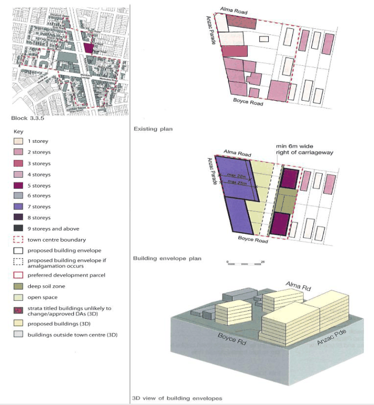

> [Picture on page 51: a picture, saved as a picture (images/part-d3-maroubra-junction-centre-page-51-2.gif, 150 dpi).]

Source: Randwick City Council

3.2.6. Block 6 Block 6 is generally bound by Boyce Road to the north, Maroubra Road to the south, Anzac Parade to the east and Hannan Street to the west. This block contains the Pacific Square site, the biggest shopping centre in the centre. This block also contains the Centrelink and Police Station sites. There are three thirteen storey towers along Maroubra Road, which are strata-titled and unlikely to change in the next 10 -15 years. There are also one to two storey residential buildings on Glanfield Street.

Objectives The objectives for Block 6 are to:

1\. Reinforce Anzac Parade as the main street

2\. Reinforce Maroubra Road as the cross street

3\. Reinforce the ‘Junction’ of Maroubra Rd and Anzac Pde as the main focus of the Maroubra Junction Centre

4\. Encourage a mix of commercial/retail uses within the retail core

5\. Provision of an open space in the middle of the centre away from the traffic noise and surrounded by shopping activity providing the focus for the centre

6\. Provide a transition in scale from the centre along Boyce Rd, Maroubra Rd and Glanfield St to the lower scale residential buildings on the periphery

7\. Maintain the amenity of the residential buildings by providing a green buffer between the busy commercial/retail activities on Anzac Parade and adjacent low scale residential uses.

Controls

a) Building envelope plan

| Location | Building envelopes |
|---|---|
| Maroubra Mall (Pacific Square) site | Consistent with the approved DA |
| Maroubra Road | Six storeys |
| Glanfield Street | Five storeys |

b) Building use

| Location | Building use |
|---|---|
| Anzac Parade | Two floors retail/commercial; residential above |
| Maroubra Road | Between Anzac Parade and Bruce Bennetts Place, two levels retail/commercial; residential above. Between Bruce Bennetts Place and Hannan Street: all floors residential |
| Bruce Bennets Place, Hannan Street and Glanfield Street | All floors residential |

c) Building depth

| Location | Max Building depth |
|---|---|
| West of Bruce Bennetts Place (all uses) | 22m (18m glass line to glass line) |

d) Setbacks

| Location | Front setback |
|---|---|
| Front setback |  |
| Maroubra Road and Bruce Bennets Place | 0m |
| Hannan Street and Glanfield Street | 3m |
| Side setback |  |
| Maroubra Road and Bruce Bennetts Place | 0m |
| Hannan Street and Glanfield Street | 1.5m; 0m with existing strata title lots |
| Rear setback |  |
| Lots fronting Hannan Street | 6m |

e) Deep soil zone

| Location | Deep soil |
|---|---|
| Hannan Street | Minimum 6m wide deep soil zone along rear boundary with substantial tree planting |

Road widening

f) Lots on Glanfield Street are to comply with Part B11: Laneway widening of the DCP for development in laneways nominated for widening.

Note The building envelopes shown in black have a maximum allowable height of 9 storeys. Any proposed variation to the building use controls should be accompanied by an assessment of the economic impact on existing commercial development in the town centre. In addition to the setback requirements in the table, the requirements in Section 3.1.6: Building Separation also apply. If any inconsistency between the maximum building envelope and setbacks arises, the setback requirements (tabled) and the requirements in Section 3.1.6 override the maximum building envelope.

Figure 38: Block 6

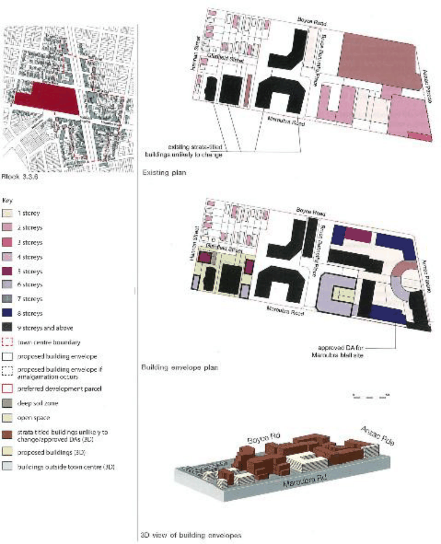

> [Picture on page 53: a picture, saved as a picture (images/part-d3-maroubra-junction-centre-page-53-12.gif, 150 dpi).]

Source: Randwick City Council

3.2.7. Block 7 Block 7 is bound by Boyce Road to the north, Green Street to the south, Garden Street to the east and Anzac Parade to the west. It contains a seven storey building on Anzac Parade, and lower residential buildings (one to four storeys) on the secondary streets. A number of lots have dual frontage (i.e. frontage to both Boyce Road and Green Street).

Objectives The objectives for Block 7 are to:

1\. Reinforce Anzac Parade as the main street

2\. To encourage a mix of commercial/retail uses within the retail core

3\. Provide a transition in scale from the centre along Boyce Road, Green Street and Garden St to the lower scale residential buildings on the periphery

4\. Maintain the amenity of the residential buildings by providing a green buffer between the busy commercial/retail activities on Anzac Parade and adjacent low scale residential uses

5\. Development of Green Street is to promote an intimate scale shopping and café laneway.

Controls

a) Building envelope plan

| Location | Building envelopes |
|---|---|
| Anzac Parade | Seven storeys |
| Secondary Streets | Three to six storeys |

b) Building use

| Location | Building use |
|---|---|
| Anzac Parade | Two floors retail/commercial; residential above |
| Secondary Streets | One level of retail/commercial; residential above (home office uses encouraged) |

c) Building depth

| Location | Max Building depth |
|---|---|
| Boyce Road, Green Street and Garden Street (commercial/retail uses) | 18m (16m glass line to glass line) |
| Boyce Road, Green Street and Garden Street (residential uses) | 18m (15m glass line to glass line) |
| Green St (additional envelope if amalgamation occurs) | 15 (12m glass line to glass line) |

d) Setbacks

| Location | Front setback |
|---|---|
| Front setback |  |
| Boyce Road | Minimum 3m |
| Green Street | Minimum 2m |
| Side setback |  |
| Anzac Parade | 0m |

| Rear setback |  |
|---|---|
| Anzac Parade | Minimum 10m |
| Garden Street | Minimum 6m |

e) Deep soil zone

| Location | Deep soil/open space |
|---|---|
| Anzac Parade | Minimum 1.5m wide deep soil tree planting strip along rear boundary |

Vehicle access and road widening

f) Lots with frontage to both Boyce Road and Green Street are to provide vehicular access via Boyce Road only.

g) Lots on Green Street are to comply with Part B11: Laneway Widening of the DCP for development in laneways nominated for widening.

Figure 39: Block 7

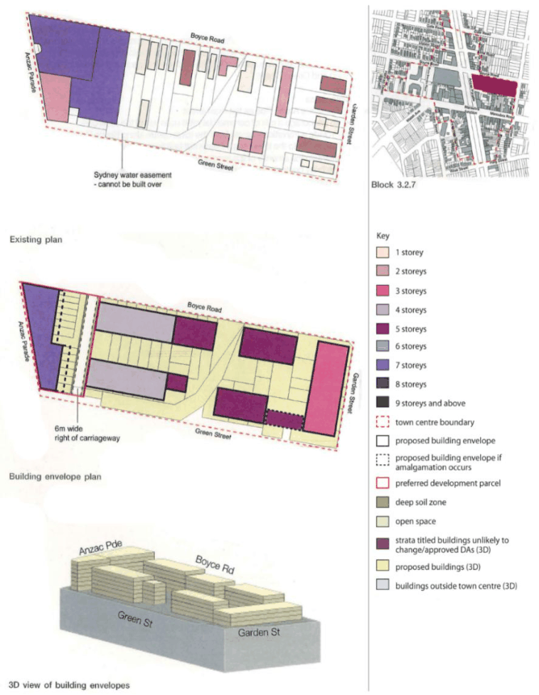

> [Picture on page 55: a picture, saved as a picture (images/part-d3-maroubra-junction-centre-page-55-10.gif, 150 dpi).]

Source: Randwick City Council

3.2.8. Block 8 Block 8 is bound by Green Street to the north, Maroubra Road to the south, Garden Street to the east and Anzac Parade to the west. This block contains strata buildings (seven to ten storeys), which are unlikely to change in the next 5-10 years. There are also lower buildings which range from one to four storeys along Maroubra Road and Green Street.

Objectives The objectives for Block 8 are to:

1\. Reinforce Anzac Parade as the main street

2\. Reinforce Maroubra Road as the cross street

3\. Reinforce the ‘Junction’ of Maroubra Road and Anzac Parade as the main focus of the Maroubra Junction Centre

4\. Encourage a mix of commercial/retail uses in the retail core area

5\. Provide a transition in scale from the centre along Green Street and Garden Street to the lower scale residential buildings on the periphery

6\. Maintain the amenity of the residential buildings by providing a green buffer between the busy commercial/retail activities on Anzac Parade and adjacent low scale residential uses

7\. Development of Green Street is to promote an intimate scale shopping and café laneway

8\. Development sensitive in scale and character to Dudleys Corner (heritage building).

Controls

a) Building envelope plan

| Location | Building envelopes |
|---|---|
| Anzac Parade | Seven storeys |
| Maroubra Road | Six storeys |
| Green Street and Garden Street | Five to six storeys |

b) Building use

| Location | Building use |
|---|---|
| Anzac Parade and Maroubra Road | Two floors retail/commercial; residential above |
| Green Street | One level of retail/commercial; residential above |

c) Building depth

| Location | Max building depth |
|---|---|
| Anzac Parade (excluding Dudleys Corner) | As set by 10m rear setback |
| Maroubra Road and Green Street (middle sites) | 22m (18m glass line to glass line) |
| Maroubra Road and Green Street (end sites), Garden Street and Anzac Parade | 18m (15m glass line to glass line) |

d) Setbacks

| Location | Front setback |
|---|---|
| Front setback |  |
| Garden Street | 0m |

| Green Street | Minimum 2m |
|---|---|
| Side setback |  |
| Green Street and Maroubra Road | 1.5m from existing strata buildings |
| Anzac Parade | 0m |
| Rear setback |  |
| Anzac Parade | Minimum 10m |

e) Deep soil zone

| Location | Deep soil/open space |
|---|---|
| Anzac Parade | Minimum 1.5m wide deep soil tree planting strip along rear boundary |
| Lots fronting secondary streets | Substantial tree planting in the middle of the lot is required |

Vehicle access and road widening

f) Lots fronting Anzac Parade are to provide vehicular access via a minimum 6m wide rear right of carriageway

g) Lots on Green Street are to comply with Part B11: Laneway widening of the DCP for development in laneways nominated for widening.

Figure 40: Block 8

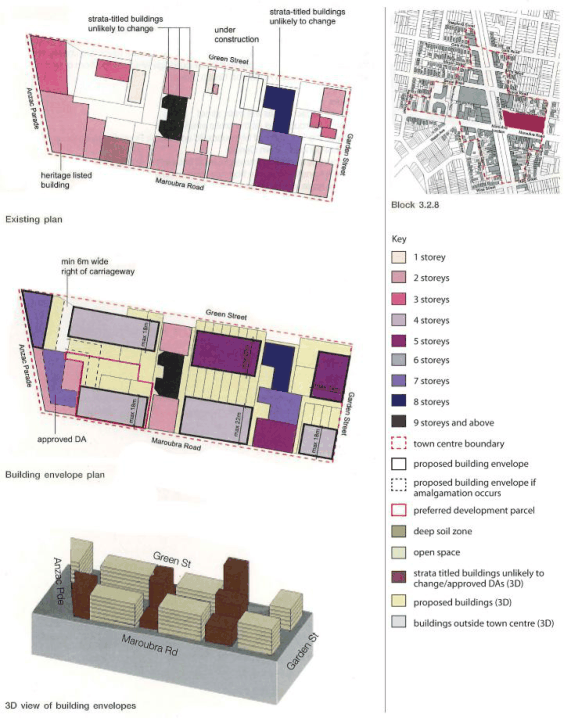

> [Picture on page 57: a picture, saved as a picture (images/part-d3-maroubra-junction-centre-page-57-10.gif, 150 dpi).]

Source: Randwick City Council

3.2.9. Block 9 Block 9 is bound by Maroubra Road to the north, Ferguson Street to the east and Robey Street to the west. Existing buildings on the block are one to two storeys high. The southern adjoining boundary of the block contains an electricity substation.

Objectives The objectives for Block 9 are to:

1\. Reinforce Maroubra Road as the primary cross street

2\. Encourage a mix of commercial/retail uses within the retail core area

3\. Provide a transition in scale from the centre along Ferguson Street and Robey Street to the lower scale residential buildings on the periphery.

Controls

a) Building envelope plan

| Location | Building envelopes |
|---|---|
| Maroubra Road | Six storeys |
| Ferguson Street and Robey Street | Five storeys |

b) Building use

| Location | Building use |
|---|---|
| Maroubra Road | Two levels of commercial; residential above |
| Ferguson Street and Robey Street | One level of commercial; residential above (home office uses encouraged) |
| c) Building depth |  |
| Location | Max building depth |
| Ferguson Street and Robey Street | 18m (15m glass line to glass line) |

d) Setbacks

| Location | Front setback |
|---|---|
| Front setback |  |
| Ferguson Street and Robey Street | Minimum 3m |
| Side setback |  |
| Maroubra Road | 0m |
| Ferguson Street and Robey Street | Minimum 1.5m |
| Rear setback |  |
| Maroubra Road | Minimum 10m |
| Ferguson Street and Robey Street | Minimum 6m |

e) Deep soil zone

| Location | Deep Soil/Open Space |
|---|---|
| Maroubra Road | Minimum 1.5m wide deep soil tree planting strip along rear boundary |

Vehicle access and road widening

f) Lots fronting Maroubra Road are to provide vehicular access via a minimum 6m wide rear right of carriageway

g) Road widening: lots on Ferguson Street are to comply with Part B11: Laneway widening of the DCP for development in laneways nominated for widening.

Figure 41: Block 9

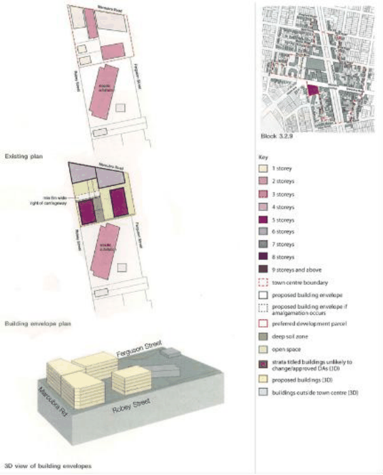

> [Picture on page 59: a picture, saved as a picture (images/part-d3-maroubra-junction-centre-page-59-9.gif, 150 dpi).]

Source: Randwick City Council

3.2.10. Block 10 Block 10 is bound by Maroubra Road to the north, Anzac Parade to the east and Ferguson Street to the west. There are some existing strata-titled buildings, six to eight storeys high, along Anzac Parade which are unlikely to change in the next 10-15 years, and one to five storey buildings along Maroubra Road and Anzac Parade. There are two heritage buildings on this block: the Maroubra Hotel on Maroubra Road and 817 Anzac Parade, which must be considered when proposing any future development in their vicinity.

Objectives The objectives for Block 10 are to:

1\. Reinforce Anzac Parade as the main street

2\. Reinforce Maroubra Road as the primary cross street

3\. Reinforce the ‘Junction’ of Maroubra Road and Anzac Parade as the main focus of the Maroubra Junction Centre

4\. Encourage a mix of commercial/retail uses within the retail core area

5\. Provide a transition in scale from the centre along Ferguson Street to the lower scale residential buildings on the periphery

6\. Development sensitive in scale and character to the heritage buildings on this block.

Controls

a) Building envelope plan

| Location | Building Envelopes |
|---|---|
| Anzac Parade | Five to seven storeys, stepping down to three storeys adjacent to heritage buildings |
| Ferguson Street | Three to five storeys |
| Corner Maroubra Road and Anzac Parade | Six storeys |

b) Building use

| Location | Building Use |
|---|---|
| Anzac Parade/Maroubra Road | Two levels of commercial; residential above (on lots adjacent to heritage building) |
| Anzac Parade | One level of commercial; residential above (on lots south of 767-771 Anzac Parade) |
| Ferguson Street | One level of commercial; residential above (home office uses encouraged) |

c) Building depth

| Location | Max Building Depth |
|---|---|
| Anzac Parade (residential uses) | 22m (18m glass line to glass line) |
| Anzac Parade (commercial uses) | 22m (20m glass line to glass line) |
| Ferguson Street | 15m (12m glass line to glass line) |

d) Setbacks

| Location | Front Setback |
|---|---|
| Front setback |  |
| Ferguson Street | Minimum 3m |
| Side setback |  |
| Anzac Parade | 0m |
| Maroubra Road | Minimum 3m from existing strata title buildings and heritage building at the southern end of the block |

| Ferguson Street | 0m (Minimum 1.5m from boundary of heritage building if amalgamation does not occur with adjacent property) Minimum 1.5m from boundary of lots fronting Wise Street Minimum 3m from existing strata buildings |
|---|---|
| e) Deep soil zone |  |
| Location | Deep Soil/Open Space |
| Maroubra Road | Minimum 1.5m wide deep soil tree planting strip along rear boundary |

Vehicle access and road widening

f) Road widening: lots on Ferguson Street are to comply with Part B11 Development in laneways nominated for widening.

Figure 42: Block 10

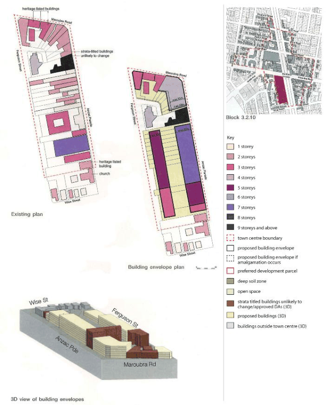

> [Picture on page 61: a picture, saved as a picture (images/part-d3-maroubra-junction-centre-page-61-6.gif, 150 dpi).]

Source: Randwick City Council

3.2.11. Block 11 Block 11 is bound by Maroubra Road to the north, Garden Lane to the south, Garden Street to the east and Anzac Parade to the west. Existing building heights range from one to three storeys.

Objectives The objectives for Block 11 are to:

1\. Reinforce Anzac Parade as the main street

2\. Reinforce Maroubra Road as the primary cross street

3\. Reinforce the ‘Junction’ of Maroubra Road and Anzac Parade as the main focus of the Maroubra Junction Centre

4\. To encourage a mix of commercial/retail uses within the retail core

5\. Provide a transition in scale from the centre along Garden Street and Garden Lane to the lower scale residential buildings on the periphery.

Controls

a) Building envelope plan

| Location | Building Envelopes |
|---|---|
| Anzac Parade | Seven storeys |
| Maroubra Road | Six storeys |
| Corner Anzac Parade and Maroubra Road | Eight storeys |
| Garden Street and Garden Lane | Three storeys |

b) Building use

| Location | Building Use |
|---|---|
| Anzac Parade and Maroubra Road | Two levels of commercial; residential above |
| Garden Street/Garden Lane | One level of commercial; residential above (home office uses encouraged) |

c) Building depth

| Location | Max Building Depth |
|---|---|
| Anzac Parade/Garden Lane (commercial/retail uses) | 12m (10m glass line to glass line) |
| Anzac Parade/Garden Lane (residential uses) | 12m (9m glass line to glass line) |
| Maroubra Road (commercial/retail) | 18m (16m glass line to glass line) |
| Maroubra Road and Garden Street (residential uses) | 15m (12m glass line to glass line) |
| Garden Street (commercial/retail uses) | 15m (13m glass line to glass line) |

d) Setbacks

| Location | Front Setback |
|---|---|
| Front setback |  |

| Garden Street and Garden Lane | Minimum 3m |
|---|---|
| Side setback |  |
| All | 0m |

Figure 43: Block 11

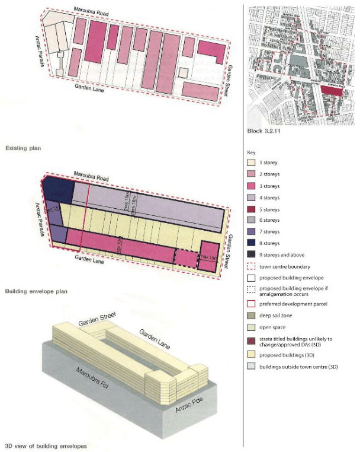

> [Picture on page 63: a picture, saved as a picture (images/part-d3-maroubra-junction-centre-page-63-3.gif, 150 dpi).]

Source: Randwick City Council

3.2.12. Block 12

Block 12 is bound by Garden Lane to the north, Haig Street to the south, Byng Lane to the east and Anzac Parade to the west. The block contains one to three storey buildings. It has a strata-titled building on the corner of Byng Lane and Haig Street, which is unlikely to change in the next 5-10 years.

Objectives The objectives for Block 12 are to:

1\. Reinforce Anzac Parade as the main street

2\. Provide a transition in scale from the centre along Garden Lane to the lower scale residential buildings on the periphery.

Controls

a) Building envelope plan

| Location | Building Envelopes |
|---|---|
| Anzac Parade | Five storeys |
| Garden Lane and Byng Lane | Three storeys |
| b) Building use |  |
| Location | Building Use |
| Anzac Parade | One level of commercial; residential above |
| Haig Street, Byng Lane and Garden Lane | One level of commercial; residential above (home office uses encouraged) |

c) Building depth

| Location | Max Building Depth |
|---|---|
| Garden Lane and Byng Lane (commercial/retail uses) | 18m maximum overall (16m glass line to glass line) |
| Garden Lane and Byng Lane (residential uses) | 18m maximum overall (15m glass line to glass line) |

d) Setbacks

| Location | Front Setback |
|---|---|
| Front setback |  |
| Haig Street, Garden Lane and Byng Lane | Minimum 3m |
| Side setback |  |
| Anzac Parade | 0m |

Figure 44: Block 12

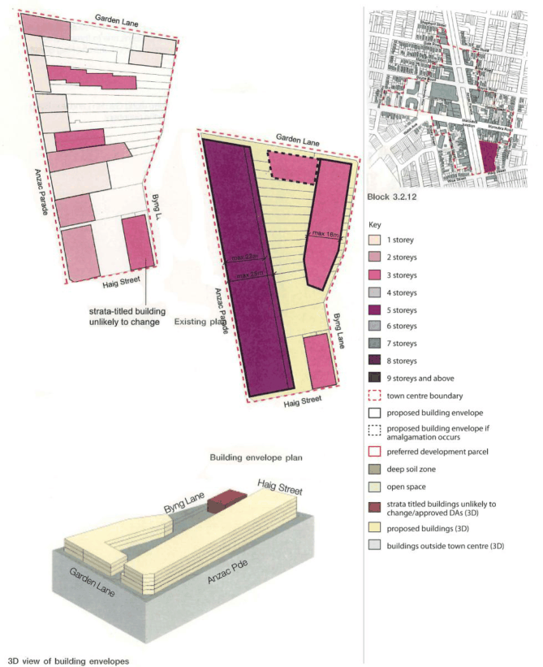

> [Picture on page 65: a picture, saved as a picture (images/part-d3-maroubra-junction-centre-page-65-2.gif, 150 dpi).]

Source: Randwick City Council
