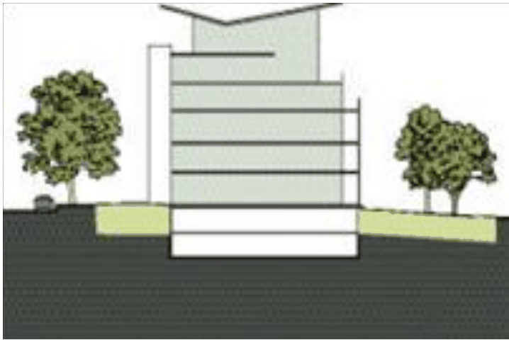
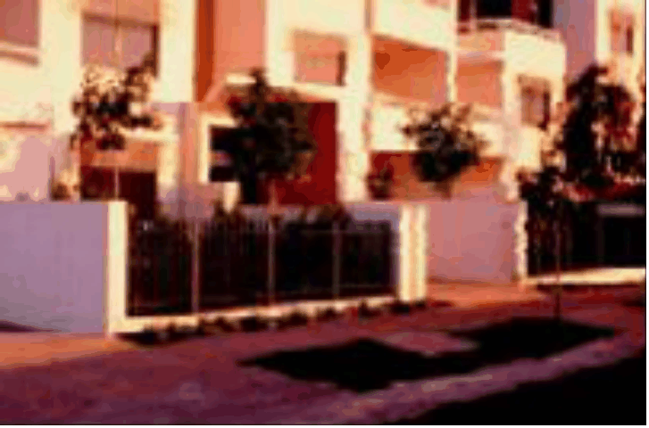
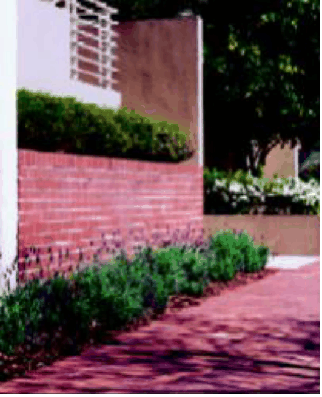
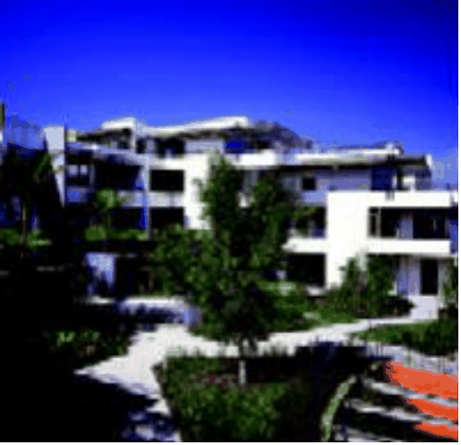
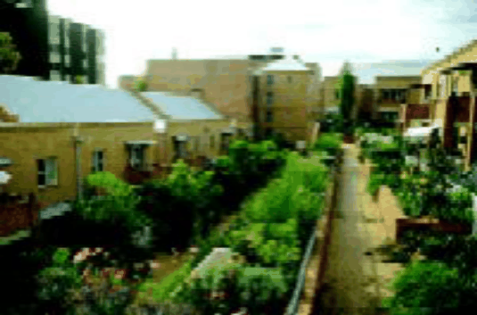
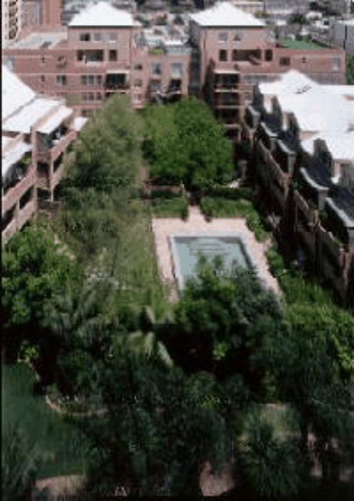
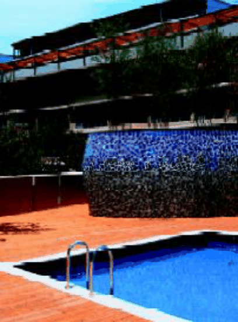
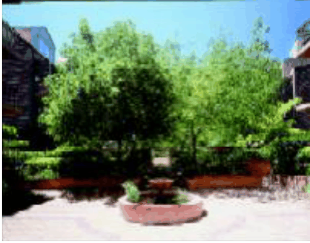
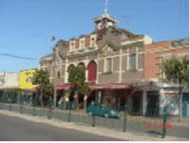
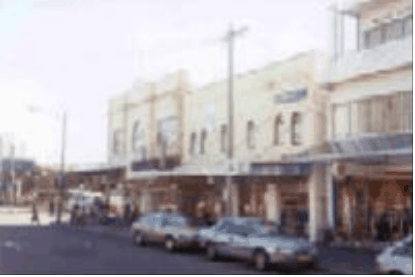

### 4.1. Site Design

#### 4.1.1. Deep soil zones

Deep soil zones are areas of natural ground with relatively natural soil profiles retained within a development. Deep soil zones are areas of the site that are not to be built upon, and are not to have underground carparking located underneath. Deep soil zones have important environmental benefits, which include promoting healthy growth of large canopy trees, protecting existing mature trees and allowing infiltration of rain water to the water table and thereby reducing stormwater runoff. Figure 45: Car parking should be located under the building footprint to promote deep soil zones in the middle of the block

> [Picture on page 66: a picture, saved as a picture (images/part-d3-maroubra-junction-centre-page-66-24.gif, 150 dpi).]

Source: Randwick City Council

Objectives The objectives for deep soil zones are to:

1\. Improve the amenity of developments through the retention and planting of trees that are or will grow to a large or medium size

2\. Assist with management of the water table

3\. Assist with management of water quality.

Controls

a) As a minimum, deep soil zones are to be provided wherever indicated in the Block-by- Block Controls, and are to be considered for all development

b) Deep soil zones should accommodate existing mature trees, as well as allowing for the planting of trees/shrubs that will grow to be mature trees

c) Deep soil zones are to have a pervious surface

d) Deep soil zones are not to be built upon or have underground carparking areas underneath.

#### 4.1.2. Fences and walls

Fences and walls include all built vertical landscaping elements that define boundaries between spaces or a change in level. The design of fences and walls has an impact on the real and perceived safety and security of residents as well as on the amenity of the public domain and the identity of the development. Fences will primarily be alongside boundaries or areas of private open space.

Figure 46: A picket and pillar fence defines the street boundary, clearly demarcating

#### ‘public’ and ‘private’ space

> [Picture on page 67: a picture, saved as a picture (images/part-d3-maroubra-junction-centre-page-67-23.gif, 150 dpi).]

Source: Randwick City Council

Figure 47: Materials and planting are combined in a good ratio of solid to void, to enhance visual amenity of the street, while ensuring privacy and security to the residents

> [Picture on page 68: a picture, saved as a picture (images/part-d3-maroubra-junction-centre-page-68-3.gif, 150 dpi).]

Source: Randwick City Council

Objectives The objectives for fences and walls are to:

1\. Define the edges between public and private land

2\. Define the boundaries between areas within the development having different functions or owners

3\. Provide privacy and security

4\. Contribute positively to the public domain.

Controls

a) Private and public domain are to be clearly defined by fences and walls which provide privacy and security whilst not eliminating views, outlook, light and air

b) Fences are to contribute to the amenity, beauty and useability of private and communal open spaces by incorporating design elements such as benches/seats, planter boxes, pergolas and trellises, barbeques, water features etc

c) The amenity of the public domain is to be retained and enhanced by:

i. Avoiding the use of continuous blank walls at street level

ii. Using planting to soften the edges of any raised terraces to the street, such as over sub-basement car parking, and reduce their apparent scale

d) Fences are to be a maximum height of 1.2 metres. Variations may be permitted dependant upon the context, siting, safety, privacy and design of the building

e) Fences and retaining walls are to be detailed on the DA plans and elevations accompanying the DA.

#### 4.1.3. Landscape design

Landscaping has the potential to contribute to the character and visual quality of the centre. It is fundamental to the design of residential flat development. Well-designed buildings and landscaped areas work together, resulting in greater aesthetic quality and amenity for occupants and the adjoining public domain. Open space should not be generated by ‘left -

over’ spaces

resulting from building siting and location. Landscape design builds on the existing site’s natural and cultural features to contribute to a development’s amenity. Landscape design should maximise useability, privacy and social opportunity, equitable access and respect for neighbours’ amenity.

Note Refer to the requirements of Part B4: Landscaping and Biodiversity of the DCP

Objectives The objectives for landscape design are to:

1\. Enhance the amenity, views and outlook within developments

2\. Improve the microclimate and solar performance within the development

3\. Create interest, variety and focal points

4\. Improve stormwater quality and reduce the quantity of stormwater runoff

5\. Improve urban air quality.

Controls

a) Ensure that landscape design:

i. Relates to the street planting and the streetscape

ii. Can be easily maintained

b) Developments are to contribute to streetscape and public domain through landscaping which visually softens the bulk of large developments

c) Ensure amenity of private and communal open spaces by:

i. Providing shade from the sun and shelter from wind (via trees, landscaping, structures etc)

ii. Providing accessible routes through the space and between buildings

d) Use landscape design to improve the energy and solar efficiency of apartments and the microclimate of open spaces by:

i. Using trees appropriately so as not to cast a shadow over solar collectors at any time of the year

ii. Using varying heights of trees/shrubs to shade walls and windows where necessary

iii. Locating pergolas on balconies and courtyards to create shaded areas in summer

e) Mulching and multi-storey planting is encouraged.

Figure 48:

#### The site’s topography has been used to create a series of smaller more intimate

spaces using retaining walls and planter beds, which step down across the site.

> [Picture on page 70: a picture, saved as a picture (images/part-d3-maroubra-junction-centre-page-70-4.gif, 150 dpi).]

Source: Randwick City Council

#### 4.1.4. Open space

Open space is breathing space for residential flat development. It may be public (accessible and useable by the general public), communal (shared by all residents of a development) or private (associated with a single dwelling and for the exclusive use of the occupants). The primary function of open space is to provide amenity through:

• Landscape design

• Daylight access

• Visual privacy

• Opportunities for recreation and social activities

• Water cycle management Figure 49: Courtyard gardens provide private open space for residents within a larger common landscaped space.

> [Picture on page 70: a picture, saved as a picture (images/part-d3-maroubra-junction-centre-page-70-18.gif, 150 dpi).]

Source: Randwick City Council 2023

Objectives The objectives for open space are to:

1\. Provide an area on site that enables soft landscaping and deep soil planting

2\. Ensure that communal open space is consolidated and designed to be useable and attractive

3\. Provide a pleasant outlook

4\. Provide residents with passive and active recreational opportunities.

Controls Communal open space

a) 25% of the total site area is to be communal open space.

b) Communal open space is to:

i. Be located so that it forms a focus of the development and provides a landscape buffer between buildings

ii. Provide a pleasant outlook

iii. Be located so that solar access is maximised

iv. Be consolidated into useable areas

v. Demonstrate that its size and dimensions allow for variety of uses, including active and passive recreation.

c) Communal open space may be provided on a podium or roof(s)

d) Communal open space design, is to provide shelter from wind

e) Communal open space is to provide environmental benefits including habitat for native fauna, native vegetation and mature trees, and rainwater percolation

f) Ventilation duct outlets from basement car parks are to be carefully located

g) External areas for clothes drying, screened from the public domain, are to be provided. These should be located so they receive sunlight

Private open space

h) All dwellings are to have access to a private, useable, functional area of open space directly accessible from the main living area

i) Private open space of apartments at ground level, or similar space on a structure, (such as on a podium over a car park), is to have a minimum area of 25m2, and a minimum dimension in one direction of 4 metres.

Note Refer to Section 4.3.1 and 4.4.3 of this DCP for more details on visual privacy and balcony design.

Figure 50: A central courtyard with mature trees, lawn and a swimming pool provides a pleasant micro-climate from surrounding apartments in a dense environment.

> [Picture on page 72: a picture, saved as a picture (images/part-d3-maroubra-junction-centre-page-72-3.gif, 150 dpi).]

Source: Randwick City Council 2023

#### 4.1.5. Planting on structures

Landscaping on top of basement car parks, on podiums and on roofs can make a significant contribution to the amenity of the building, and particularly for the dwellings that overlook these spaces as they soften expanses of hard surfaces. The plants in these areas are grown in containment with artificial soils, drainage and irrigation, however good design of planting areas can result in healthy plant growth.

Objectives The objectives for planting on structures are to:

1\. Contribute to the quality and amenity of communal open space on roof tops, podiums and internal courtyards

2\. Encourage the establishment and healthy growth of trees in the centre

3\. Provide screening between private, communal, and public spaces.

Figure 51: Sculptural planters provide adequate depth for small trees and visually enhance the design of adjacent spaces.

> [Picture on page 73: a picture, saved as a picture (images/part-d3-maroubra-junction-centre-page-73-3.gif, 150 dpi).]

Source: Randwick City Council

Controls

i) Plant growth is to be optimised by:

a. Providing soil depth, volume and area appropriate to the size of the plants selected

b. Providing appropriate soil conditions and irrigation methods

c. Providing appropriate drainage.

ii) Planters are to be suitable for plant selection and achievement of maximum mature plant growth

iii) Planters are to accommodate the largest volume of soil possible [minimum soil depths will vary depending on the size of the plant - refer to iv. below]

iv) Minimum soil depths are to be increased in accordance with:

a. The mix of plants in a planter for example where trees are planted in association with shrubs, groundcovers and grass

b. The level of landscape management, including frequency of irrigation, anchorage requirements of large and medium trees, soil type and quality

v) Minimum soil depths are to be provided as follows:

| Plant size | Minimum soil requirements |
|---|---|
| Large trees (16 metre canopy diameter at maturity) | Volume – 150m3 Depth – 1.3m Area – 10m2 |
| Medium trees (8 metre canopy diameter at maturity) | Volume – 35m3 Depth – 1m |
| Shrubs | Depth – 0.5m to 0.6m |
| Ground cover | Depth – 0.3m to 0.45m |
| Turf | Depth – 0.1m to 0.3m |

Note Any subsurface drainage systems are in addition to the minimum depths above.

Figure 52: Shade trees and planters enclose a small courtyard and provide intimacy within a larger communal open space.

> [Picture on page 74: a picture, saved as a picture (images/part-d3-maroubra-junction-centre-page-74-5.gif, 150 dpi).]

Source: Randwick City Council

#### 4.1.6. Heritage

Heritage buildings, spaces, streets and items link people with their past, and contribute to the identity of an area. These are to be retained and reinforced, as far as possible. Heritage items may have scientific, aesthetic, historic or social/cultural significance or a combination of these. There are 3 heritage items within the centre: Dudley’s Corner, Maroubra Junction Hotel and 817 Anzac Parade. The scale and proportion of development in the vicinity of heritage items should consider the context and heritage significance of relevant heritage items.

Objective The objective for heritage is to:

1\. Retain and enhance heritage buildings and items, older items and places of significant

> [Picture on page 74: a picture, saved as a picture (images/part-d3-maroubra-junction-centre-page-74-18.gif, 150 dpi).]

character in the local area.

Figure 53:

#### Dudley’s Corner and Maroubra Junction Hotel

> [Picture on page 74: a picture, saved as a picture (images/part-d3-maroubra-junction-centre-page-74-22.gif, 150 dpi).]

Source: Randwick City Council

Controls

a) Development of or in proximity to a heritage item shall comply with the requirements of the DCP Part B2: Heritage

b) Developments within proximity of heritage items are to be appropriate in scale, proportion and materials to these items and their context

c) Developments near heritage items are to reflect and relate to, but not replicate or reproduce the heritage item.
