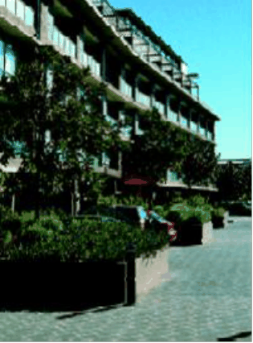
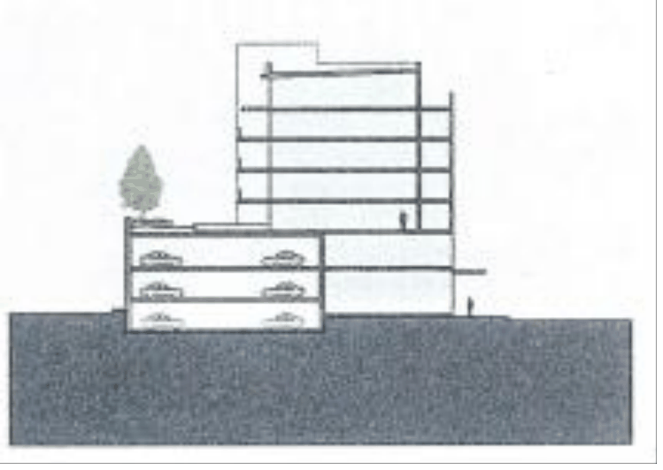
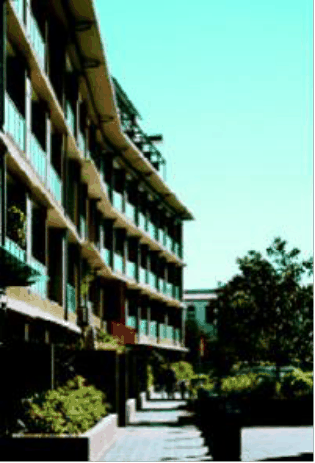
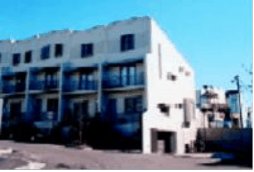
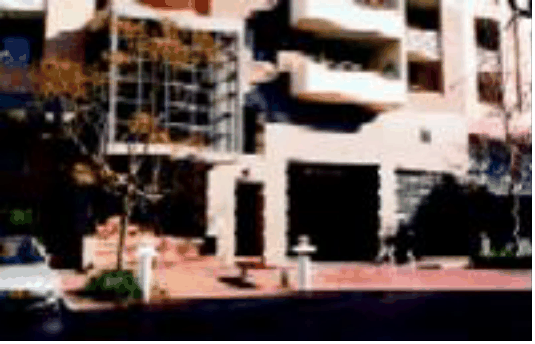
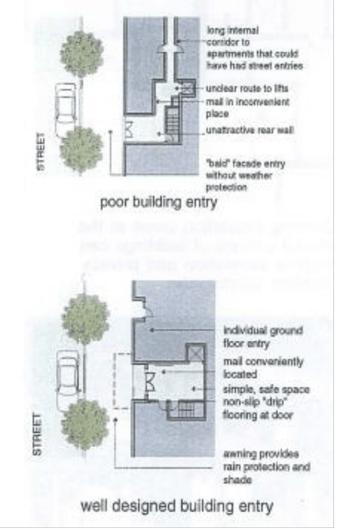
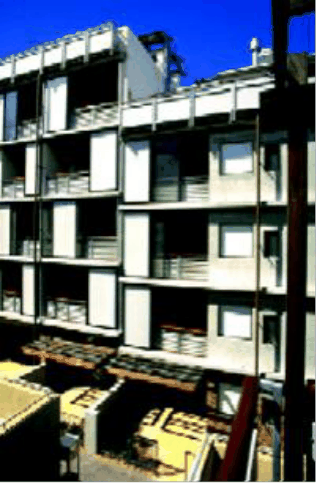
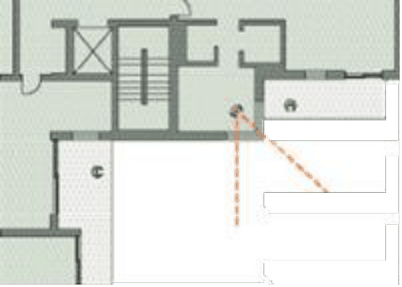

### 4.2. Site Access

#### 4.2.1. Parking

Accommodating parking on site, has a significant impact on the site layout, landscape design, deep soil zones and stormwater management. Parking provision should also be considered in relation to the local context. The location of public transport facilities, services and recreational facilities within walking or cycling distance may reduce the need for parking spaces.

Objectives The objectives for parking are to:

1\. Minimise car dependency for commuting and recreational transport use and to promote alternative means of transport-public transport, bicycling, and walking

2\. P

rovide adequate car parking for the building’s users and visitors

3\. Integrate the location and design of car parking with the design of the site and the building. Figure 54: Where on-grade car parking is necessary, its impact can be reduced by quality paving and landscaping between smaller groups of car spaces.

> [Picture on page 75: a picture, saved as a picture (images/part-d3-maroubra-junction-centre-page-75-23.gif, 150 dpi).]

Source: Randwick City Council

Controls

a) Car parking provision is to be in accordance with Part B7: Transport, Traffic and Parking of the DCP

b) Parking is to be accommodated underground where possible

c) Basement and sub-basement car parking areas are not to be located on the primary street frontage as indicated in the section diagram (figure 55).

d) Basement and sub-basement car parking areas are to have natural ventilation where possible

e) Ventilation grilles or screening devices of car park openings are to be integrated into the overall façade and landscape design of the development

f) Safe and secure access is to be provided for building users, including direct access to residential apartment

g) A logical and efficient structural grid is to be provided. There may be a larger floor area for basement car parking than for upper floors above ground

h) Where above ground enclosed parking cannot be avoided, the car park (including vehicle entries) must be integrated into the overall facade design of the building. The car park must not be located on the street frontage

i) Sub-basement car parking is to be not more than1.2m above existing ground level

j) Podiums above basement or sub basement car parks are to be landscaped as private or communal open space

k) The impact of on-grade car parking is to be minimised by:

a. Locating parking on the side or rear of the lot away from street frontage

b. Screening cars from view of streets and buildings

c. Allowing for safe and direct access to building entry points

d. Incorporating car parking into the landscape design of the site (considerations include: vegetation between parking bays to ameliorate views, selection of paving material and screening from communal and private open space areas).

Figure 55: Locating above-ground car parking to the rear of the site behind commercial and retail uses is a good way of screening it from the main road.

> [Picture on page 76: a picture, saved as a picture (images/part-d3-maroubra-junction-centre-page-76-24.gif, 150 dpi).]

Source: Randwick City Council

#### 4.2.2. Pedestrian access

Design for pedestrians focuses on delivering high quality, safe and pleasant walking environments. It is person-centred rather than vehicle-centred. Pedestrian access should also provide a barrier-free environment where all people who live in and visit the development can enjoy the public domain, and can access apartments and communal use areas.

Objectives The objectives for pedestrian access are to:

1\. Promote development which is well connected to the street and contributes to the accessibility of the public domain

2\. Ensure that residents, including users of strollers and wheelchairs and people with bicycles, can reach and enter their apartment and use communal areas via minimum grade ramps, paths, accessways or lifts.

Controls

a) High quality safe and accessible routes are to be provided to public and semi-public areas of the building and the site, including shopfronts, major entries, lobbies, communal open spaces, site facilities, parking areas, public streets, and internal roads

b) Equity is to be promoted by:

i. Ensuring that the main building entrance for apartments is accessible for all from the street and from car parking areas

ii. Integrating ramps into the overall building and landscape design

c) Ground floor apartments are to be designed to be accessible from the street, where possible

d) The number of accessible and adaptable apartments in a building is to be maximised.

e) Pedestrian accessways and vehicle accessways are to be separate and clearly distinguishable

f) The provision of public through-site pedestrian accessways is to be considered in large development sites

g) Pedestrian access from the street and car parking area to the apartment entrance, are to be clearly identified on the DA plans

h) The accessibility standard set out in Australian Standard AS 1428 (parts 1 and 2), is to be followed as a minimum

i) Barrier-free access is to be provided to and within at least 1 in 15 dwellings in all development.

Figure 56: A safe pedestrian pathway mediates between private building entries and on-grade car parking.

> [Picture on page 77: a picture, saved as a picture (images/part-d3-maroubra-junction-centre-page-77-31.gif, 150 dpi).]

Source: Randwick City Council

#### 4.2.3. Vehicle access

Vehicle access is the ability for cars, maintenance and service vehicles to access a development. The location, type and design of vehicle access points to a development will have significant impacts on the streetscape, the site layout and the building façade design. It is important that vehicle access is integrated with site planning from the earliest stages to balance any potential conflicts with streetscape requirements and traffic patterns and to minimise potential conflicts with pedestrians.

Objectives The objectives for vehicle access are to:

1\. Integrate adequate car parking and servicing access without compromising street character, landscape or pedestrian amenity and safety

2\. Encourage the active use of street frontages.

Controls

a) Vehicular access is not permitted from Anzac Parade or Maroubra Road for new developments. Vehicular access to sites fronting these roads is to be provided from secondary streets or via 6m (minimum) wide rights-of-carriageways running parallel to their rear boundaries, where identified on the block-by-block diagrams

b) Basement carpark access must comply with the requirements of the DCP Part B8: Water Management

c) Potential pedestrian/vehicle conflict is to be minimised by:

i. Limiting the width and number of vehicle access points (whilst complying with the relevant Australian Standards)

ii. Ensuring clear sight lines at pedestrian and vehicle crossings

iii. Utilising traffic calming devices

iv. Separating and clearly distinguishing between pedestrian and vehicular accessways

d) Adequate separation distances are required between vehicular entries and street intersections

e) Active street frontages are to be optimised by consolidating vehicle access within sites under single body corporate ownership

f) The appearance of car parking and service vehicle entries are to be improved by:

i. Screening and locating garbage collection, loading and servicing areas away from the street

ii. Recessing car park entries from the main façade line

iii. Avoiding black holes in the façade by providing security doors to car park entries

iv. where doors are not provided, ensuring that the visible interior of the car park is incorporated into the façade design and material selection and that building services pipes and ducts are concealed

v. continuing the façade material into the car park entry recess for the extent visible from the street

g) The width of driveways is to comply with the relevant Australian Standards.

Figure 57: A safe pedestrian pathway mediates between private building entries and on-grade car parking

> [Picture on page 79: a picture, saved as a picture (images/part-d3-maroubra-junction-centre-page-79-3.gif, 150 dpi).]

Source: Randwick City Council Figure 58: This elevation treats the car park entry as part of the whole elevation. It narrows the width of the entry and defines an opening in proportion to the other facade elements.

> [Picture on page 79: a picture, saved as a picture (images/part-d3-maroubra-junction-centre-page-79-7.gif, 150 dpi).]

Source: Randwick City Council

#### 4.2.4. Building entry

Entrances define the threshold between the public street and private areas within the building. They may lead into a common entry or directly into the private space of an apartment from the street. Building entries provide a public presence and should contribute to the identity of a residential development. Using multiple entries (a main entry plus individual entries to ground floor apartments) helps to create a human scale along the street.

Objectives The objectives for building entries are to:

1\. Create entrances which are clearly identifiable and provide a desirable residential identity for the development

2\. Orient the visitor

3\. Contribute positively to the streetscape and building façade design.

Controls

a) Building entries are to be:

i. Oriented to, and clearly visible from the street

ii. Convenient for pedestrians; and

iii. A clearly identifiable element of the building in the street.

b) Building entries must be designed to provide equal access to all people.

c) Safe and secure access is to be provided by:

i. Avoiding ambiguous spaces in entry areas

ii. Providing a clear line of sight between one circulation space and the next

iii. Providing sheltered, well lit and highly visible spaces for building entry and for the collection of mail

d) Separate entries from the street are to be provided for:

i. Pedestrians and cars

ii. Different uses (for example, for residential and commercial users in a mixed-use development)

iii. Ground floor apartments

e) Entries, lifts and their associated circulation space are to be of an adequate size to allow movement of furniture between public and private spaces.

Figure 59: This diagram illustrates a contrast between undesirable practice (top) and better design practice (bottom) for entry and lobby design.

> [Picture on page 80: a picture, saved as a picture (images/part-d3-maroubra-junction-centre-page-80-19.gif, 150 dpi).]

Source: Randwick City Council

#### 4.2.5. Visual privacy

Visual privacy protects residents’ ability to carry out functions within rooms and private open spaces without compromising views, outlook, ventilation and solar access or the functioning of these spaces. Visual privacy is influenced by topography, site configuration, the scale of the proposed development, apartment layout and the relationship to adjoining development. Privacy is influenced by factors such as:

• The nature of activities in areas

• The times and frequency of use of the spaces

• O ccupants’ ability to control overlooking with screening devices.

Objectives The objectives for visual privacy are to:

1\. Provide reasonable levels of visual privacy externally and internally, during the day and at night

2\. Maximise outlook and views from principal rooms and private open spaces without compromising visual privacy.

Controls

a) New development is to be located and oriented to maximise visual privacy between buildings on site and adjacent buildings by providing adequate:

i. Building separation (refer to Section 3.1.6); and

ii. Rear and site setbacks (refer to Section 3.1.8 and 3.1.9)

b) Building layouts are to be designed such that direct overlooking of rooms and private open spaces is minimised in apartments by:

i. separating communal open space, common areas and access routes from windows of rooms, particularly habitable rooms

ii. changing the level between ground floor apartments (including their associated private open space), and the public domain or communal open space

c) Building and site design are to increase privacy without compromising access to light and air through:

i. Offsetting windows of apartments in new development to windows in adjacent development

ii. Recessing balconies and/or providing vertical fins between adjacent balconies

iii. Using solid or semi-solid balustrades to balconies

iv. Using louvres or screen panels to windows and/or balconies

v. Providing appropriate fencing

vi. Providing landscape screening

vii. Incorporating planter boxes into walls or balustrades to increase the visual separation between areas

viii. Utilising pergolas or shading devices to limit overlooking of lower apartments or private open space.

Figure 60: Building elements provide privacy between spaces: pergolas limit overlooking, solid walls and sliding screens limit horizontal views.

> [Picture on page 82: a picture, saved as a picture (images/part-d3-maroubra-junction-centre-page-82-3.gif, 150 dpi).]

Source: Randwick City Council Figure 61: Locating circulation cores at the internal corners of buildings can improve separation and privacy between apartments.

> [Picture on page 82: a picture, saved as a picture (images/part-d3-maroubra-junction-centre-page-82-7.gif, 150 dpi).]

Source: Randwick City Council

#### 4.2.6. Safety and security

The built environment has an impact on perceptions of safety and security, as well as on the actual opportunities for crime. Development should provide safe ground level entry and exit at all times of day and night, enable casual surveillance, clearly define public and private ownership, and control access to the building.

Objectives The objectives for safety and security are to:

1\. Ensure that residential flat developments are safe and secure for residents and visitors

2\. Contribute to the safety of the public domain

Controls

a) The development boundary should clearly define public and private space through one or more of the following:

i. A level change at the site and/or building threshold

ii. Signs

iii. Entry awnings

iv. Fences, walls and gates

v. Change of material in paving between the street and the development

b) Casual surveillance opportunities should be provided by:

i. Orienting living areas with views over public or communal open spaces

ii. Providing clear lines of sight between building entrances, foyers and the street

iii. Using bay windows and balconies, which protrude beyond the building line and enable a wider angle of vision to the street

iv. Using corner windows, which provide oblique views of the street

v. Providing casual views of common internal areas, such as lobbies and foyers, hallways, recreation areas and car parks

c) Opportunities for concealment are to be minimised by:

i. Avoiding blind or dark alcoves near lifts and stairwells, at the entrance and within indoor car parks, along corridors and walkways

ii. Providing well-lit routes throughout the development

iii. Providing appropriate levels of illumination for all common areas

iv. Providing graded illumination to car parks and illuminating entrances higher than the minimum acceptable standard

d) Access to the development is to be controlled by:

i. Making apartments inaccessible from the balconies, roofs and windows of neighbouring buildings

ii. Separating the residential car parking component from any other building use

iii. Providing direct access from car parks to apartment lobbies for residents

iv. Providing separate access for residents in mixed use buildings

v. Controlling car park access from public and common areas

e) A formal crime risk assessment, consistent with the Crime Prevention and the Assessment of DAs guidelines, is to be carried out for all residential developments of 20 or more new dwellings.
