### 4.3. Building configuration

#### 4.3.1. Apartment layout

The internal layout of an apartment establishes the uses of rooms, circulation between rooms, and the degrees of privacy for each room. In addition, the layout directly influences the quality of residential amenity, such as access to daylight and natural ventilation, and the assurance of acoustic and visual privacy. The apartment layout also includes private open space.

Objectives The objectives for apartment layout are to:

1\. Ensure that apartment layouts are efficient and provide high standards of residential amenity

2\. Maximise the environmental performance of apartments.

Controls

a) The following minimum sizes (internal area) of apartments are to be complied with:

| Apartment size | Minimum area |
|---|---|
| Studio apartment | 40m2 |
| 1 Bedroom apartment | 50m2 |
| 2 Bedroom apartment | 80m2 |
| 3 Bedroom apartment | 125m2 |

Note For each additional bedroom above 3 bedrooms, an addition 20m2 is required.

b) Single-aspect apartments are to have a maximum depth of 8 metres

c) The back of a kitchen should be no more than eight metres from a window

d) The width of cross-over or cross-through apartments over 15 metres deep is to be 4 metres or greater to avoid deep narrow apartment layouts

e) Apartment layouts must be designed to:

i. Provide appropriate room size for their use

ii. Accommodate a variety of furniture arrangements

iii. Provide for a range of activities and privacy levels between different spaces within the apartment

iv. Incorporate flexible room sizes and proportions or open plans

v. Provide adequate window locations and sizes appropriate for their use

vi. Ensure circulation by stairs, corridors and through rooms is planned as efficiently as possible thereby increasing the amount of floor space in rooms

f) Apartment layouts are to be designed to respond to the natural environment and optimise site opportunities by:

i. Locating the primary private open space (e.g. balcony, terrace, courtyard or garden) adjacent to the main living area

ii. Orienting main living spaces toward the primary outlook and aspect and away from neighbouring noise sources or windows

iii. Locating habitable rooms, and where possible kitchens and bathrooms, on the external face of the buildings thereby maximising the number of rooms with windows

iv. Maximising opportunities to facilitate natural ventilation and to maximise natural daylight, for example by providing:

- Corner apartments

- Cross-over or cross-through apartments

- Split-level or maisonette apartments

- Shallow, single-aspect apartments.

Figure 62: Examples of different apartment configurations

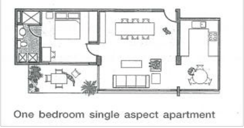

> [Picture on page 85: a picture, saved as a picture (images/part-d3-maroubra-junction-centre-page-85-2.gif, 150 dpi).]

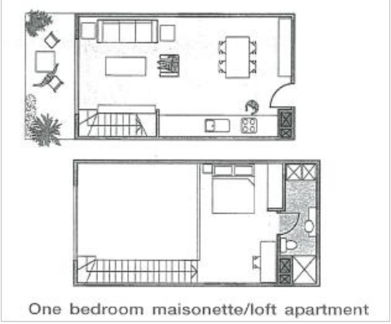

> [Picture on page 85: a picture, saved as a picture (images/part-d3-maroubra-junction-centre-page-85-3.gif, 150 dpi).]

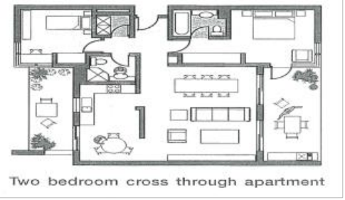

> [Picture on page 85: a picture, saved as a picture (images/part-d3-maroubra-junction-centre-page-85-4.gif, 150 dpi).]

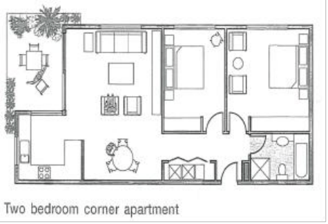

> [Picture on page 85: a picture, saved as a picture (images/part-d3-maroubra-junction-centre-page-85-5.gif, 150 dpi).]

Source: Randwick City Council

Note Apartment configuration is to be designed in response to the attributes of the site identified in the site analysis diagram (such as orientation, winds, relationship to adjoining development).

#### 4.3.2. Apartment mix

A mix of apartment types provides housing choice and supports equitable housing access. By accommodating a range of household types, a mix of apartments can ensure apartment buildings support the needs of society now and in the future. This is particularly important because apartment buildings form a significant and often permanent part of the urban environment.

Objectives The objectives for a mix of apartment types are to:

1\. Provide a diversity of apartment types, which cater for different household requirements now and in the future

2\. Maintain equitable access to new housing by cultural and socio-economic groups.

Controls

a) A mix of studio, one, two, and three or more bedroom apartments is to be provided

b) The number of accessible and adaptable apartments is to be optimised to cater for a wider range of occupants

c) The possibility of flexible apartment configurations is to be investigated, which supports change in the future.

Figure 63: Balconies allow for privacy while at the same time giving a view and surveillance over the street they face

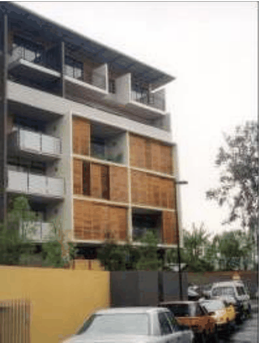

> [Picture on page 86: a picture, saved as a picture (images/part-d3-maroubra-junction-centre-page-86-23.gif, 150 dpi).]

Source: Randwick City Council

#### 4.3.3. Balconies

Balconies are outdoor rooms, which enhance the amenity and lifestyle choices of apartment residents. They provide private open space, extend the living spaces of the apartment and capitalise on the temperate climate. Balconies are also important architectural elements, contributing to the form and articulation of apartment buildings.

Objectives The objectives for balconies are to:

1\. Provide all apartments with private open space

2\. Ensure balconies are functional, responsive to the environment, and promote outdoor living for apartment residents

3\. Ensure that balconies are integrated into the overall architectural form and detail of residential flat buildings

4\. Contribute to the safety and liveliness of the street by allowing for casual overlooking and address.

Controls

a) Each apartment is to have at least one primary balcony

b) Primary balconies are to have a minimum depth of 2.5 metres

c) The minimum area of primary balconies is to be as follows:

| Apartment size | Minimum area |
|---|---|
| Studio and 1 bedroom | 6m2 |
| 2 and 3 bedrooms | 10m2 |
| 4 or more bedrooms | 15m2 |

d) Primary balconies are to be:

i. Located adjacent to the main living areas (such as living room, dining room, kitchen) to extend the living space; and

ii. Sufficiently large and well-proportioned to be functional and promote indoor/ outdoor living (a dining table and two to four chairs should fit on the majority of balconies in any development. Consideration should be given to supplying a tap and gas point)

e) Additional amenity and choice is to be provided in the following situations, via secondary balconies (including Juliet balconies or operable walls with balustrades):

i. In larger apartments

ii. Adjacent to bedrooms

f) Balconies are to be detailed and designed in response to the local climate and site context. This may be achieved by:

i. Locating balconies facing predominantly north, east or west to provide solar access

ii. Utilising sun screens, pergolas, shutters and operable walls to control sunlight and wind

iii. Providing balconies with moveable screens, Juliet balconies or sliding doors with a balustrade in locations where noise or high winds prohibit other solutions (such as on busy roads or in tower buildings)

iv. The use of cantilevered, partially cantilevered and/or recessed balconies in response to daylight, wind, acoustic privacy and visual privacy

v. Ensuring that balconies do not prevent sunlight entering apartments adjacent or below

g) Balustrades are to be designed to allow views and casual surveillance of the street while providing for safety and visual privacy. Design considerations may include: detailing balustrades using a proportion of solid to transparent materials to address privacy, sight lines from the street, public domain or adjacent development (note: full glass balustrades do not provide privacy for the balcony or apartment interior, especially at night and are to be avoided).

Figure 64: The detailed design of these partially solid balustrades, sun shades and privacy screens contribute to the overall facade composition of the building

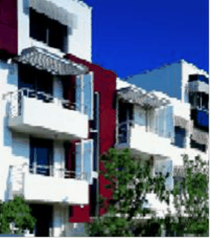

> [Picture on page 88: a picture, saved as a picture (images/part-d3-maroubra-junction-centre-page-88-9.gif, 150 dpi).]

Source: Randwick City Council Figure 65: Variation in height of different floors adds to the articulation/ visual quality of the building

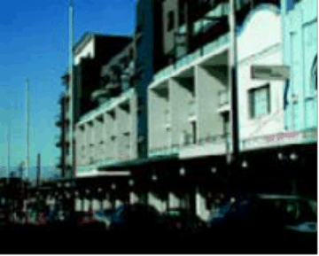

> [Picture on page 88: a picture, saved as a picture (images/part-d3-maroubra-junction-centre-page-88-13.gif, 150 dpi).]

Source: Randwick City Council

#### 4.3.4. Ceiling heights

Ceiling heights are measured from finished floor to finished ceiling level. Well designed and appropriately defined ceilings ensure quality residential amenity and create spatial interest.

Objectives The objectives for ceiling heights are to:

1\. Increase the sense of space in apartments and provide well proportioned rooms

2\. Promote the penetration of daylight into the depths of the apartment

3\. Contribute to flexibility of use

4\. Achieve quality interior spaces while considering the external building form requirements.

Controls

i) All development must comply with the following minimum floor to ceiling levels:

| Floor | Minimum ceiling height |
|---|---|
| Ground | 3.6m |
| First floor | 3.3m* |
| All floors above first floor | 2.7m |

\* To allow flexibility for this level to be commercial/retail or residential

ii) Ceilings are to:

a. Enable better proportioned rooms (for example, smaller rooms often feel larger and more spacious when ceilings are higher)

b. Maximise heights in habitable rooms by stacking wet areas from floor to floor (ensuring that services and their bulkheads are located above bathroom and storage areas rather than habitable spaces)

c. Reduce reliance on air conditioning by promoting the use of ceiling fans for cooling and heating distribution

iii) Better access to natural light is to be facilitated by using ceiling heights which

a. Promote the use of taller windows, highlight windows and fan lights (this is particularly important for apartments with limited light access, such as ground floor units and apartments with deep floor plans)

b. Enhance the effectiveness of light shelves in providing daylight into deep interiors

iv) Ceiling heights are to be designed to promote building flexibility over time for a range of other uses, including retail or commercial, where appropriate

v) Double height spaces with mezzanines are to be counted as two storeys. Figure 66: The double height spatially unifies two floor levels, creating a pleasant well-lit living area

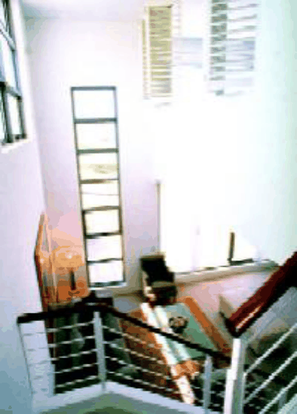

> [Picture on page 89: a picture, saved as a picture (images/part-d3-maroubra-junction-centre-page-89-23.gif, 150 dpi).]

Source: Randwick City Council

#### 4.3.5. Corner Buildings

Buildings on the corner of two streets/roads are identified as ‘corner buildings’. Corner buildings are highly visible because of their location, with address and visibility from two streets.

Objective The objective for corner buildings is to:

1\. Ensure that corner buildings, are well designed and respond to the different characteristics of the streets they address.

Controls

a) Buildings are to align and reflect the corner conditions. This is to:

i. Accentuate the topography

ii. Clarify the street hierarchy; and

iii. Reinforce the spatial relationships

b) Corner buildings are to reflect the architecture, hierarchy and characteristics of the streets they address.

Figure 67: This corner building owing to its alignment to both streets, helps pedestrians to place themselves relative to the two roads it addresses

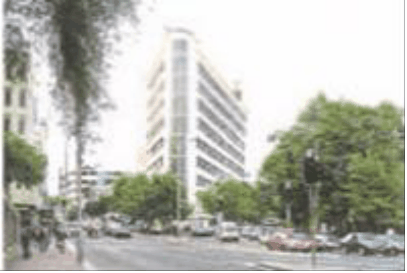

> [Picture on page 90: a picture, saved as a picture (images/part-d3-maroubra-junction-centre-page-90-17.gif, 150 dpi).]

Source: Randwick City Council

#### 4.3.6. Flexibility

Flexible apartment design ensures that buildings can accommodate a wider range of inhabitants and their changing lifestyle needs, such as:

• Changes in household structure (single, couple, family, extended family)

• Home/office arrangements

• Changing mobility and access needs, including those of the elderly or young children in prams; and

• Future changes in use such as a change from residential floors to commercial office space.

Objectives The objectives for flexibility are to:

1\. Encourage housing designs which meet a broad range of needs

2\. Promote buildings which can be adapted to accommodate whole or partial changes of use over time

3\. Encourage adaptive re-use

4\. Save the embodied energy expended in building demolition.

Controls

a) Building configurations are to utilise multiple entries and circulation cores, especially in larger buildings over 15 metres in length

b) Buildings are to be designed to accommodate future change in building use or configuration by incorporating:

i. Slim building cross sections (suitable for both residential and commercial uses a mix of apartment types

ii. Separate entries for the ground floor level and the upper levels

iii. Aligning structural walls, columns and services cores throughout the building

iv. Knock-out panels between apartments to allow two adjacent apartments to be amalgamated; and

v. Minimising internal structural walls.

c) Apartment layouts are to be designed to accommodate flexibility in room use through:

i. Adequate room sizes or open-plan apartments, which provide a variety of furniture layout opportunities

ii. Dual master-bedroom apartments, which can support two independent adults living together or a live/work situation

iii. Incorporate flexible room sizes.

d) A minimum of 10% of all ground floor apartments are to comply with AS4299-1995 Adaptable House Class A

e) A minimum of 10% of all ground floor apartments are to comply with AS4299-1995 Adaptable House Class C

f) All commercial/retail components of mixed use buildings are to comply with Australian Standards AS1428-2001.

Figure 68: The layout on the ground floor of this 2-storey apartment facilitates a variety of uses: small business, third bedroom, shared housing for independent adults and housing for an elderly parent

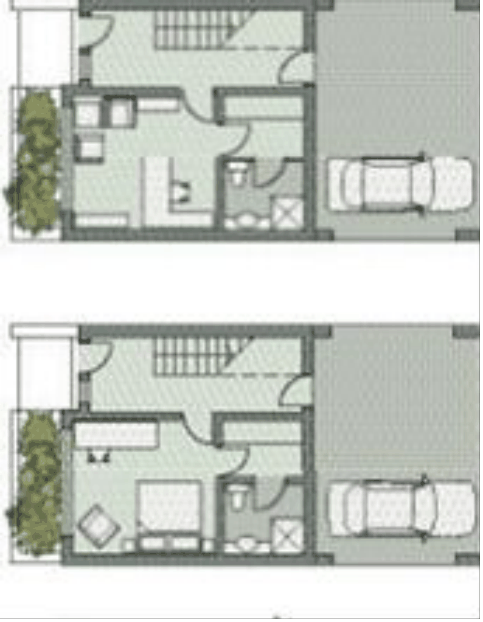

> [Picture on page 91: a picture, saved as a picture (images/part-d3-maroubra-junction-centre-page-91-28.gif, 150 dpi).]

Source: Randwick City Council

#### 4.3.7. Ground floor apartments

Ground floor apartments offer the potential for direct access from the street and private open space areas. They provide opportunities for the apartment building and its landscaping to create a pedestrian scale at street level. Ground floor apartments that address the street with individual entries increase pedestrian activity and street surveillance. Ground floor apartments also support housing choice by providing access for elderly and/or disabled people, and are suitable for families with small children. Ground floor apartments extend the lifestyle choices available in apartment buildings by facilitating activities, such as gardening, play and pet ownership.

Objectives The objectives for ground floor apartments are to:

1\. Contribute to the desired streetscape of an area and to create active safe streets

2\. Increase the housing and lifestyle choices available in apartment buildings.

Controls

a) Housing choice is to be promoted by:

i. Maximising the number of accessible apartments on the ground floor

ii. Designing ground floor apartments to accommodate a change of use, such as a corner shop or home office accessible from the street

b) Where no front setback is required, privacy and safety of ground floor units is to be ensured by

i. Stepping up the ground floor from the level of the footpath (to a maximum of 1.2 metres)

ii. Designing balustrades and window sill heights to minimise sight lines into apartments

iii. Ensuring safety bars or screens are integrated into the overall building design and detailing

c) Solar access to ground floor units is to be increased by:

i. Providing higher ceilings and taller windows; and

ii. Use of deciduous trees and shrubs which allow solar access in winter and shade in summer.

d) Ground floor apartments are to have direct access to private open space, preferably a terrace or garden, which should contribute to the character of the street while maintaining adequate privacy for apartment occupants.

Figure 69: The use of multiple lift/stair cores creates more entries on the street and helps articulate a long building facade

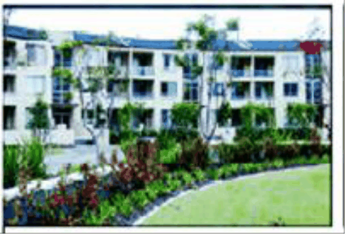

> [Picture on page 92: a picture, saved as a picture (images/part-d3-maroubra-junction-centre-page-92-35.gif, 150 dpi).]

Source: Randwick City Council

Figure 70: Street level picket fencing with planting provides screening to car park ventilation louvres

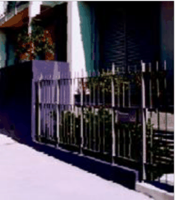

> [Picture on page 93: a picture, saved as a picture (images/part-d3-maroubra-junction-centre-page-93-3.gif, 150 dpi).]

Source: Randwick City Council

#### 4.3.8. Home offices

A home office is a small work place forming part of a dwelling, with no traffic or parking implications, and no interference with the amenity of the neighbourhood.

Objectives The objectives for home offices are to:

1\. Promote economic growth and diversity within the centre

2\. Promote transport initiatives by reducing travel time and cost, creating a cleaner environment

3\. Promote an active and safe neighbourhood, and casual surveillance of the street

4\. Improve personal and property security

5\. Promote a diverse workforce in terms of age and mobility.

Controls

a) Home offices are to have no traffic or parking implications on the neighbourhood/street

b) Home offices are to minimise conflict with domestic activities

c) Home offices are to have the flexibility of being able to convert to become part of the residence

d) Home offices are to have a clearly identifiable area, ideally designed to be able to be closed-off from the rest of the dwelling for purposes of safety, security and privacy

e) The work activity is not to interfere with the amenity of the neighbourhood by reason of emission of noise, vibration, odour, fumes, smoke, vapour, steam, soot, ash, dust, waste, water, waste products, grit, oil, or otherwise

f) Home offices are to have:

i. Adequate storage areas

ii. A mailbox suitable for business mail

iii. Any special utility services needed (e.g. separate power metering)

g) Home offices are not to display any goods in a window

h) Home offices are not to exhibit any notice, advertisement or sign, other than a notice, sign or advertisement exhibited on the dwelling house or dwelling to indicate the name and occupation only of the resident

#### 4.3.9. Internal circulation

Lobbies, stairs, lifts and corridors make up the common circulation spaces within a building. Important design considerations include safety, amenity and choice of materials for durability and low maintenance.

Objectives The objectives for internal circulation are to:

1\. Create safe and pleasant spaces for the circulation of people and their personal possessions

2\. Facilitate quality apartment layouts, such as dual aspect apartments

3\. Contribute positively to the form and articulation of the building façade and its relationship to the urban environment

4\. Encourage interaction and recognition between residents to contribute to a sense of community and improve perceptions of safety.

Controls

a) Optimise safety and security by grouping apartments to a maximum of ten (10) around a common lobby. Council may consider a variation in the maximum number of apartments per floor where the Applicant can demonstrate that a high level of amenity of the common lobby, corridors and apartments is achieved (for example through light wells)

b) Where apartments are arranged off a double-loaded corridor, the number of units accessible from a single core/corridor is to be limited to eight

c) Amenity and safety in circulation spaces is to be increased by:

i. Providing generous corridor widths and ceiling heights, particularly in lobbies, outside lifts and apartment entry doors

ii. Providing appropriate levels of lighting, including the use of natural daylight, where possible

iii. Minimising corridor lengths to give short, clear sight lines

iv. Avoiding tight corners

v. Providing adequate ventilation

d) Building layouts are to utilise multiple cores to

i. Increase the number of entries along a street

ii. Increase the number of vertical circulation points

iii. Give more articulation to the façade

iv. Limit the number of units off a circulation core on a single level

e) Longer corridors are to be articulated by

i. Changing the direction or width of a corridor

ii. Utilising a series of foyer areas

iii. Providing windows along or at the end of a corridor

f) Durable, low maintenance materials are to be used in common circulation areas. Details of proposed materials are to be provided on DA plans and in the Statement of Environmental Effects.

Figure 71: Conventional practice locates single aspect units along a double loaded corridor

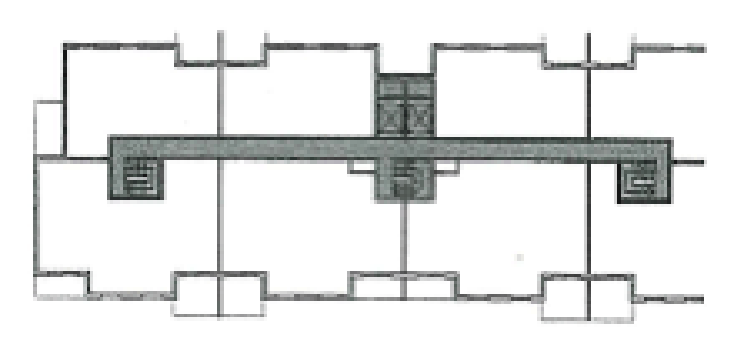

> [Picture on page 95: a picture, saved as a picture (images/part-d3-maroubra-junction-centre-page-95-3.gif, 150 dpi).]

Source: Randwick City Council Figure 72: Better practice uses multiple cores to support more dual aspect apartments with better daylight access and cross-ventilation

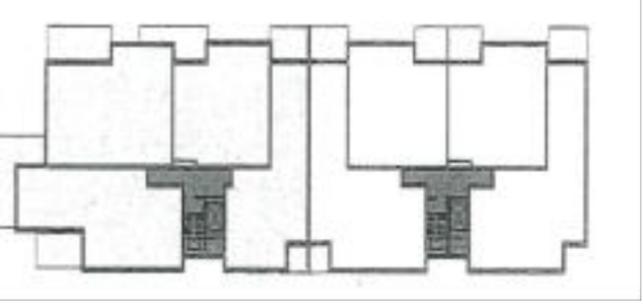

> [Picture on page 95: a picture, saved as a picture (images/part-d3-maroubra-junction-centre-page-95-7.gif, 150 dpi).]

Source: Randwick City Council

#### 4.3.10. Storage

Providing adequate and useable storage space is particularly important in residential developments where dwelling size and configuration is constrained. Storage is calculated on an individual apartment basis, proportional to the size of the apartment.

Objectives The objectives for storage are to:

1\. Provide adequate storage for everyday household items within easy access of the apartment

2\. Provide storage for sporting, leisure, fitness and hobby equipment.

Controls

a) Storage is to be located conveniently for apartments

b) At least 50% of the required storage within each apartment is to be accessible from either the hall or living area. Storage within apartments is best provided as cupboards accessible from entries and hallways and/or from under internal stairs

c) Dedicated storage rooms may be provided on each floor within the development, which can be leased by residents as required

d) Storage can be provided in dedicated and/or leasable storage in internal or basement car parks. Where this is provided, it must be contained in fire-safe compartments and must comply with fire regulations

e) Storage is to be provided to accommodate larger items such as surfing and skiing equipment, bicycles, etc

f) Storage which is provided separate from the apartments is to be safe and secure for individual use

g) Where basement storage is provided, it must not compromise natural ventilation in car parks

h) Additional storage may be provided in smaller apartments in the form of built-in cupboards to promote a more efficient use of small spaces. Details are to be shown on DA plans

i) In addition to kitchen cupboards and bedroom wardrobes, accessible storage facilities are to be provided at the following rates as a minimum requirement:

| Apartment size | Accessible storage |
|---|---|
| Studio apartments | 6m3 |
| One bedroom apartments | 8m3 |
| Two bedroom apartments | 10m3 |
| Three plus bedroom apartments | 12m3 |

Note The above minimum storage areas shall be excluded from apartment size calculations.

j) Storage spaces are to have a minimum height of 1.5m.
