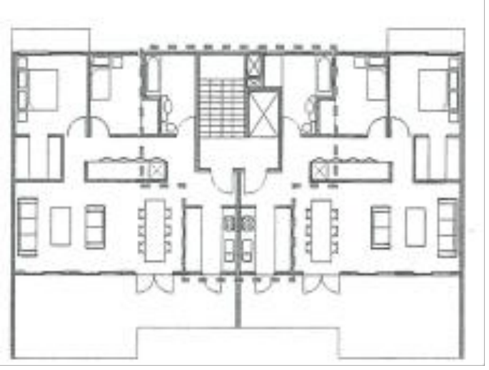
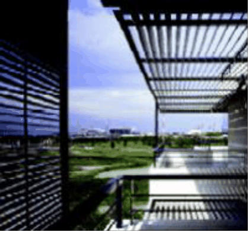
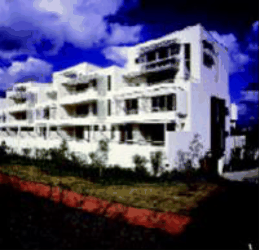
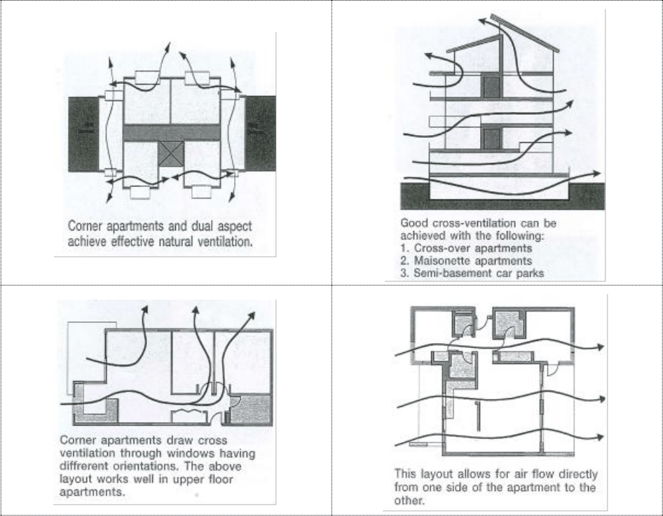

### 4.4. Amenity

#### 4.4.1. Acoustic privacy

Acoustic privacy is a measure of sound insulation between apartments and between external and internal spaces. Acoustic privacy is important for the amenity of apartments in multi-unit housing and mixed-use developments. Designing for acoustic privacy relates to the location and separation of buildings and the arrangement of apartments and internal spaces within apartments.

Objective The objective for acoustic privacy is to:

1\. Ensure a high level of amenity by protecting the privacy of occupants of residential flat buildings, both within the apartments and in private open spaces

Controls

a) All residential buildings are to be constructed so as to achieve the following internal acoustic amenity criteria, when tested in accordance with Australian Standard AS2107- 2000

i. In naturally ventilated residential units; the repeatable maximum LAeq (1hour) should not exceed:

- 35 dB(A) between 10.00 pm and 7.00 am in sleeping areas when the windows are closed

- 45 dB(A) in sleeping areas when windows are open (24 hours)

- 5 dB(A) in living areas (24 hours) when the windows are closed, and

- 55 dB(A) in living areas (24 hours) when the windows are open

b) Where natural ventilation cannot be achieved, in residential units provided with mechanical ventilation, air conditioning or other complying means of ventilation (in accordance with the ventilation requirements of the Building Code of Australia), when doors and windows are shut, the repeatable maximum LAeq (1hour) should not exceed:

i. 38 dB(A) between 10.00 pm and 7.00 am in sleeping areas

ii. 46 dB(A) in living areas (24 hours)

iii. 45 dB(A) in sleeping areas between 7.00 am and 10.00 pm

c) A noise and vibration assessment report, prepared by an appropriately qualified professional, is to be submitted with DAs, addressing appropriate measures to minimise potential noise and vibration impacts for any proposed development

d) This assessment is to:

i. B

e prepared having regard to the NSW Environmental Protection Authority’s Industrial Noise Policy, Chapter 174 of the NSW Environmental Protection Authority’s Noise Control Manual and relevant Australian Standards

ii. Incorporate external noise sources (such as traffic, plant & equipment) and internal noise sources (such as mechanical ventilation)

iii. Specify if the findings and recommendations can be achieved and detail the measures needed to achieve the required acoustic environment

e) The site and building layout are to maximise acoustic privacy by providing adequate building separation within the development and from neighbouring buildings (refer to Section 3.1.6: Building Separation)

f) Developments are to be designed to minimise noise transition between apartments by:

i. Locating busy, noisy areas next to each other and quieter areas next to other quiet areas, for example, living rooms next to living rooms, bedrooms with bedrooms

ii. Locating bedrooms away from busy roads and other noise sources

iii. Using storage or circulation zones within the apartment to buffer noise from adjacent apartments, mechanical services or corridors and lobby areas

iv. Minimising the amount of party (shared) walls with other apartments

g) Noise transmission is to be reduced from common corridors or outside the building by providing seals at entry doors

h) Conflicts between noise, outlook and views are to be resolved using design measures such as double glazing and operable screening

i) Comply with BCA requirements for acoustic control of airborne noise and impact of noise between apartments.

Figure 73: This apartment layout locates living spaces away from noise sources such as the lift and stairs. Quiet bedrooms are also located separate from main living areas

> [Picture on page 98: a picture, saved as a picture (images/part-d3-maroubra-junction-centre-page-98-3.gif, 150 dpi).]

Source: Randwick City Council

#### 4.4.2. Daylight access

Daylight access refers to natural light as well as direct sunlight. It changes with the time of day, season, and weather conditions. Within an apartment, access to natural light reduces reliance on artificial light, improving energy efficiency and residential amenity.

Objectives The objectives for daylight access are to:

1\. Ensure that daylight access is provided to all habitable rooms and encouraged in all other areas of residential flat development

2\. Provide adequate ambient lighting and minimise the need for artificial lighting during daylight hours

3\. Provide residents with the ability to adjust the quantity of daylight to suit their needs.

Controls

a) The building configuration is to optimise northern aspect to new residential apartments where possible

b) Communal open spaces are to receive sunlight between March and September and appropriate shading is to be provided in summer

c) Habitable rooms and private open spaces are to be designed to maximise daylight access, particularly in winter

d) Living rooms and private open spaces for at least 70 percent of apartments in a development are to receive a minimum of three hours direct sunlight between 9 am and 3 pm in mid-winter, unless existing overshadowing prevents this

e) Skylights, clerestory windows and fanlights are to be used to supplement daylight access

f) Where daylight access is limited (e.g. due to orientation or adjoining development), two-storey and mezzanine apartments are encouraged to facilitate daylight access to living rooms and private open spaces

g) The depth of single aspect apartments is to be limited to 8 metres

h) Living areas are to be located on the northern side, and service areas located on the southern and western sides of the development, as much as possible

i) Single storey-single aspect apartments are to have a northerly or north-easterly aspect

j) The number of south-facing apartments is to be kept to a minimum. Single aspect apartments are not to be oriented to Anzac Parade or Maroubra Road

k) Buildings are to be designed for shading and glare control, particularly in summer, by

a. Using shading devices, such as eaves, awnings, colonnades, balconies, pergolas, external louvres and planting, particularly for north and western facing windows

b. Using high performance glass (note: the use of reflective glass is not permitted)

l) Lightwells should not be used as a primary source of daylight to habitable rooms

m) Submit shadow diagrams in elevation and plan form prepared by a suitably qualified professional with each DA. Refer to Council’s DA guide for details

Figure 74: A combination of louvres provides shading for different times of the day.

> [Picture on page 99: a picture, saved as a picture (images/part-d3-maroubra-junction-centre-page-99-19.gif, 150 dpi).]

Source: Randwick City Council Figure 75: Sun shading is an integral component of the building form and facade design.

> [Picture on page 99: a picture, saved as a picture (images/part-d3-maroubra-junction-centre-page-99-22.gif, 150 dpi).]

Source: Randwick City Council

#### 4.4.3. Natural ventilation

Natural ventilation is the circulation of sufficient volumes of fresh air through an apartment to create a comfortable indoor environment. Designing for natural ventilation exercises sustainable practice by responding to the local climate and by reducing or eliminating the need for mechanical ventilation. The building envelopes and bock-by-block controls have been designed to encourage effective natural ventilation. Building orientation, apartment layout and external building facades are key elements in achieving optimal natural ventilation.

Objectives The objectives for natural ventilation are to:

1\. Ensure that apartments are designed to provide all habitable rooms with direct access to fresh air and to assist in promoting thermal comfort for occupants

2\. Provide natural ventilation in non-habitable rooms, where possible

3\. Reduce energy consumption by minimising the use of mechanical ventilation, particularly air conditioning.

Controls

a) Ensure that all apartments are single loaded or dual aspect, to allow the direct flow of air from one side of the apartment to the other

b) Development is to utilise natural breezes by

i. Determining prevailing breezes and orienting buildings to maximise use, where possible

ii. Locating vegetation to direct breezes and cool air as it flows across the site; and

iii. Selecting planting or trees that do not inhibit airflow

c) Building layout is to maximise the potential for natural ventilation through

i. Dual aspect apartments (e.g. cross through apartments and corner apartments), which allow cross ventilation

ii. Apartment design which draws cool air in at lower levels and allow warm air to escape at higher levels (e.g. maisonette apartments and two-storey apartments)

d) The internal layout of apartments is to be designed to promote natural ventilation by:

i. Minimising interruptions (such as corners and walls) to air flow through an apartment

ii. Grouping rooms with similar usage together, for example, keeping living spaces together and sleeping spaces together (allowing the apartment to be compartmentalised for efficient summer cooling or winter heating)

e) Doors and operable windows are to maximise natural ventilation by:

i. Locating small windows on the windward side and larger windows on the leeward side of the building (utilising air pressure to draw air through the apartment)

ii. Using higher level casement or sash windows, clerestory windows or operable fanlight windows (including above internal doors) to facilitate convective currents. This is particularly important in apartments with only one aspect; and

iii. Selecting windows which can be reconfigured to funnel breezes into the apartment, such as vertical louvred and casement windows.

f) Innovative technologies to naturally ventilate internal building areas or rooms such as bathrooms, laundries and underground car parks (e.g. using stack-effect ventilation or solar chimneys), are to be explored

g) Council may consider some double-loaded apartments only if specific site conditions create design difficulties and the applicant can provide appropriate verification/evidence

(from suitably qualified professional) that innovative technologies will be employed to achieve natural ventilation.

Figure 76: Natural ventilation

> [Picture on page 101: a picture, saved as a picture (images/part-d3-maroubra-junction-centre-page-101-4.gif, 150 dpi).]

Source: Randwick City Council
