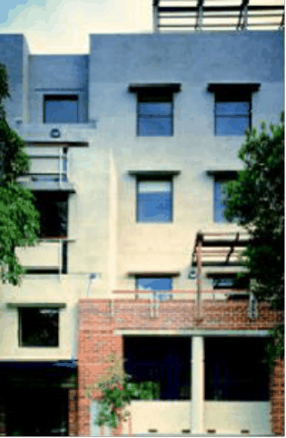
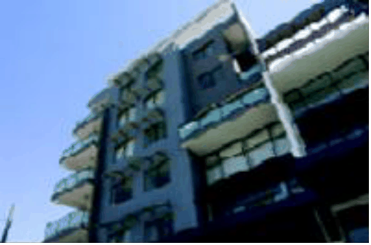
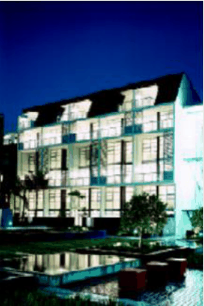

### 4.5. Building form

#### 4.5.1. Awnings and signs

Awnings increase the amenity of public footpaths and protect pedestrians from sun and rain. They encourage pedestrian activity along streets and are an important part of the streetscape and building facade. Signs are an important consideration in the design of buildings located in mixed-use areas. Signs should be compatible with the desired streetscape character, building scale and proportions, without obscuring or dominating important views. Signs should be considered at the design stage of the building.

Objectives The objectives for awnings and signs are to:

1\. Provide shelter for public streets

2\. Ensure signs are in keeping with desired streetscape character and with development scale, detail and overall design.

Controls Awnings

a) Awnings are to:

i. Complement the height, depth and form of the desired character or existing pattern of awnings, and

ii. Provide sufficient protection from sun and rain.

b) Awning dimensions for buildings fronting main roads and major side streets are to provide:

i. a minimum width of 3m

ii. a minimum soffit height of 3.5m and no higher than 4.2m above the footpath

iii. a minimum 1 metre setback from the kerb

iv. Awnings are generally to extend no more than two thirds across the public footpath, to permit street trees and verge planter beds access to sunlight and direct rainfall

–

refer to Council’s Street Garden Guidelines

c) Continuous awnings are to be provided in busy pedestrian areas

d) Awnings are to be located over building entries and should help identify the entry point

e) Pedestrian safety is to be enhanced by providing under-awning lighting Signs

f) Signs are to be integrated with the design of the development by responding to scale, proportions and architectural detailing

g) Location and space for future signs is to be detailed on DA plans and elevations.

h) Signs are to provide clear direction for residents and visitors

i) Signs on blinds are not permitted

j) All signs are to comply with State Environmental Planning Policy (Industry and Infrastructure) 2021 and Part B12 – Advertising and Signage in the Randwick DCP.

#### 4.5.2. Facades and articulation

Facades are the public face of buildings. Their architectural quality contributes to the character and design of the public domain. The composition and detailing of the building façade has an impact on its apparent scale as well as its appearance. The proportions of the façade, the placement and size of windows, the articulation and detailing of external walls, and materials used are all important considerations.

Objectives The objectives for facades and articulation are to:

1\. Promote high architectural quality in buildings

2\. Ensure that new developments define and enhance the public domain and desired street character

3\. Ensure that building elements are integrated into the overall building form and façade design.

Controls

a) A satisfactory relationship between the building form and the façade, including building elements, is to be established

b) Facades are to have an appropriate scale and proportion, which respond to building use and desired character by:

i. Defining a base, middle and top related to the overall proportion of the building

ii. Emphasising the vertical elements

iii. Using cornices, a change in materials or building setback to articulate the façade

iv. Expressing the variation in floor to floor height, particularly at the lower levels

v. Articulating building entries with awnings, porticos, recesses, blade walls and projecting bays

vi. Use of balcony types which respond to the street context, building orientation and residential amenity and to add visual depth to the façade

vii. Using a variety of window types to differentiate building uses

viii. Incorporating architectural features which give human scale to the design of the building at street level (such as porches, awnings, colonnades, pergolas and fences)

c) The use of face brickwork and or stone is encouraged for medium to large buildings (up to 9 stories). Rendered masonry is also supported to a limited extent, to complement face brickwork materials palette. This is due to brickwork and stonework’s capacity to contribute scale, detail, texture and a rich colouring to the building facade – a limited and well considered palette is encouraged

d) For residential and commercial buildings, the extensive use of fixed panel grills, perforated metal, louvres, expanded mesh and the like, as the primary facade finish/material are to be avoided

e) Box-like or monolithic forms, that present as large unarticulated cubes, are not supported, as they are institutional or industrial in character, and therefore unsuited to town centre or residential areas

f) Important corners are to be expressed by giving visual prominence to parts of the façade (e.g. a change in building articulation, material or colour, roof expression or increased height)

g) Building services such as drainage pipes are to be coordinated and integrated, with the overall façade and balcony design

h) Security grilles/screens, ventilation louvres and car park entry doors are to be coordinated with the overall façade design

i) Grilles and transparent security shutters are to have a minimum of 70% transparency. Solid shutters, screens or grilles are not permitted.

Figure 77: Rectilinear elements, clearly defined volumes and a change of materials create visual interest on this building facade

> [Picture on page 103: a picture, saved as a picture (images/part-d3-maroubra-junction-centre-page-103-33.gif, 150 dpi).]

Source: Randwick City Council

Figure 78: The use of varying alignments on the facade and sunscreens has articulated the taller mass of this building

> [Picture on page 104: a picture, saved as a picture (images/part-d3-maroubra-junction-centre-page-104-3.gif, 150 dpi).]

Source: Randwick City Council

#### 4.5.3. Roof design

The roof is an important architectural element for the overall composition of a building. The roof of a building may be visible from adjacent taller buildings, as well as in silhouette against the

sky. Roof design should consider the context of surrounding development and should add interest to the building.

Objectives The objectives for roof design are to:

1\. Provide quality roof designs, which contribute to the overall design and performance of mixed use and residential flat buildings

2\. Integrate the design of the roof into the overall facade and composition of the building.

Controls

a) Roof design is to be related to the desired built form. Design solutions include articulating the roof, or breaking down its massing on large buildings, to minimise the apparent bulk or to relate to a context of smaller building forms

b) The roof design, including any parapet, is to relate to the size and scale of the building, the building elevations and 3D building form

c) Roofs, particularly on large buildings, are to be articulated to minimise apparent bulk.

d) Roof design is to respond to the orientation of the site, for example, by using eaves and skillion roofs to respond to sun access

e) Roof design is to relate to the scale of the proposed development. ‘Domestic’ roof forms may not be appropriate on larger buildings

f) Service elements (such as lift over-runs, service plants, telecommunications infrastructure, satellite dishes, and vent stacks) are to be incorporated into roof design to minimise visual impact

g) Where roofs are used for open space, structures to provide shade and shelter from wind are to be incorporated into the design

h) The use of the roof for sustainable functions is to be facilitated by:

i. Allowing rainwater tanks for water conservation

ii. Orienting surfaces so they are suitable for photovoltaic panels/cells

iii. Allowing for future innovative design solutions, such as water features or green roofs.

Figure 79: This modern version of the attic contributes to a dynamic and vibrant roofscape at night time

> [Picture on page 105: a picture, saved as a picture (images/part-d3-maroubra-junction-centre-page-105-3.gif, 150 dpi).]

Source: Randwick City Council
