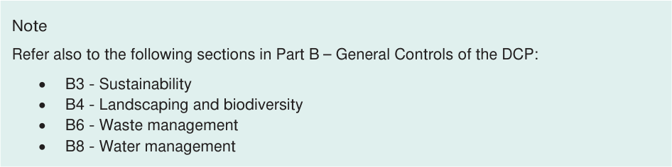

### 4.6. Ecologically Sustainable Development

#### 4.6.1. Maintenance

Detailed design and material selection should support long-term maintenance of buildings. On-going maintenance ensures the longevity of quality architectural and landscape design, sustains and increases the value of property and minimises the life-cycle cost of a development to owners.

> [Picture on page 105: a picture, saved as a picture (images/part-d3-maroubra-junction-centre-page-105-11.gif, 150 dpi).]
> Words printed on the picture (title and legend, copied from the PDF):
> • B3 - Sustainability
> • B4 - Landscaping and biodiversity
> • B6 - Waste management
> • B8 - Water management

Note Refer also to the following sections in Part B

– General Controls of the DCP:

Objective The objective for maintenance is to:

1\. Ensure long life and ease of maintenance for the development.

Controls

a) Windows are to be designed to enable their cleaning from inside the building, where possible

b) Manually operated systems, such as blinds, sunshades, pergolas and curtains are to be selected in preference to mechanical systems

c) Building maintenance systems are to be incorporated and integrated into the design of the building form, roof and façade

d) Durable materials, which are easily cleaned and are graffiti resistant, are to be selected.

e) Appropriate landscape elements and vegetation are to be selected and appropriate irrigation systems are to be provided

f) For developments with communal open space, a garden, maintenance and storage area are to be provided, which is efficient and convenient to use and is connected to water and drainage. Details are to be shown on DA plans.
