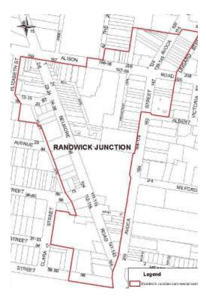

## 1 Introduction

Refer to Clause 5.10 Heritage conservation of the RLEP for criteria relevant to development within the heritage conservation area.

Randwick Junction (Figure 1) is a local centre comprising a strip shopping centre along a prominent ridgeline with some residential properties and a school located within it. It has significant aesthetic, historic and social significance which are recognised by its heritage conservation area listing.

This section of the DCP should be read in conjunction with:

> [Picture on page 2: a picture, saved as a picture (images/part-d3-randwick-junction-centre-page-2-11.gif, 150 dpi).]

#### Figure 1 Randwick Junction commercial centre

• Part A 5 Introduction and Part B 5 General Controls; and

• Other sections of the DCP for specific development types, locations or sites, if relevant to the application.

### 1.1 Objectives

• To encourage and facilitate well designed and  appropriate development within Randwick Junction commercial centre, with new development or alterations to existing buildings designed to be compatible with and enhance the heritage streetscape.

• To protect and enhance the heritage values of the commercial centre.

• To encourage the provision of a variety of residential and commercial accommodation.
