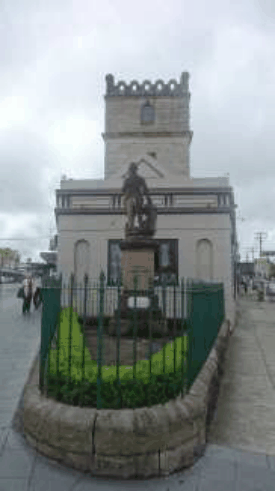
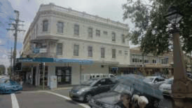
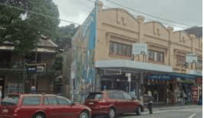
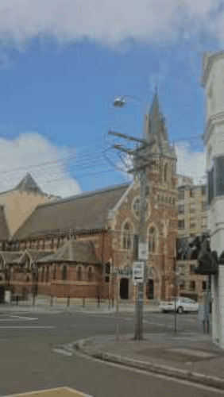

## 3 Statement of Significance

### 3.1 Aesthetic significance

The heritage conservation area is a good and generally intact example of a traditional commercial “strip” (linear) style centre. Buildings are typically two or three storeys and are generally built to the street alignment, for the full width of the allotment.  The urban spaces formed by the buildings impart a strong linear character, particularly along Belmore Road.  There are many good examples of building from the Victorian, Federation and Inter5War periods.

In the Coach and Horses grouping the Victorian Italianate style is dominant, interspersed with other later styles such as Federation Freestyle.  There are significant groups of these buildings on the south5west corner of Avoca Street and Alison Road, as well as on the east side of Avoca Street, north of Alison Road.  There are excellent examples of Victorian Italianate commercial and residential buildings on Alison Road, between Avoca Street and Belmore Road as well as three outstanding Victorian Italianate residences on Avoca Street, adjacent to Marcellin College.

The single most striking building within the heritage conservation area is the former Star and Garter Inn, at the corner of Avoca Street and Belmore Road, notable for its distinctive castellated sandstone tower and the adjacent statue of Captain James Cook.  The pairing of the Coach and Horses Hotel and the former Post Office, located on diagonally opposite corners of the intersection of Alison Road and Avoca Street is also prominent.

> [Picture on page 3: a picture, saved as a picture (images/part-d3-randwick-junction-centre-page-3-42.gif, 150 dpi).]

### 3.2 Historic significance

Randwick Junction has been the centre for commercial activity in Randwick since the establishment of the village in the mid5 nineteenth century.  The buildings in the heritage conservation area provide physical evidence of the process of growth and development of Randwick as a commercial centre.  The heritage conservation area is at the intersection of three roads that have been the principal routes for travel between Randwick and other parts of Sydney since the establishment of the suburb.  The first Randwick5Sydney horse omnibus and the first mail service were established on the site of the Coach and Horses Hotel in 1859, reflecting a strong relationship between Randwick Junction and early transport and communications in the district.

Many of the important sites in the early development of the commercial area were at the street intersections.  The former Star and Garter Inn (circa 1859) was one of the earliest hotels in Randwick.  No.119 Belmore Road, at the corner of Short Street, was the site of the post office from 1878 to 1897.

The most rapid period of growth began after the introduction of steam trams in 1881.  The 1880’s were a period of large scale subdivision in Randwick.  In the Federation and Inter5War periods development of the commercial centre continued.  There was considerable expansion on the western side of Belmore Road. Earlier, less intense residential uses, such as “Sandgate” at No.128 Belmore Road, were displaced.

The foundation stone for Randwick Post Office 1897 is on the northwest corner of Alison Road and Avoca Street.  This building provides historical evidence of the importance of the heritage conservation area as a centre of communication and reflects the connection to government and institutions within Randwick.

### 3.3 Social significance

The heritage conservation area continues as Randwick’s main commercial centre, developing around the earliest hotels in Randwick, namely the former Star and Garter Inn and the Coach and Horses Hotel.  The Victorian, Federation and Inter5War buildings provide a sense of historical continuity throughout the centre and the streetscape character of the conservation area are well recognized throughout the community.  In 1923, the Catholic Church acquired the Brisbane Villa Estate on Alison Road for a monastery.  This site later became the Marcellin College, an important and enduring centre for education within the local community.

When considered further in the context of the two adjacent conservation areas of St Judes and High Cross, with their significant administrative, cultural and institutional roles, Randwick Junction may be seen as the focal point of the city, as many of the enduring symbols of Randwick’s development are located either within or immediately adjacent to the conservation area.  Important community services such as mail services and government savings bank (initially operated from the post office), as well as educational and commercial activities have been centred in and around Randwick Junction for as long as the suburb has been established.

> [Picture on page 4: a picture, saved as a picture (images/part-d3-randwick-junction-centre-page-4-53.gif, 150 dpi).]

> [Picture on page 4: a picture, saved as a picture (images/part-d3-randwick-junction-centre-page-4-54.gif, 150 dpi).]

> [Picture on page 4: a picture, saved as a picture (images/part-d3-randwick-junction-centre-page-4-55.gif, 150 dpi).]

#### Themes represented

The following historical themes, identified in the 1989 Randwick Heritage Study, are directly illustrated in the conservation area:

• Industry and commerce

• Promotion of culture, religion and education

• Recreation, entertainment and leisure

• Transport and communications

The following themes are indirectly represented:

• Speculation and promotion

• Government and institutions

• Suburbanisation
