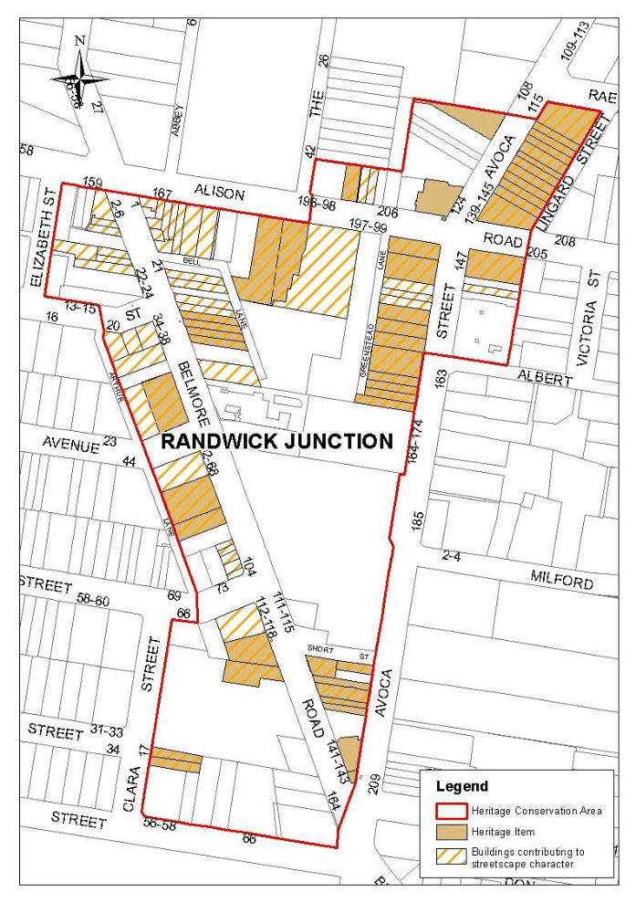

## 4 Heritage items and contributory buildings

#### Explanation

The Knox and Tanner Urban Design Study of Randwick and “The Spot” Shopping Centres identified many buildings which contribute to the heritage value, aesthetic qualities and visual character of Randwick Junction, and which tell us about the development history of the area.  Heritage items and contributory buildings are mapped in Figure 2.

Contributory buildings should be retained.  Original fabric should be conserved, new work should be sensitive, and neighbouring development should be sympathetic to their character.  “Facadism” (the retention of only the outer skin of a building) is not acceptable as suitable conservation practice.

#### Figure 2 Randwick Junction heritage and contributory buildings

> [Picture on page 6: a picture, saved as a picture (images/part-d3-randwick-junction-centre-page-6-2.gif, 150 dpi).]
