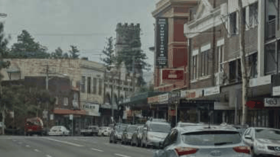
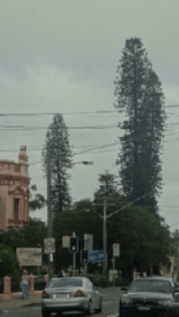
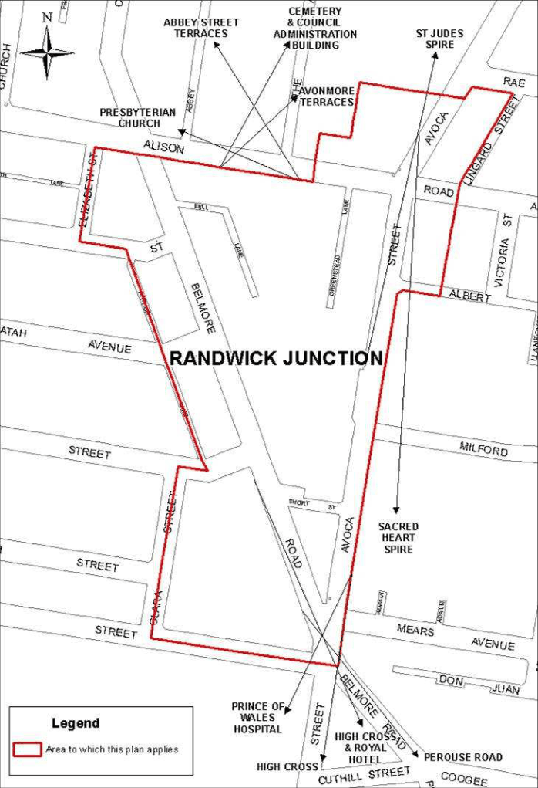

## 5 Visual Character

#### Explanation

Randwick Junction is situated on a ridge line that is highly visible from many vantage points within the local government area.  Key view corridors provide internal vistas and offer views into and out of Randwick Junction, including Avoca Street, Alison Road and Belmore Road.  Views to landmarks including the statue of Captain Cook and the tower at the corner of Avoca Street and Belmore Road, contribute strongly to the visual character of Randwick Junction.

There are a number of important landmarks just outside Randwick Junction in adjacent heritage conservation areas, including St. Jude’s Church, cemetery and associated buildings, Randwick Town Hall, Randwick Presbyterian Church, Alison Park and surrounding terraces, the Sacred Heart Church, High Cross Reserve, the Royal Hotel and the Prince of Wales Hospital.  The townscape within Randwick Junction has an important visual relationship with these landmarks and with the adjacent heritage conservation areas of High Cross, Sacred Heart and St. Jude’s.  View corridors are mapped in Figure 3.

#### Controls

i) Views and vistas should be addressed in the site analysis for new development, as they may necessitate adjustments to the built form and site layout, so that view corridors and vistas are not obstructed.

ii) Development should fit within the wider townscape indicated by the view corridors and should not disrupt existing visual relationships.

> [Picture on page 7: a picture, saved as a picture (images/part-d3-randwick-junction-centre-page-7-29.gif, 150 dpi).]

> [Picture on page 7: a picture, saved as a picture (images/part-d3-randwick-junction-centre-page-7-30.gif, 150 dpi).]

#### Figure 3 View corridors

> [Picture on page 8: a picture, saved as a picture (images/part-d3-randwick-junction-centre-page-8-2.gif, 150 dpi).]
