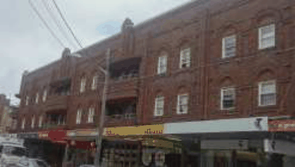
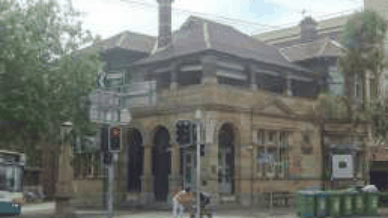
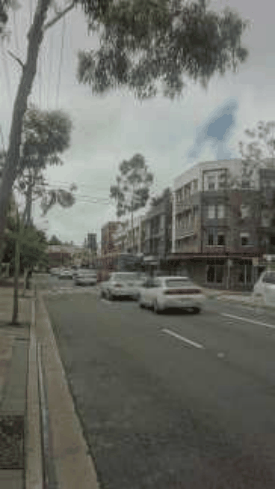

## 7 Architectural Styles

#### Victorian

Randwick Junction’s nineteenth century buildings were at one time predominantly residential and have since been adapted for a range of other uses.  They are constructed predominantly of rendered and painted masonry, with intricate classical mouldings and decorative iron lacework.

#### Federation/Edwardian

Federation buildings such as the former Post Office on the corner of Avoca Street and Alison Road and nos110 – 116 Avoca Street nearby, rely on face brickwork for architectural effect, with contrasting elements of either sandstone, stucco or ceramic tile.

#### Inter War (1920 to 1940)

Randwick’s Inter5War Art Deco architecture is characterised by rich detail, polychromatic brickwork and decorative piers and fins, often extending above the parapet to provide vertical emphasis. Recessed balconies add façade interest.

#### Post War (1940 to present)

Several buildings constructed since 1940, including two major shopping malls, the Gemini building and Marist Brothers School have impacted on the character of Randwick Junction.  The most visually intrusive post war development occurred during the 1970s with several eight to ten storey buildings which are inconsistent with the predominant scale of development in Randwick Junction and nearby residential areas.

> [Picture on page 9: a picture, saved as a picture (images/part-d3-randwick-junction-centre-page-9-43.gif, 150 dpi).]

> [Picture on page 9: a picture, saved as a picture (images/part-d3-randwick-junction-centre-page-9-44.gif, 150 dpi).]

> [Picture on page 9: a picture, saved as a picture (images/part-d3-randwick-junction-centre-page-9-45.gif, 150 dpi).]
