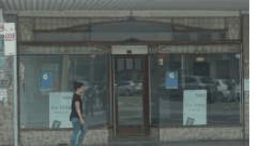

## 9 Building Envelope

#### Objectives

• To ensure that new development respects the scale and form, and siting and setbacks of surrounding buildings.

• To ensure that new development reinforces existing urban form, the streetscape and visual character.

#### Controls

i) The FSR and building height controls set by RLEP together with DCP envelope controls define the overall built form and scale of development.

ii) New development should be built to the street alignment and to the side boundaries of the allotment.

iii) Where adjoining and nearby development is set back from

#### Note:

The floor space ratio may not be achievable if the height control is not satisfied, or if residential amenity standards are not able to be maintained

> [Picture on page 11: a picture, saved as a picture (images/part-d3-randwick-junction-centre-page-11-20.gif, 150 dpi).]

the street, new development should be consistent with the setbacks of adjoining development or the dominant setbacks along the street.

iv) Where buildings are setback from the front boundary, such as the school and terraces along Avoca Street, fences are to be used to reinforce the street alignment and provide a strong visual transition point between public and private space.
