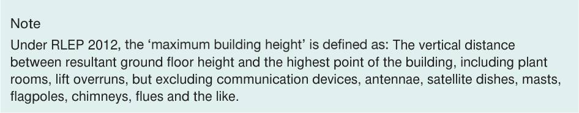

### 2.2. Building height

Explanation Building height is an important control which influences the bulk and scale of a development and the visual amenity of a place and neighbouring properties. It can also reinforce an area’s existing or desired future character. The maximum permissible building height for any development is prescribed and defined in the RLEP 2012 Height of Buildings Map (HOB).

Objectives

1\. Ensure that the number of storeys in a development aligns with the maximum permissible building height in metres under the RLEP 2012

2\. Ensure development height does not cause unreasonable impacts upon the neighbouring dwellings in terms of overshadowing, view loss, privacy and visual amenity

3\. Ensure an appropriate relationship between new development, street width and surrounding dwellings

4\. Ensure appropriate floor to ceiling heights within commercial buildings and to enable flexibility of uses through higher floor to ceiling heights for ground floor development

5\. Achieve a consistent built street wall height.

Controls

a) In local centres with a 9.5m maximum height limit, development must not exceed two storeys in height (with the exception of habitable roof space/partial floor, which must be setback, so as not to be visible from the street, or incorporated into the roof design to have the appearance of a roof rather than an additional storey)

b) In local centres with a 12m maximum height limit, development must not exceed three storeys in height (with the exception of habitable roof space/partial floor which must be setback, so as not to be visible from the street, or incorporated into the roof design to have the appearance of a roof rather than an additional storey)

c) The minimum floor to ceiling height for a floor must comply with the following table:

| Floor | Minimum floor to ceiling height |
|---|---|
| Ground floor | 3.3 meters |
| Upper floors | 2.7 meters |

Note Ceiling heights shall be measured from Finished Floor Level (FFL) to finished ceiling. level (FCL).

d) Demonstrate the suitability of an alternative number of storeys, and/or floor to ceiling heights, having regard to:

i. Proposed uses

ii. Existing predominant storeys and/or floor to ceiling heights within the centre

iii. Character of the street.

> [Picture on page 8: a picture, saved as a picture (images/part-d4-local-centres-page-8-9.gif, 150 dpi).]

Note Under RLEP 2012 , the ‘maximum building height’ is defined as: The vertical distance between resultant ground floor height and the highest point of the building, including plant rooms, lift overruns, but excluding communication devices, antennae, satellite dishes, masts, flagpoles, chimneys, flues and the like.
