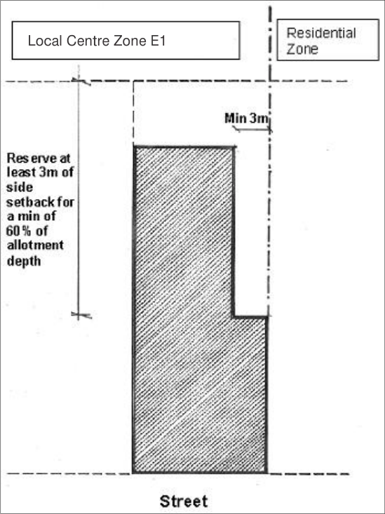

### 2.3. Setbacks

Explanation Setbacks define the outer extremities of a building in relation to the front, side and rear boundaries. The front setback control is formulated to maintain any established building alignment along the street. They help define the proportions of the street and can contribute to the streetscape character and activation through continuity of street facades. Continuous retail frontages with a zero street setback help reinforce a shopping street. Side and rear setbacks are established to ensure an adequate level of building separation, and to provide for access, landscaping, privacy, natural lighting and ventilation. In retail main streets, zero side setbacks may be appropriate with common walls, to maintain continuity of the retail frontage. Side setbacks may be required where there are transitions to adjoining R2 low density residential areas. Where rear lanes exist, they ensure adequate space is maintained for parking, loading and services. Setbacks to upper levels may also be required to ensure an appropriate building scale is realised. Setback controls do not apply to below ground structures.

Note Vehicle access from classified roads and state roads are generally not supported. Setbacks are to be in accordance with TfNSW requirements in relation to classified roads and signalised intersections.

Definition Setback distances are measured perpendicular (that is, at 90 degrees angle) from the boundary to the outer face of the building elevation, excluding eaves, gutters, semi-basement car park, terraces, decks or landings not more than 1.2m above ground level (finished) and minor projecting features, such as awnings, sun hoods, screening devices and bay windows.

Objectives

1\. Define the street edge and establish or maintain the desired spatial proportions of development on the street

2\. Ensure front setbacks maintain the continuity of setbacks in the street

3\. Ensure a development does not detrimentally affect the amenity of adjoining residential development

4\. Ensure any building fronting a rear lane has a smaller scale and massing appropriate for the width of the lane.

Controls

a) Setbacks for residential redevelopment in E1 zones must refer to the Medium Density Residential setback controls in DCP Part C2.

Front setback

b) Comply with the following minimum front setback:

| Description | Minimum setback |
|---|---|
| Development fronting a primary road, up to 9.5m in building height | 0m setback from the street edge |
| Development fronting a primary road, above 9.5m in building height | 2m setback |
| Corner allotments | A minimum 1.5m x 1.5m splay corner across all levels at the intersection of two roads. No walls or plantings higher than 600mm may be located within the splay corner. |

c) Provide increased setbacks, over and above the aforementioned minimum requirements, or demonstrate the suitability of an alternative setback having regard to the following matters:

i. Existing predominant street setback

ii. Character of the street.

Rear setback

d) Where the site has rear lane access, car parking structures (hardstand car space, carport or garage) and ancillary development must have a 1m minimum setback from the rear boundary

e) All ancillary buildings fronting laneways must have a maximum height of not more than 6m. The maximum external wall height is limited to 4.5m. Ancillary buildings on laneways must have a mass and scale secondary to the primary dwelling on the allotment. Any upper level (for instance, storey above garage) must be contained within the roof form as an attic storey

f) Where there is no rear lane access and the site adjoins land in a residential zone, provide a minimum rear setback of 15% of allotment depth or 5m, whichever is the lesser.

Side setback

g) Where the site’s side boundary adjoins land in a business zone, provide a zero metre side setback

h) For alterations and/or additions to dwellings in E1 zones, redevelopment must address the residential sections of the DCP

i) Where a side boundary of the site forms the edge of a business zone or, adjoins land in a non-business zone (and not separated by a road), provide a minimum 3m setback from the side boundary for a minimum of 60% of the allotment depth. For constrained sites, Council may consider a variation to the standard if the proposal can demonstrate that a reduced setback will suitably address privacy and solar access to the neighbouring properties.

Figure 1: Side setback controls for development adjoining non-commercial zone

> [Picture on page 10: a picture, saved as a picture (images/part-d4-local-centres-page-10-13.gif, 150 dpi).]
> Words printed on the picture (title and legend, copied from the PDF):
> Local Centre Zone E1

Source: Randwick City Council
