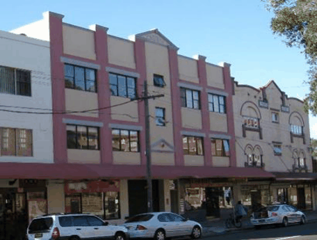
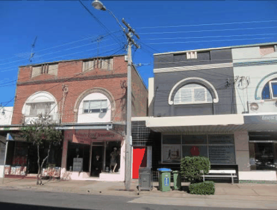
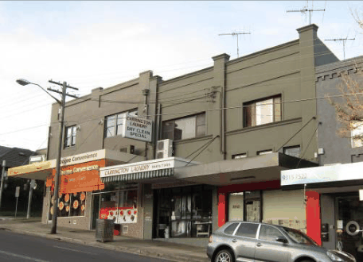

## 3. Building design

### 3.1. Facades

Explanation Facades have an important role to play in the perception and enjoyment of a place. Design emphasis through facade details, materials, colours, changes in the building plane (recessed or extended from building surface), contrasts in materials or decorative artwork can all contribute to the unique character of a building and a place. This visual interest, or articulation, can also assist to visually ‘divide’ buildings into smaller, identifiable proportions.

> [Picture on page 11: a picture, saved as a picture (images/part-d4-local-centres-page-11-9.gif, 150 dpi).]

Figure 2: Examples of facades in E1 Local Centres

> [Picture on page 11: a picture, saved as a picture (images/part-d4-local-centres-page-11-11.gif, 150 dpi).]

> [Picture on page 11: a picture, saved as a picture (images/part-d4-local-centres-page-11-12.gif, 150 dpi).]

Source: Randwick City Council

Objectives

1\. Ensure building facades are articulated to complement and enhance the character of the street

2\. Buildings are to be well-designed with

articulated facades, reflecting a ‘fine grain’

character, common to local centres

3\. Ensure that corner buildings suitably resolve the design characteristics of the two streets they address, and reinforce corner elements in the local centre setting

4\. Retain and restore the surviving examples of original whole shop frontages and elements

5\. Encourage new shopfronts to be compatible with the existing proportions, materials and detailing across the centre to maintain and enhance the character of the local centre.

Controls

a) Where a development has two street frontages, each façade treatment must respond to the buildings in those streets

b) Include shopfronts on side street frontages of corner sites to enhance the commercial potential of the space and minimise blank walls to the street front

c) Facades should display proportions and detailing which respect the prevailing building facades across the centre (i.e. designing fine grain shop fronts, where the existing subdivision is fine grain)

d) Distinguish residential entries from commercial/retail entries in the case of mixed use development

e) Design shopfronts, including entries and windows, to reinforce any prevalent character in the centre

f) All street frontage windows at ground level are to have clear glazing. Large glazed shopfronts should be avoided, with window configurations broken into discrete sections to ensure visual interest

g) All facade elements must be contained within the site boundaries

h) Building services, such as drainage pipes shall be coordinated and integrated with overall facade and balcony design

i) Balconies to the street facade are to be recessed behind the principal building facade

j) Balcony balustrades should comprise a light open/glazed material and should be compatible with the style of the building

k) The development of colonnades is discouraged.
