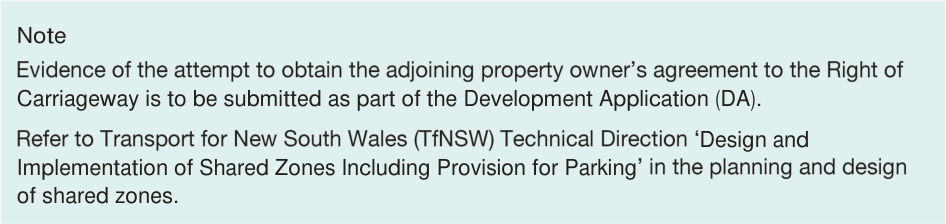

### 4.3. Laneways / shared zones

Explanation Laneways and shared zones contribute to the fine grain character of urban areas and help to enhance walkability and connectivity. They also provide an important service function for waste management and car parking access to developments. Laneways / shared zones in certain situations assist in providing an appropriate scale transition and separation from surrounding lower scaled neighbourhoods. Objectives

1\. Facilitate vehicular access and servicing away from main road frontages to improve pedestrian and active transport movement and safety

2\. Provide usable, green and leafy laneways

3\. Encourage passive surveillance of any existing or new laneways. Controls

a) All new development fronting lanes shall be articulated to create visual interest and incorporate passive surveillance by orienting windows and balconies onto the lane

b) Development shall ensure sufficient width for turning and U-turn movements within laneways, without compromising vehicular and pedestrian movement

c) Development adjacent laneways shall provide landscaping, lighting and high quality materials and finishes to enhance the pedestrian environment

d) In an urban context, ground floor uses fronting lanes shall incorporate openings onto the lane to contribute to the enjoyment and activation of the lane including, where possible, outdoor dining

e) Applicants are to negotiate Rights of Carriageway with adjoining property owners where required for access.

> [Picture on page 16: a picture, saved as a picture (images/part-d4-local-centres-page-16-35.gif, 150 dpi).]
> Words printed on the picture (title and legend, copied from the PDF):
> Note
> Evidence of the attempt to obtain the adjoining property owner’s agreement to the Right of
> Refer to Transport for New South Wales (TfNSW) Technical Direction ‘ Design and

Carriageway is to be submitted as part of the Development Application (DA).

Implementation of Shared Zones Including Provision for Parking ’ in the planning and design of shared zones.
