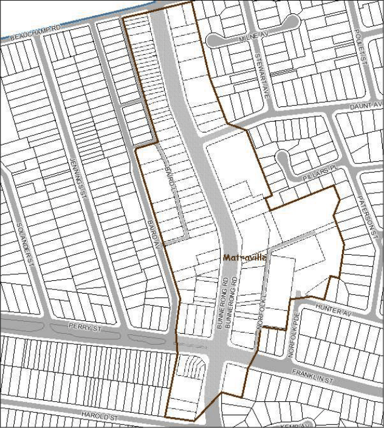

## 1 Preliminary

### 1.1 Purpose of this Section

This Section establishes planning and design objectives and controls to guide and prescribe the built form and environmental amenity standards and requirements for the Matraville Centre by:

• Providing a clear vision

• Building on the centre’s strengths to achieve an identifiable local character

• Establishing controls designed to achieve active, safe and accessible public places, and visual and design quality in sustainable new development that provides an excellent quality of life

• Promoting innovation and creativity.

### 1.2 Land Covered by this section of the DCP

This Section of the DCP applies to all land within the Matraville Centre as identified by heavy black edging on Map 1 below.

#### Map 1: Matraville Centre

> [Picture on page 3: a picture, saved as a picture (images/part-d5-matraville-centre-page-3-18.gif, 150 dpi).]

### 1.3 Relationship to other Sections

This Section forms part of an integrated hierarchy of planning controls.

This section of the DCP should be read in conjunction with:

• Part A . Introduction and Part B . General Controls; and

• Other sections of the DCP for specific development types, locations or sites, if relevant to the application.

To the extent that the provisions of this section are inconsistent with the provisions of the above, the provisions in this section shall prevail.

### 1.4 How to Use this Section

To use this Section, you should:

• Become familiar with the context and the desired future character for the Matraville Centre;

• Develop an understanding of the existing centre context by examining the background studies to this section, and undertaking a site analysis;

• Become familiar with the concept of Building Envelopes;

• Identify whether your site is an Opportunity Location; and

• Use the remaining sub.sections to guide the detailed resolution of your development proposal.
