## 2 Background & Urban Structure

### 2.1 Region

Matraville is located approximately 10km south.east of Sydney’s CBD, bounded by its neighbours Maroubra to the north, Malabar and Chifley to the east, Phillip Bay to the south, Port Botany, Banksmeadow and Hillsdale to the west.

Matraville is a low density residential community just 5 kilometres from Sydney Airport, 1.5 kilometres from Port Botany, and 2 kilometres from the beaches of Maroubra, Malabar, and Phillip Bay. The centre is close to major retail competitors, including Westfield Eastgardens, Southpoint Shopping Centre and Pacific Square at Maroubra Junction.  All three shopping centres are located within a short drive from Matraville and offer a comprehensive shopping experience including department stores, supermarkets, specialty stores, services and entertainment.

Quality new development should assist Matraville Centre develop its own unique niche as a place to live, work, shop, do business, recreate, and socialise.

### 2.2 Randwick City

The suburb of Matraville is the sixth largest population centre in Randwick City.  The scale of the centre reflects and responds to higher order retail and commercial activities in Randwick, Maroubra Junction, Kingsford, Coogee and Kensington. All

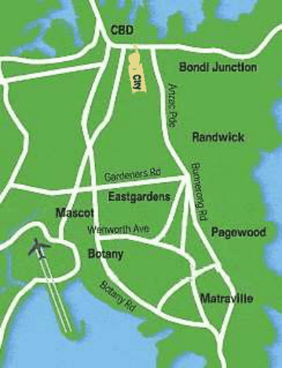

> [Picture on page 4: a picture, saved as a picture (images/part-d5-matraville-centre-page-4-45.gif, 150 dpi).]

Randwick City’s commercial centres allow for mixed use development.

As a local commercial centre, Matraville Centre’s retail/business mix does not currently contain many of the key uses which could provide convenient, day to day shopping for residents e.g. a neighbourhood supermarket and/or fruit & vegetable grocer.

### 2.3 Local

Matraville’s beginnings were small farms and market gardens, many of them worked by Chinese settlers following the gold rush

era.  The suburb is named after James Mario Matra, a midshipman on the Endeavour who has been credited by some as the first person to propose a permanent British colony in NSW. Matraville was gazetted as a postal area in 1911.

True residential growth began in 1917, when 72.5 acres of Crown land described as ‘the waste sand hills beyond Daceyville’, was gifted to returned soldiers from World War 1.

The Bunnerong Power Station was situated west of Botany Cemetery from 1929 and demolished only in recent years.  In 1934, a new tramline to the power station helped to encourage residential and industrial growth.  Australia’s first bitumen and oil refinery ‘Bitumen Oil Refineries (Australia) Limited’ opened in Matraville in 1946, and traded under that name until 1963, when it became known as Boral Limited. Boral still operates as a significant local employer, along with the Port Botany facilities and industrial areas immediately south.

The Matraville Centre is located in Bunnerong Road between Beauchamp Road and Perry/Franklin Streets.  Although current long.term residents of Matraville describe considerable change in the functions of the centre during their life. times, it still remains the notional heart of a relatively low density and tight knit community.

### 2.4 Matraville’s People

Matraville Centre is ideally located within walking distance of Heffron Park and close to beaches and a range of recreational facilities.

The suburb of Matraville had a population of 8690 at the 2001 Census, an increase of 580 persons from the 1991 Census.  This represents the 6th largest population suburb in Randwick City. The majority of the growth in Matraville can be attributed to mixed use development in the centre and a number of one.off townhouse developments.

The suburb is adjacent to Port Botany and includes a large light industrial employment area. The people living in Matraville are more likely to work in trades, clerical, production and transport than the Randwick City average.

Matraville has a higher proportion of young people under 19 and people aged over 40 years than the Randwick City average, and significantly fewer people in the 20.34 year age bracket than the

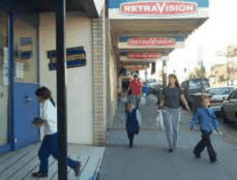

> [Picture on page 5: a picture, saved as a picture (images/part-d5-matraville-centre-page-5-49.gif, 150 dpi).]

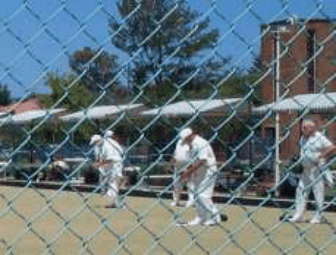

> [Picture on page 5: a picture, saved as a picture (images/part-d5-matraville-centre-page-5-50.gif, 150 dpi).]

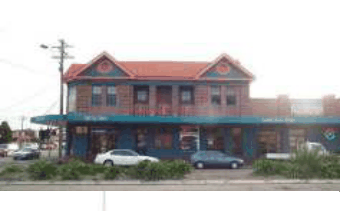

> [Picture on page 5: a picture, saved as a picture (images/part-d5-matraville-centre-page-5-51.gif, 150 dpi).]

Randwick City average.  Two person households (28%) and one person (21%) are the most common household types in Matraville.

Of the people who live in Matraville, approximately 31.6% speak a language other than English at home . mainly Chinese (Cantonese and Mandarin), Greek, Italian and Spanish. This was slightly higher than the Randwick City average of 28.1%.

Matraville is primarily a low density residential environment with one of the lowest proportions of flats in Randwick City (14% of dwellings compared to 48% for Randwick City). Approximately half of all private dwellings in Matraville are detached houses, significantly higher than the Randwick City average (28%).

Matraville has a slightly higher proportion of dwellings that are fully owned than the Randwick City average and slightly more dwellings that are being purchased. Matraville residents move less frequently than other Randwick City residents and are more likely to be long term residents of the area.  The emerging trend is that families with young children are moving into the area’s larger single detached housing.

The number of people living in and around the centre (approximately 29 persons per hectare) is also characteristic of the low density residential nature of this area and is lower than the Randwick City average. The area surrounding the centre is characterised by single detached dwelling houses. An estimated 500 people (approx) live within the commercial area, a density of approximately 54 persons/ hectare.

Active and vibrant centres comprise a mix of uses and residential development, which focus density within walking distance of public transport and the services provided in the centre. Suburbs with vibrant centres, offering a range of local retail services include Leichhardt (population density of 49/ha), Newtown (population density of 77/ha) and Paddington (population density of 114/ha). Paddington also demonstrates that higher density does not necessarily equate to high rise buildings.  Paddington’s attached terraces achieve population densities similar to Raleigh Park, Kensington.

### 2.5 Heritage

RLEP identifies few Heritage Items in and around Matraville Centre, including three houses in Baird Ave and the Matraville Hotel at the intersection of Bunnerong Rd and Perry St.

A row of InterWar shops and residences (constructed in 1927 and known as Iresons Corner) on the western side of Bunnerong Road on the south west corner with Beauchamp Road was identified by the 1987 Randwick Heritage Study as one of the oldest buildings in the area. However, independent heritage assessment of the site has noted that the building does not demonstrate the level of significance to be considered as a heritage item.

### 2.6 Pedestrian and Bicycle Amenity

Pedestrian amenity is affected by: the speed and configuration of traffic along Bunnerong Road; the condition of footpaths; the location of pedestrian crossings; and the timing of walk indicators at crossings.

There are currently no dedicated cycling facilities in the centre, which would improve transport choice and general access within, to and from the centre.

There are opportunities for Council to progressively implement the Randwick Bicycle Plan and Public Domain Strategy, and to work with State Government Agencies to improve pedestrian amenity to create a more walkable and sustainable centre.

### 2.7 Public Domain

Other than intersections or private uses such as the Church, there are no readily identifiable public gathering places or places for public celebrations. Footpath improvements have occurred on the western side of Bunnerong Road. Future improvements including upgrading the footpath on the eastern side, will be guided by the Public Domain Strategy and the Section 94A Contributions Plan.

### 2.8 Parks and Public Open Space

Heffron Park, the largest recreational facility within Randwick City, is located north of the centre. It comprises a broad range of local and regional facilities including netball, rugby league, soccer fields and the Des Renford Aquatic Centre.

In addition to the sporting fields there is an extensive 4.2 kilometre cycle track. The park also provides opportunities for passive recreation such as walking, jogging, kite flying and ball games. There are only a few smaller parks in and around the centre, including a pocket park in Baird Ave

### 2.9 Public Transport

Public transport is a significant presence in the Matraville street network. Because casual surveillance is a critical aspect of Crime Prevention Through Environmental Design (CPTED), active uses with extended trading hours are useful adjacent to bus stops. Opportunities exist to improve and promote public transport use in Matraville.

### 2.10 Traffic

Matraville Centre is located on the north south spine of Bunnerong Road, a regional road connecting the northern and southern sections of Randwick City.

With 3 lanes of traffic in each direction, Bunnerong Road is a wide and daunting road to navigate as a pedestrian, despite carrying relatively low traffic volumes. Pedestrian crossings are located at the Beauchamp, Daunt and Perry intersections, and    outside St Agnes Primary School.

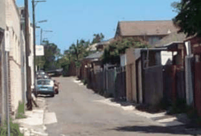

> [Picture on page 7: a picture, saved as a picture (images/part-d5-matraville-centre-page-7-46.gif, 150 dpi).]

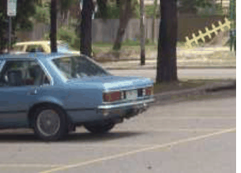

> [Picture on page 7: a picture, saved as a picture (images/part-d5-matraville-centre-page-7-47.gif, 150 dpi).]

A major portion of the road is limited to a 40 kilometre per hour speed limit (8.00am . 9.30am and 2.30pm . 4.00pm).  This slow speed should be a positive factor for businesses in the centre. However, it is counteracted by the width of Bunnerong Road and the fact that on.street parking is disrupted by many driveways and ‘No Standing’ zones.  There is an opportunity for Council to work with State Government agencies to slow the speed of traffic through the centre in order to improve the local shopping and social environment.

### 2.11 Local Parking

The centre is currently serviced by a Council owned off.street carpark in Baird Ave, and a large carpark at the rear of the RSL Club.  Neither carpark is connected to the centre by active or attractive pedestrian ways. Improving pedestrian connections and signage indicating the location and number of parking spaces available could assist better utilisation of these carparks. The Public Domain Strategy identifies a number of strategies for traffic and parking improvements. Providing on.site parking for all new development will assist traffic management in the centre.

### 2.12 Rear Lanes

Almost two thirds of the western side and the south eastern section of Bunnerong Road have rear lane access.

Crime Prevention through Environmental Design (CPTED) principles are especially important in rear lane development. These principles suggest that new development should promote casual surveillance as a means of improving security. Consideration of rear lanes as an important element of the local pedestrian network can guide streetscape improvements to encourage pedestrian use.

Any new development with rear lane access will be encouraged to take full advantage of the rear lane in terms of access and presentation, providing new residents with safe and welcoming access to their homes, and keeping the retail frontage of Bunnerong Road free from interrupting driveways.

### 2.13 Desired Future Character

The Matraville Centre will evolve into a lively local village that is compact and pedestrian friendly, with plenty of choice in housing styles and affordability, great speciality shopping, and enjoyable walks to parks, sporting and outdoor play areas.

The built.form will be unified by consistency in building heights and setbacks from the street.  New development will address the street and complement the scale and form of the centre.

Quality architecture with an emphasis on environmental performance will ensure improved residential and commercial opportunities for the people of Matraville.

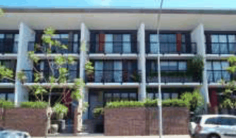

> [Picture on page 8: a picture, saved as a picture (images/part-d5-matraville-centre-page-8-46.gif, 150 dpi).]

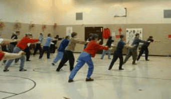

> [Picture on page 8: a picture, saved as a picture (images/part-d5-matraville-centre-page-8-47.gif, 150 dpi).]

Contemporary new buildings will compliment older buildings and add uniquely artistic features that express Matraville’s own special identity.

Landscaped areas integrated into outdoor dining, bus stops and seating, combined with landscaping in the public domain, will contribute to a pleasant environment with a distinctly urban feel, connecting the centre with local places of interest including Heffron Park and the Shirley Crescent shops.

New landscaping, new lighting and signage, and better design will improve pedestrian walkways to and from existing carparks in the centre.

If site amalgamation results in sufficient site area, the development of a supermarket and/or other large format retailer will ‘anchor’ the centre by fulfilling day to day shopping needs.

New retail uses including cafes and restaurants with outdoor dining facilities and specialty retailers building on Matraville’s current elements such as recreational/ sporting uses will consolidate the centre’s commercial success.

A centrally located and well equipped community facility that connects the retail, business and public transport facilities of the centre with other community uses also offers improved and expanded public carparking.

The neighbourhood character of this area will evolve to include new development addressing the lanes running parallel to Bunnerong Road, improving overall safety and providing pleasant pedestrian connections between low density residential areas and the centre itself.

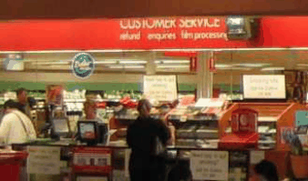

> [Picture on page 9: a picture, saved as a picture (images/part-d5-matraville-centre-page-9-28.gif, 150 dpi).]

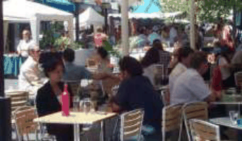

> [Picture on page 9: a picture, saved as a picture (images/part-d5-matraville-centre-page-9-29.gif, 150 dpi).]

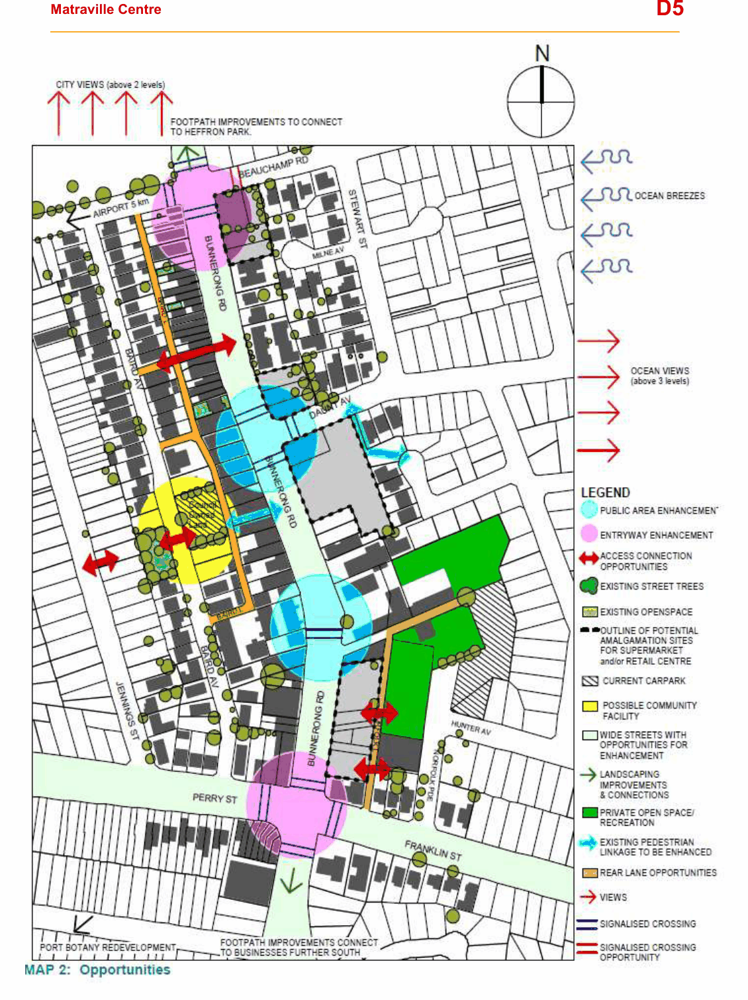

> [Picture on page 10: a picture, saved as a picture (images/part-d5-matraville-centre-page-10-1.gif, 150 dpi).]
