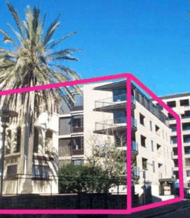
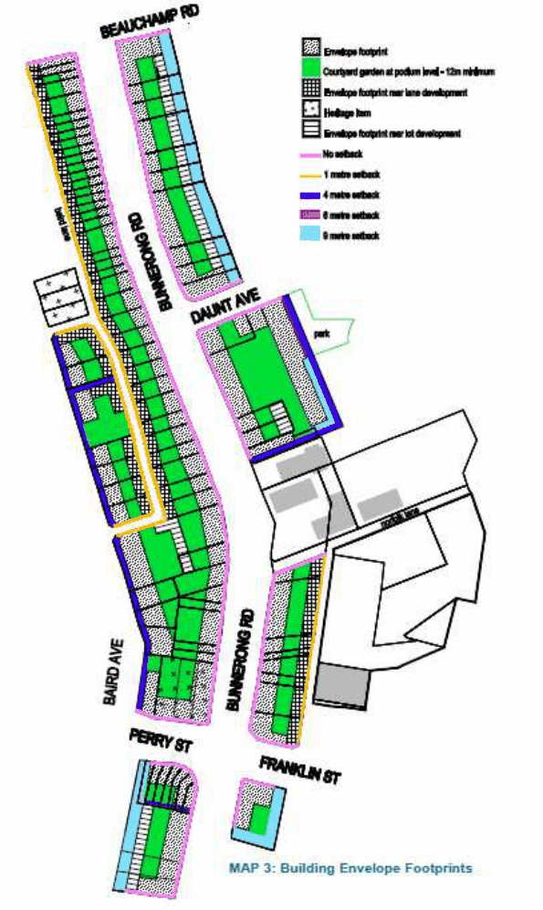
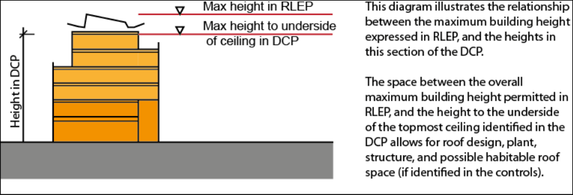
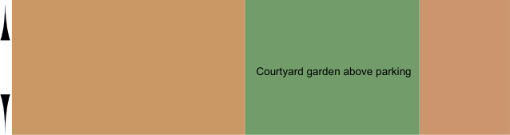
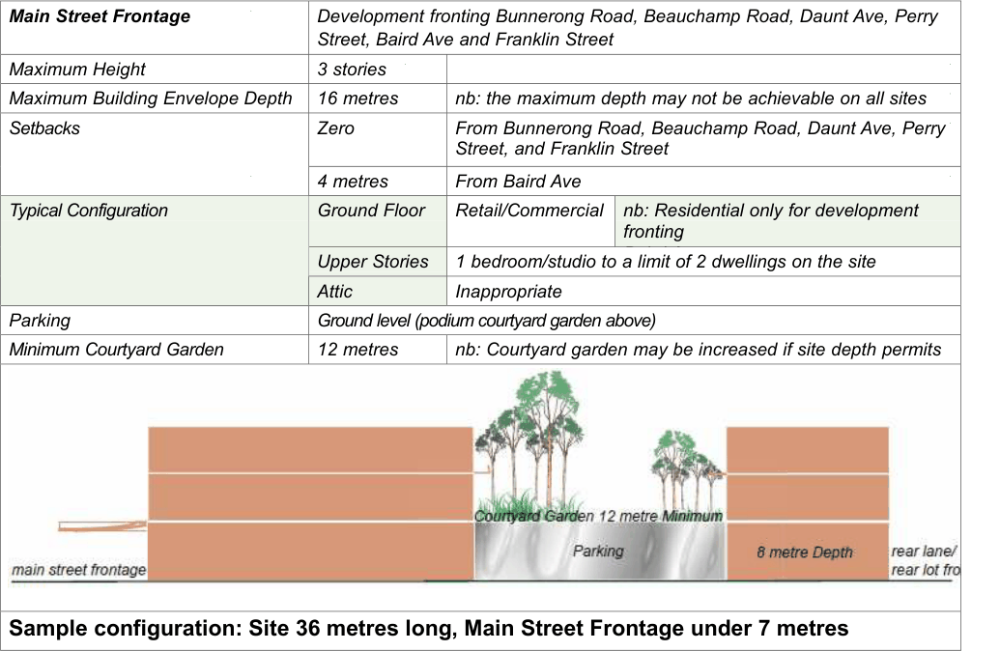
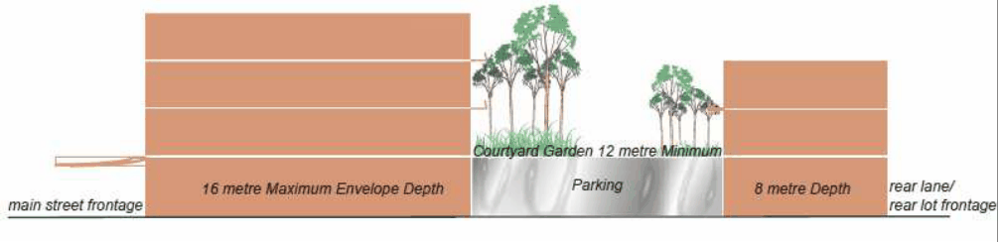
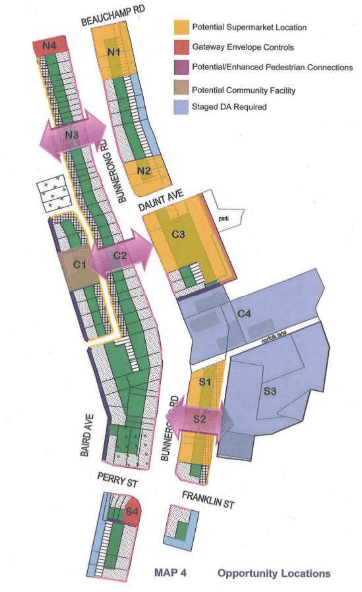
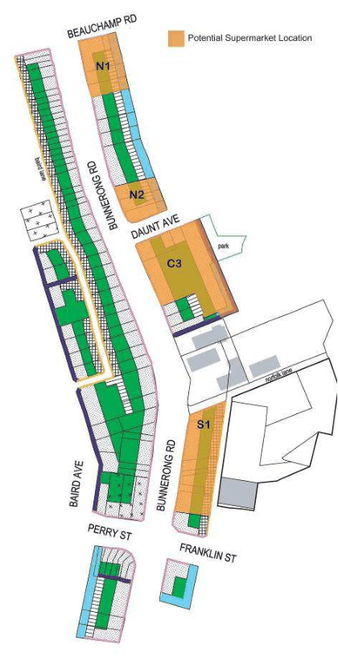
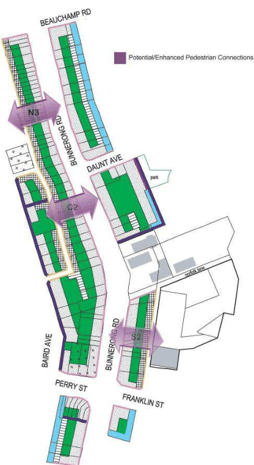
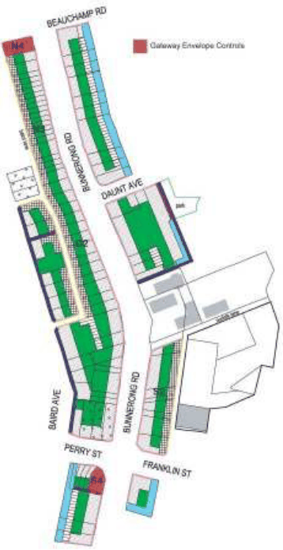

## 3 Development Controls

### 3.1 Site Requirements/Amalgamation

The Matraville Centre comprises a variety of lot sizes and dimensions, from narrow, long lots with rear lane access, to wider lots with access only from Bunnerong Road. This DCP allows, where possible, development of any lot regardless of its size or frontage. However some narrow allotments may find it difficult to fulfil all necessary development controls. Some allotments fall within areas which have been identified as strategic opportunities to strengthen the centre retail mix if site amalgamation occurs.

#### Objective

• To ensure that development can be accommodated on a variety of lot sizes and is appropriate for lot size and configuration.

#### Controls

i) Ensure that development/redevelopment/ amalgamation does not adversely affect or limit the future development potential of adjacent and adjoining sites.

### 3.2 Building envelopes

A building envelope is a three dimensional space which defines the maximum extent of a building in any direction, that is: maximum building height, maximum building length, and maximum building depth. Buildings must be designed to fit within the applicable building envelopes.

This subsection contains building envelope controls for the Matraville Centre. In addition to considering the desired future character of the centre as a whole, these envelopes have been tailored to take into consideration localised site characteristics, including:

• size and orientation;

• relationship to current or potential pedestrian connections;

• potential to provide desirable retail facilities;

• optimum development potential; and

• the potential of adjoining private properties.

This approach defines a physical bulk, height and scale outcome for the centre, whilst encouraging innovative architectural design within the specified envelopes.

The building envelopes define:

> [Picture on page 11: a picture, saved as a picture (images/part-d5-matraville-centre-page-11-42.gif, 150 dpi).]

#### Note:

#### A building envelope is not a building.

It is the maximum three dimensional shape within which a building will be designed

• the position of new development in relation to the lot, the street edge and neighbouring development (3.2.1)

• the overall building height (3.2.2)

• the building depth (3.2.3)

• setbacks from boundaries and upper storey setbacks

Because all building facades must be articulated within the building envelope, the envelope will always represent more than the maximum limit of development. All Development Controls in this section of the DCP must be read in conjunction with the envelopes to determine the actual development potential of a particular site. Refer to Tables 2, 3 & 4 for a summary of the Envelope Controls.

#### 3.2.1 Footprints

The envelope footprints shown here are designed to facilitate new development that provides on.site parking, landscaped open space, appropriate separation between buildings and the right scale for each street address.  The dominant feature is a consistent internal landscaped Courtyard Garden between buildings on lots that are relatively deep.  This approach will also facilitate rear lane development to activate rear lanes, improving their safety and functionality for all centre users.

> [Picture on page 12: a picture, saved as a picture (images/part-d5-matraville-centre-page-12-18.gif, 150 dpi).]

#### 3.2.2 Heights

The general heights occurring along Bunnerong Road are between 1 and 5 storeys. A 3 to 4 storey street edge frames the street with a scale that identifies the centre and relates well to surrounding residential areas.

#### Objectives

• To ensure an appropriate relationship between new development, street width, and surrounding dwellings.

• To achieve a consistent built street edge height.

• To ensure appropriate floor to ceiling height within buildings.

• To achieve a visual transition between the heights of buildings on Bunnerong Road and the heights of buildings ‘behind’ the main street.

#### Controls

i) Comply with the following maximum building heights:

| Building height | Maximum |
|---|---|
| Sites with a frontage of less than 7 metres | Height 3 storeys |
| Building at a laneway edge | 3 storeys |
| Building at the rear of a lot | 3 storeys |
| Building at a street edge (minimum frontage 7 metres) | 4 storeys |

| ii) | If all required parking is provided at basement level on sites with a minimum frontage of 12 metres, a 5th storey may be considered with a setback from the floor below of 4 metres. |  |  |  | Maximum building height to underside |
|---|---|---|---|---|---|
| iii) | If a supermarket or pedestrian connection is |  |  |  | of topmost ceiling (metres) |
|  | included in a development where nominated, a 6th storey may be considered with the 5th and 6th storeys setback from the street edge by 4 metres. | Storey 5:floor to ceiling | 2.7 | 2.9 | 15.7 |
| iv) | Reinforce street corners by concentrating the tallest | Ceiling space & floor slab | 0.2 |  | 12.8 |
| v) | part of the building at the corner. Comply with Table 1 (shown left) which indicates: • minimum floor to ceiling height; • indicative ceiling space and floor slab height; and • maximum floor to floor height required to achieve the appropriate overall building height as a relationship between storeys and height. | Storey 4:floor to ceiling Ceiling space & floor slab Storey 3:floor to ceiling Ceiling space & floor slab Storey 2:floor to ceiling Ceiling space & floor slab | 2.7 0.2 2.7 0.2 2.7 0.8 | 2.9 2.9 2.9 | 9.9 7.0 |
| vi) | The maximum building height for a 6th storey is | 18.6 |  |  | 3.5 |
|  | metres to the underside of the topmost ceiling | Grd/Storey 1: floor to ceiling | 3.5 | 4.3 |  |

#### Table 1

Storey 1

#### Note:

The maximum envelope depth may not be achieved on all sites.  Consideration may be given to reducing the depth of laneway or rear lot development in circumstances which severely constrain the amenity of development fronting a main street.

#### Note about building height:

RLEP applies maximum building height controls to

#### Matraville Centre. Under RLEP height is defined as:

The vertical distance between ground level (existing) and the highest point of the building, including plant and lift overruns, but excluding communication devices, antennae, satellite dishes, masts, flagpoles, chimneys, flues and the like.

The envelope controls in this section of the DCP refer to height in storeys, and building height as the height to the underside of the topmost ceiling. The relationship between the two height measurements is explained in the diagram below:

> [Picture on page 14: a picture, saved as a picture (images/part-d5-matraville-centre-page-14-25.gif, 150 dpi).]

#### 3.2.3 Depth

Building depth is the horizontal cross section dimension of a building. It generally refers to the dimension measured from front to back (from the street to the inside of the block). The envelopes specified will achieve slim buildings to facilitate natural ventilation and access to natural lighting.

#### Objectives

• To encourage dual aspect apartments.

• To ensure residential apartments have good amenity for residents in terms of sun access and natural ventilation.

#### Controls

i) Comply with the following building envelope depths:

| Description | Envelope Depth |
|---|---|
| Development fronting Bunnerong Road, Beauchamp Road, Daunt Ave, Baird Ave, Perry Street, and Franklin Street | Maximum 16 metres |
| Development fronting a lane and development at the rear of a lot | 8 metres |

ii) Within the maximum building envelope depths:

• articulate the building facade, and

• design apartments so that the maximum glass to glass dimension is 14 metres.

iii) Balconies may extend outside the maximum building envelope depth by up to 600 mm, but may not extend beyond the property boundary.

#### 3.2.4 Setbacks & Separation

Street setbacks establish the front building line. They help create the proportions of the street and can contribute to the public domain by defining streetscape character and the continuity of street facades. Street setbacks are measured from the street boundary to the outside face of the external wall of the building. Side and rear setbacks provide for amenity between neighbouring properties.

To reinforce Bunnerong Road as a shopping street, continuous retail frontages with a zero street setback are appropriate.

Upper storey setbacks will ensure that the desired village scale character of the centre is maintained through a consistent maximum height of four storeys at the street edge.

#### Objectives

• To define the street edge and establish the desired spatial proportions of development on the street.

• To ensure continuing amenity for adjoining and adjacent properties.

• To allow an outlook to and casual surveillance of the street.

#### Controls

i) Comply with the following front setbacks:

| Description | Minimum Setback |
|---|---|
| Development fronting Bunnerong Road, Beauchamp Road, Daunt Ave, Perry Street, and Franklin Street: | No setback from the street edge up to and including 4 storeys. 4 metres from the street edge for any storeys higher than 4. |
| Corner allotments: | A minimum 1.5 metre x 1.5 metres splay corner at ground level at the intersection of two roads. No walls or planting higher than 600 mm may be located within the splay corner. |
| Development fronting a laneway: | 1 metre from the lane edge. |
| Development fronting Baird Ave: | 4 metres from the street edge or the predominant street frontage. |

ii) Setback all development by a minimum of 9 metres from adjoining sites in a residential zone.  Landscape this rear setback, preferably with a substantial deep soil zone.  This setback may be suitable for use as private open space for development at the rear of a lot.

iii) No side setbacks are required in the business zone.

iv) For sites with rear lane or rear lot development, provide an internal courtyard garden with a minimum separation between buildings of 12 metres (see 7.1).

v) For minimum separations between rooms in adjacent buildings (see 5.2).

#### 3.2.5 Summary – built form controls

The tables on the next three pages summarise how the footprint, height, envelope depth and setback controls operate together to provide a built form solution for sites in the centre.

Three key scenarios are summarised in the following tables:

• Table 2 considers a site with a main street frontage under 7 metres.

• Table 3 considers a main street frontage between 7 and 12 metres wide.

Rear lane/rear lot development

Main street frontage development

Max envelope depth determined by site depth

Under 7 metres

7  12 metres

Greater than 12 metres

Height is determined by dimension of

main street frontage

Fixed height Fixed envelope development

• Table 4 considers a site with a main street frontage greater than 12 metres.

Applicants are advised that these tables must be read and used in conjunction with all other parts of this Section.

The tables indicate a sample cross section of a development, including envelope dimensions and setbacks, and provide information about uses in particular areas of the town centre. They also show how the configuration of buildings on a site will always include a landscaped courtyard garden with a minimum depth of 12 metres.

> [Picture on page 17: a picture, saved as a picture (images/part-d5-matraville-centre-page-17-23.gif, 150 dpi).]
> Words printed on the picture (title and legend, copied from the PDF):
> Courtyard garden above parking

Due to the individual characteristics of particular lots and the interrelationship of controls throughout this DCP, some sites may not achieve the maximum allowable envelope, for example if parking requirements cannot be met. DAs must simultaneously meet all the controls expressed in this DCP.

#### TABLE 2

> [Picture on page 18: a picture, saved as a picture (images/part-d5-matraville-centre-page-18-2.gif, 150 dpi).]
> Words printed on the picture (title and legend, copied from the PDF):
> Main Street Frontage
> Development fronting Bunnerong Road, Beauchamp Road, Daunt Ave, Perry
> Street, Baird Ave and Franklin Street
> Maximum Height
> 3 stories
> Maximum Building Envelope Depth 16 metres nb: the maximum depth may not be achievable on all sites
> Zero
> From Bunnerong Road, Beauchamp Road, Daunt Ave, Perry
> Street, and Franklin Street
> Setbacks
> 4 metres From Baird Ave
> Typical Configuration
> Ground Floor Retail/Commercial nb: Residential only for development
> fronting
> Baird Ave
> Upper Stories 1 bedroom/studio to a limit of 2 dwellings on the site
> Attic
> Inappropriate
> Parking
> Ground level (podium courtyard garden above)
> Minimum Courtyard Garden 12 metres nb: Courtyard garden may be increased if site depth permits

#### Sample configuration: Site 36 metres long, Main Street Frontage under 7 metres

| Rear Lane/Rear Lot Frontage | Development fronting Baird and Norfolk Lanes Development at rear of other lots in the town centre |  |
|---|---|---|
| Maximum Height | 3 stories |  |
| Fixed Building Depth | 8 metres |  |
| Typical Configuration | Ground Floor Upper Stories Attic | Carpark/residential entry 1 bedroom/studio Inappropriate |
| Setbacks | 1 metre 9 metres | From lane From boundary of any property in an adjoining residential zone |

#### TABLE 3

| Main Street Frontage | Development fronting Bunnerong Road, Beauchamp Road, Daunt Ave, Perry Street, Baird Ave and Franklin Street |  |  |
|---|---|---|---|
| Maximum Height | 4 stories |  |  |
| Maximum Building Envelope Depth | 16 metres | note: the maximum depth may not be achievable on all sites |  |
| Setbacks | Zero 4 metres | From Bunnerong Road, Beauchamp Road, Daunt Ave, Perry Street, and Franklin Street From Baird Ave |  |
| Typical Configuration | Ground Floor Upper Stories Attic | Retail/Commercial Mix of studios 1,2 & 3 Inappropriate | nb: Residential only for development fronting Baird Ave or more bedroom apartments |
| Parking | Basement and/or Ground level (podium courtyard garden above) |  |  |
| Minimum Courtyard Garden | 12 metres | nb: Courtyard garden | may be increased if site conditions permit |

> [Picture on page 19: a picture, saved as a picture (images/part-d5-matraville-centre-page-19-3.gif, 150 dpi).]

Sample configuration: Site 36 metres long, Main Street Frontage 7 @ 12 metres wide

| Rear Lane/Rear Lot Frontage | Development fronting Baird and Norfolk Lanes Development at rear of other lots in the town centre |  |
|---|---|---|
| Maximum Height | 3 stories |  |
| Fixed Building Depth | 8 metres |  |
| Typical Configuration | Ground Floor Upper Stories Attic | Carpark/residential entry Mix of apartments subject to all other controls including parking Inappropriate |
| Setbacks | 1 metre 9 metres | From lane From boundary of any property in an adjoining residential zone |

#### TABLE 4

| Main Street Frontage | Development fronting Bunnerong Road, Beauchamp Road, Daunt Ave, Perry Street, Baird Ave and Franklin Street |  |  |
|---|---|---|---|
| Maximum Height | 4 stories | A 5th storey setback from the Bunnerong Road, Beauchamp Road, Daunt Ave, Perry Street, and Franklin Street street edge by 4 metres may be achieved if basement parking is provided. |  |
| Maximum Building Envelope Depth | 16 metres | nb: the maximum depth may not be achievable on all sites |  |
| Setbacks | Zero 4 metres | From Bunnerong Road, Beauchamp Road, Daunt Ave, Perry Street, and Franklin Street From Baird Ave |  |
| Typical Configuration | Ground Floor Upper Stories Attic | Retail/Commercial Mix of studios, 1,2 & 3 bedroom apartments May be considered if linked to an apartment below | nb: Residential only for development fronting Baird Ave |
| Parking | Basement parking must be provided. (Podium courtyard garden above) |  |  |
| Minimum Courtyard Garden | 12 metres | nb: Courtyard garden may be increased if site conditions permit |  |
| 4 metre setback main street frontage 16 metre Maximum Envelope Depth 8 metre depth Rear Courtyard Garden 12 metre Minimum lane/rear lot frontage Parking &/or commercial use Basement Parking |  |  |  |

Sample configuration: Site 36 metres long, Main Street Frontage over 12 metres wide

| Rear Lane/Rear Lot Frontage | Development fronting Baird and Norfolk Lanes Development at rear of other lots in the town centre |  |
|---|---|---|
| Maximum Height | 3 stories |  |
| Fixed Building Depth | 8 metres |  |
| Typical Configuration | Ground Floor Upper Stories Attic | Carpark/residential entry. Note that commercial uses may extend the full depth of the site subject to all other controls including setbacks and parking Mix of apartments subject to all other controls including parking Inappropriate |
| Setbacks | 1 metre 9 metres | From lane From boundary of any property in an adjoining residential zone |

### 3.3 Opportunity Locations

The general envelope controls of this subsection establish an appropriate built form height and depth, street setback and site configuration for the centre. To strengthen the future viability and liveability of the centre, this subsection also seeks to achieve:

• a better relationship between the eastern and western sides of Bunnerong Road,

• specific commercial and community uses within the centre, including supermarket and grocery shopping as anchor retail, community spaces and facilities, and public toilets

• better pedestrian connectivity between residential areas to the east and west of the centre and the main shopping strip

Certain locations within the centre present specific opportunities to achieve these objectives.

#### Northern Precinct

N1 To achieve, through site amalgamation, a neighbourhood supermarket or large format retail store on the eastern corner of Beauchamp and Bunnerong.

N2 To achieve, through site amalgamation, a neighbourhood supermarket or large format retail store on the northern corner of Daunt and Bunnerong Road.

N3 To achieve a mid.block pedestrian connection with an active frontage between Baird Lane and Bunnerong Road.

N4 To achieve an appropriate ‘gateway’ building on the western corner of Beauchamp and Bunnerong Road.

#### Central Precinct

C1 To achieve community facilities and a civic space through redevelopment that includes improved public parking and public toilets on the Council carpark site in Baird Lane. To enhance pedestrian spaces and connections between Bunnerong Road and the park in Baird Ave.

C2 To enhance the pedestrian connection between the Council owned carpark and Bunnerong Road.

C3 To achieve a neighbourhood supermarket based shopping centre on the former ‘Theo’s’ site (southern corner of Daunt Ave and Bunnerong Road).   Careful consideration could achieve better pedestrian connections between Bunnerong Road and residential areas to the east.

C4 To consider how to achieve a continuing community focus, and an appropriate built form, should the needs of the archdiocese, the church and the community change to the extent that St Agnes School is no longer required.

#### Southern Precinct

S1 To achieve, through appropriate site amalgamation, a neighbourhood supermarket and/or large format retail store.

S2 To  achieve  a  mid.block  pedestrian  connection  between  the RSL  carpark  and Bunnerong Road.

S3 To consider opportunities to improve the leisure and recreational services offered by the Matraville RSL Club, including future residential redevelopment of the site in the context of the centre.

S4 To achieve an appropriate ‘gateway’ building on the western corner of Perry Street and Bunnerong Road.

> [Picture on page 22: a picture, saved as a picture (images/part-d5-matraville-centre-page-22-9.gif, 150 dpi).]

#### 3.3.1 Supermarket

#### N1, N2, C3, S1 Supermarket/Large Format Retailer

The Matraville community would benefit from the development of a neighbourhood supermarket, fulfilling local day to day shopping needs with the provision of groceries, fresh food and other convenience items.   Subject to suitable site amalgamation, this plan identifies 4 potential locations which, through site amalgamation, could accommodate a small format supermarket. A fruit and vegetable grocer which operates on a similar scale to a small format supermarket, would also contribute to the 1 centre, providing a day to day shopping focus for the local community.

#### Objectives

• To provide day to day shopping for the Matraville community by achieving a local neighbourhood supermarket based shopping centre, or a supermarket and/or large fruit & vegetable grocer with an active and inviting street edge.

• To contribute to the long term commercial viability of the Matraville Town Centre by providing an anchor retailer.

#### Controls

i) Amalgamate a minimum site area of 1,700 sq metres in the general locations indicated on this map.

ii) Provide evidence of an Agreement to Lease with a recognised supermarket retailer intending to operate a supermarket or fruit & vegetable grocery of at least 500 sq metres retail area with any D.A.

iii) Where a supermarket or large format retailer is included, the general envelope controls may be varied in the following manner:

> [Picture on page 23: a picture, saved as a picture (images/part-d5-matraville-centre-page-23-30.gif, 150 dpi).]

| Maximum building depth at Ground/Storey 1 | Full depth of site, subject to appropriate setbacks from any neighbouring residential development. |
|---|---|
| Setbacks | 4 metre deep soil zone setback from adjoining sites in a residential zone, up to and including Storey 2 Above Storey 2, provide a 9 metre setback from adjoining sites in a residential zone, and a 6 metre setback from adjoining park/ open space |
| Maximum overall height (at Bunnerong Road only) | 6 storeys, with the upper two storeys setback from the street edge by 4 metres. |
| Maximum floor to ceiling height at Ground/Storey 1 | 5 metres (overall building height is adjusted to reflect this increased maximum). |

#### Note:

Any development on the Fire Brigade site would need to maintain the Brigade’s operational and response requirements within the Brigade’s designated response target zone for Matraville.  This may include the provision by the developer of an alternate site

iv) Provide supermarket and other convenience shopping at ground level with a minimum lettable and common floor area of 1,000 sq metres over one level.

v) Provide all parking at basement level.

vi) Provide active retail and  commercial  uses  and  frontages addressing Bunnerong Road and Daunt Ave. For corners addressing other streets, active residential frontages may be appropriate.

#### 3.3.2 Pedestrian Connections

#### N3, C2, S2 Pedestrian Connections

Mid.block pedestrian connections between residential streets to the east and west of Bunnerong Road will assist customers and residents access the town centre.

#### Objective

• To achieve pleasant, active, pedestrian connections between the main retail strip and surrounding residential areas.

#### Controls

i) Amalgamate, in the general location indicated on the map shown left, a site with a minimum Bunnerong Road site frontage of 18 metres.

ii) At ground level, provide active retail uses addressing a well lit, 6 metre wide arcade linking Bunnerong Road with either Baird Lane or Norfolk Lane, accessible to the general public at all times.

iii) The maximum overall height (at Bunnerong Road only) may be varied to 6 storeys, with the upper two storeys setback from the street edge by 4 metres.

iv) Provide all parking at basement level.

#### 3.3.3 Gateway Development

#### N4, S4   Potential Gateway Development

The north western corner of Bunnerong Road and Beauchamp Road is the most visible northern entry point to the Matraville Centre.  The allotments which comprise the Ireson’s Corner and Perry Street corner are narrow.  In order to achieve a more appropriate gateway development to the town centre, in terms of overall scale and presentation to Beauchamp Road and Perry Street, any proposal must involve site amalgamation of a minimum of 3 allotments.

#### Objective

• To achieve a quality gateway development with an active retail, commercial or residential edge to Bunnerong Road, Beauchamp Road and Perry Street.

> [Picture on page 24: a picture, saved as a picture (images/part-d5-matraville-centre-page-24-41.gif, 150 dpi).]

> [Picture on page 24: a picture, saved as a picture (images/part-d5-matraville-centre-page-24-42.gif, 150 dpi).]

#### Controls

i) Amalgamate a minimum of 3 allotments as indicated on the map shown left

ii) Provide an active retail, commercial or residential  frontage addressing Beauchamp Road/Perry Street.

iii) Provide all parking at basement level.

#### 3.3.4 Community Facility
