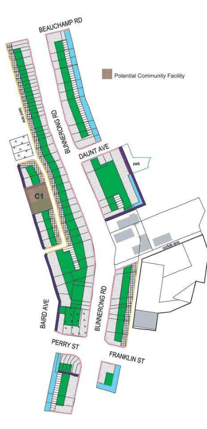

#### C1 Carpark Site

Council’s carpark in Baird Lane is centrally located near a current pedestrian link through to Bunnerong Road.  To the north and south of the carpark are 3 storey residential flat buildings with garage entries onto Baird Lane.

Randwick Council’s Community Facilities Plan has identified a need for a community facility with a floor space of around 300 sq metres in or near the centre, close to public transport and other facilities, to ensure the facility can be accessed by the community.

Redevelopment of Council’s carpark, either in conjunction with adjacent properties, or on its own, has the potential to achieve this community facility, together with improved public parking, and public toilet facilities for the centre.

#### Objective

• To achieve a quality development that offers a community facility, improved public parking, public toilet facilities for the centre and enhanced east west pedestrian connections.

#### Controls

i) Provide a multi.use community facility.

ii) Provide at ground level for the full length of the southern boundary, a civic space of approximately 15 metre wide offering pedestrian connection between Baird Ave and Baird Lane. Landscape this space to duplicate the existing row of trees at the southern boundary.

iii) Provide residential or community facility frontages to Baird Ave and Baird Lane. A complementary use such as a cafe may be considered provided that it addresses the civic space.

iv) Provide, in addition to all other required parking, a minimum of 80 public parking spaces, accessible to the public at all times.

v) Within the community facility, provide public toilet facilities.

vi) The maximum overall height (at Baird Ave only) may be varied to 5 storeys, with the upper storey setback by 4 metres from the floor below.

> [Picture on page 25: a picture, saved as a picture (images/part-d5-matraville-centre-page-25-44.gif, 150 dpi).]

#### 3.3.5 Staged DA – St Agnes School
