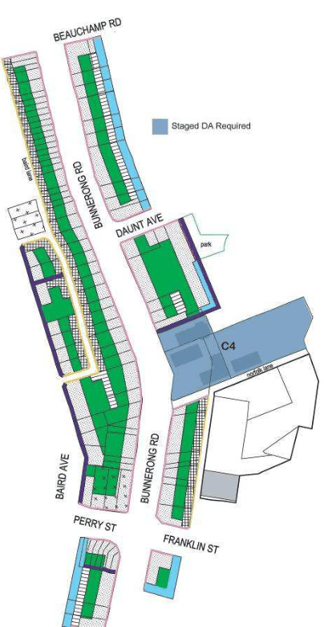

#### C4         St Agnes School

St Agnes Catholic Church and St Agnes School are a central community focus.  This section recognises that the current uses may continue.  However, over the next 20 years, it is appropriate to consider how to maintain this focus should the needs of the church and the community it serves change to the extent that the school or the church is no longer required.

This site is also identified in RLEP as a key site. Any redevelopment proposed for this area should consider these lots as one parcel, requiring a site specific DCP or staged DA.

#### Objectives

• To provide a comprehensive redevelopment framework should the Archdiocese of Sydney decide that the educational needs of its community change over the next twenty years.

• To maintain and enhance the community focus and public open space of this key location within the centre by introducing a substantial civic space accessible to the general public at the Bunnerong Road frontage.

• To provide St Agnes Church (if retained) with a more suitable curtilage to the north and south.

• To provide improved parking arrangements for the Church.

• To provide public parking.

• To enable mixed use residential development that supports the centre and frames the civic space with active uses.

#### Controls

i) Prepare a site.specific staged DA for any redevelopment altering the use of the whole or part of this site from church and/or school.

ii) Ensure that the site.specific staged DA generally conforms to the objectives and controls of this Matraville Centre section of the DCP.

iii) Provide, as an integral and integrated component of the proposal, a civic space/town square with a minimum site area of 1200 sq metres.  Should the church use remain as part of the redevelopment, ensure that the town square provides an enhanced southern curtilage for St Agnes Church.

> [Picture on page 26: a picture, saved as a picture (images/part-d5-matraville-centre-page-26-41.gif, 150 dpi).]

#### Note:

Minor development or upgrades of existing uses on this site should generally conform to the objectives and controls of this section of the

#### DCP

iv) Provide Grd/Storey 1 uses to activate the town square by day and by night i.e. cafes, restaurants, retail.

v) Provide all parking below ground at basement level.

vi) In addition to all parking generated by the redevelopment provide additional public parking spaces accessible to the general public at all times.

vii) Provide all vehicle access from Norfolk Parade.

#### 3.3.6 Staged DA – RSL Club
