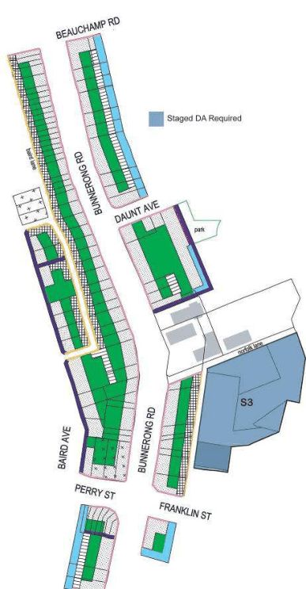

#### S3         RSL Club

The RSL Club provides local sporting, leisure and entertainment opportunities which contribute to the life and activity of the centre.

The lots indicated in these Parcels currently comprise a variety of uses including parking and leisure activities associated with the RSL Club.

This subsection recognises that the current uses may continue. However, a redevelopment which improves community access (including physical pedestrian connections) to public parking, leisure facilities and community uses combined with residential would be well regarded by Council.

This site is also identified in RLEP as a key site. Any redevelopment proposed for this area should consider these lots as one parcel, requiring a site.specific DCP or staged DA.

#### Objectives

• To provide a comprehensive redevelopment framework which improves community access (including physical pedestrian connections) between the town centre and public parking, leisure facilities and community uses.

• To maintain and enhance the community focus and public open space of this key location within the town centre.

• To maintain and enhance public parking in a central location.

• To enable mixed use residential development to support the town centre.

#### Controls

i) Prepare a site.specific staged DA for any redevelopment altering the use of the whole or part of this site.

ii) Ensure that the site.specific proposal generally conforms to the objectives and controls of this Matraville Centre section of the DCP.

iii) Provide, as an integral and integrated component of the proposal public open space with a minimum site area of 500 sq metres. Ensure that this open space, which may include the existing tennis courts and bowling greens, provides well. lit, safe and active pedestrian connections between the town centre and public parking, leisure facilities and community uses.

iv) Provide all parking below ground at basement level.

> [Picture on page 27: a picture, saved as a picture (images/part-d5-matraville-centre-page-27-41.gif, 150 dpi).]

#### Note:

Minor development or upgrades of existing uses on this site should generally conform to the objectives and controls of this Matraville Centre section of

#### DCP.

v) In addition to all parking generated by the redevelopment provide additional public parking spaces accessible to the general public at all times.

vi) Submit a traffic and access study with any staged DA to identify appropriate vehicle access route(s) to the site.
