## 4 Building Design

### 4.1 Active Frontages

An active town centre relies on: local residents who provide demand for local goods and services; street level retail and commercial activities which enliven the street by day and by night; interactivity between commercial uses and the public domain; choices of access; good presentation; safety and comfort; and sociability.

Active frontages have a positive influence on the safety and security of an area, improving perceptions of safety by providing a level of comfort that others are nearby. People are more inclined to walk along pleasant, active streets. Multiple opportunities to meet and interact also contribute to community cohesion.

Glazed or open shopfronts, good visual merchandising, interesting building entries and outdoor eating areas all create street level interest and variation to enrich the visual experience of pedestrians.

#### Objectives

• To achieve a well designed streetscape that engages and activates the centre and contributes to its economic viability.

• To provide a walkable environment, with visual interest and opportunities for social interaction.

#### Controls

i) Provide a continuous and active zero setback business frontage on the ground floor in Bunnerong Road, Daunt Ave, Perry Street, and Franklin Street.

ii) Maximise street level activity (e.g. by wrapping shopfronts around corners) and minimise blank walls at ground level.

iii) Maximise glazing for retail/commercial uses, but break large glazed shopfronts into discrete sections to ensure visual interest.

iv) The use of opaque or reflective glass which obscures uses on the ground floor is discouraged.

v) Ensure that any grilles or transparent security shutters to retail frontages, offer a minimum of 70% transparency.

vi) Ensure that entrances to internally orientated shopping or commercial arcades, and the arcades themselves, are a minimum of 6 metres wide.  Provide active retail and business frontages throughout any arcades.

vii) Incorporate outdoor dining in cafés and/or restaurants wherever possible in accordance with Part D12, Footpath dining and trading.

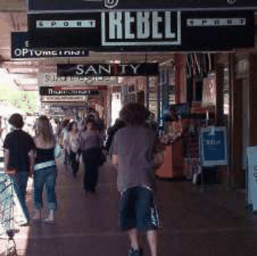

> [Picture on page 28: a picture, saved as a picture (images/part-d5-matraville-centre-page-28-44.gif, 150 dpi).]

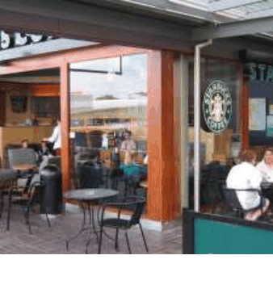

> [Picture on page 28: a picture, saved as a picture (images/part-d5-matraville-centre-page-28-45.gif, 150 dpi).]

viii) Recess doors to ensure they do not encroach over the footpath when open.

ix) The use of fully operable glass walls (e.g pivot, stacking or bi.fold) to open cafés and restaurants to the street is encouraged.

### 4.2 Awnings

Awnings improve the shopping experience by providing weather protection and by creating a pedestrian scale. They play a role in sheltering passengers waiting at bus stops and travelling to and from bus stops.  Awnings also offer a good opportunity to create architectural detail and contribute to the character of the street.

Matraville Centre has an east.west street frontage orientation, meaning that sun penetration may be significant at certain times of the day. Vertical blinds from the awning edge are an appropriate means of managing the effects of the sun.

#### Objectives

• To provide shelter and amenity for pedestrians on public streets.

• To reinforce an existing coordinating feature of the town centre.

• To provide continuity in the streetscape.

#### Controls

i) Provide continuous street frontage awnings to all new development. Generally awnings should be a minimum 3 metres deep.

ii) Setback awnings a minimum of 600mm from the kerb.

iii) Design new awnings to be complimentary with their neighbours, and aligned with the general alignment of existing awnings in the street.

iv) Cantilever awnings from the buildings with a minimum soffit height of 3.5 metres.

v) Provide under.awning lighting to improve public safety.

vi) Colonnades along the street edge are inappropriate in this context.

vii) Signage on canvas blinds is inappropriate.

### 4.3 Balconies

Balconies are outdoor rooms, which enhance the amenity and lifestyle choices of apartment residents. They provide private open space, extend the living spaces of the apartment and capitalise on the temperate climate. Balconies are also important architectural elements, contributing to the form and articulation of apartment buildings.

#### Objectives

• To ensure that every apartment has access to a private, functional open space accessed directly from main internal living spaces.

• To contribute to building articulation by integrating balcony design into the architectural form and detail of the buildings.

#### Controls

Unless otherwise indicated in 3.2 and 3.3:

i) Provide a primary balcony/terrace for each apartment, directly accessible from the main living area.

ii) Ensure that the primary balcony has a minimum depth of

2.5 metres, and a minimum area of: . 6 sq metres for a studio/one bedroom apartment . 10 sq metres for a two/three bedroom apartment . 15 sq metres for a four/more bedroom apartment

iii) Ensure that the primary balcony extends the living space with proportions that accommodate outdoor furniture and space for plants.  Consider the benefits of supplying a tap and gas point.

iv) Ensure that additional balconies have a minimum depth of

1.5 metres.

v) Orientate  balconies  to  maximise  solar  access.  Ensure that  the  longer dimension of any balcony is outward facing to maximise light penetration into the interior of each apartment. Design the depths of balconies to ensure that sunlight enters the lower apartments in the building.

vi) Ensure that the undersides of balconies exhibit a well designed, completed appearance from the street.

vii) Design balustrades to take advantage of views and improve community safety by allowing surveillance over the street and other public areas while providing for safety and visual privacy.

viii) Include sunscreens, pergolas, shutters and operable walls to enhance design and livability, respond to the local climate and site context, reduce road noise impacts and assist visual privacy.

ix) Wherever possible, integrate permanent landscaped features into balcony design. Wintergardens may be included on the western elevation.

x) Retractable awnings may be included above the 4th storey.

xi) Residential balconies must not extend beyond the property boundary.

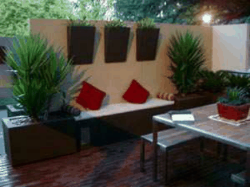

> [Picture on page 30: a picture, saved as a picture (images/part-d5-matraville-centre-page-30-45.gif, 150 dpi).]

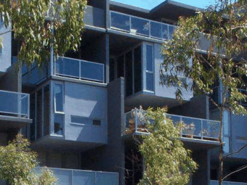

> [Picture on page 30: a picture, saved as a picture (images/part-d5-matraville-centre-page-30-46.gif, 150 dpi).]

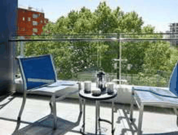

> [Picture on page 30: a picture, saved as a picture (images/part-d5-matraville-centre-page-30-47.gif, 150 dpi).]

### 4.4 Facades

Since the majority of people experience buildings from the outside, facades have an important role to play in the perception and feeling of a place.  Design emphasis through use of special details, materials, changes in building plane (recessed or extended from building surface), contrasts in materials or decorative   artwork can all contribute to the unique character of a building and a place. This sort of visual interest, or articulation, can also assist to visually ‘divide’ buildings into smaller, identifiable pieces.

Visual interest can be derived from: articulation of the façade into horizontal divisions of bottom, middle and top; balcony and fenestration details; proportions and spaces; and ‘modelling’ of the surface through detail and relief.   As a rule of thumb, detail and articulation should enable a resident to readily identify his or her apartment from street level, outside the building.

Quality design will be achieved by articulated facades to the front, sides and rear of new development, for example by expression of entries to buildings, use of awnings, use of screens and louvres, and incorporation of private open space including courtyards at ground level and balconies/terraces on upper levels.

Buildings on street corners, which are highly visible from two streets, are important in terms of both ‘wayfinding’ and ‘place making’.  Well defined corner buildings can assist pedestrians to orient themselves and navigate their way around a precinct.

The process of development along Bunnerong Road will sometimes leave party walls exposed where new development abuts existing, lower buildings.  Care must be taken to ensure that any exposed party walls are not left as stark, blank walls until adjoining development occurs.

#### Objectives

• To achieve building facades that enhance to the character of the street.

• To achieve buildings with well designed articulated massing to all facades.

• To ensure that corner buildings respond to the characteristics of the two streets they address, reinforcing the corner elements.

• To encourage identifiable, good quality entry spaces to lobbies, foyers or individual dwelling entrances.

#### Controls

i) Ensure that each building has a unique identity, demonstrating articulation either as a result of permanent elements such as balconies and terraces incorporated into the facade, or as a result of innovation in the use of windows, awnings, screens and other building elements.

ii) Design buildings to address the street, ensuring that rear and side facades also provide visual interest to the street and surrounding neighbours.  Ensure that each street frontage of a corner building addresses the street with active ground floor uses.

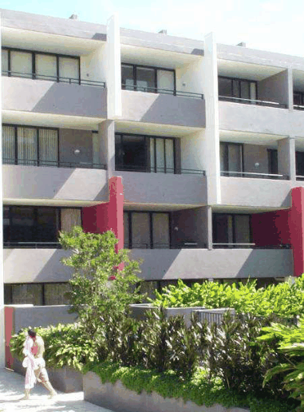

> [Picture on page 31: a picture, saved as a picture (images/part-d5-matraville-centre-page-31-51.gif, 150 dpi).]

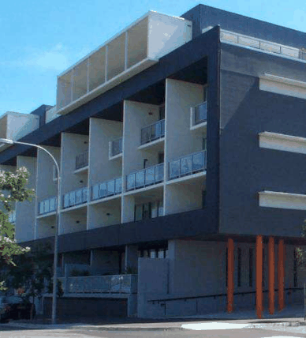

> [Picture on page 31: a picture, saved as a picture (images/part-d5-matraville-centre-page-31-52.gif, 150 dpi).]

iii) Emphasise verticality at street corners, if possible by concentrating the tallest portion of the building on the corner itself.  Utilise design devices such as splayed corner details, and expression of junction of building planes to reinforce the wayfinding attributes of street corners.

iv) Integrate buildings into the streetscape by adopting a modular form, ideally one  which  reflects  the  underlying narrow  shop  width  of  older  buildings and lots in the town centre (6 . 8 metres).  Use vertical elements such as vertically proportioned windows, exposed party walls, attached piers, vertical balustrades, attached columns or fins to express this modulation and rhythm. Use horizontal elements such as roofs, parapets, balconies and balustrades, eaves lines, string courses, cornices and door/window heads to align the building with its neighbours.

v) Ensure that shutters, louvres and other facade features do not encroach over Council’s road reserve.

vi) Ensure that the façade clearly expresses a bottom, middle and top related to the overall proportion of the building. Generally, the bottom will read as the area below the awning, and the top will read as the uppermost storeys.

vii) Incorporate design characteristics such as: projecting fins; corbelling and string courses; balconies with variable materials and finishes; ‘punctuated walls’ with visually recognisable patterns, decorative features, rhythm and texture; and a variable colour palette to achieve façade modulation and articulation.

viii) To enhance the articulation, lightweight structures, sunshading devices, and horizontal and vertical architectural elements including balconies may penetrate the Building Envelope (but not the property boundary) by a maximum of 1.5 metres.

ix) Avoid curtain walls, large expanses of glass and large expanses of concrete as these do not create well articulated and harmonious facades

x) Demonstrate that the design is a contemporary response to the current context of the Matraville Centre.

xi) Where new development leaves exposed party walls

#### Note:

A curtain wall is a particular type of exterior wall construction using a continuous sheet of panels hung onto the side of a building over the framework and generally used for modern high@ rise buildings

adjacent to existing, lower buildings, improve the appearance of the exposed section of the party wall with colour, modulation, and articulation.

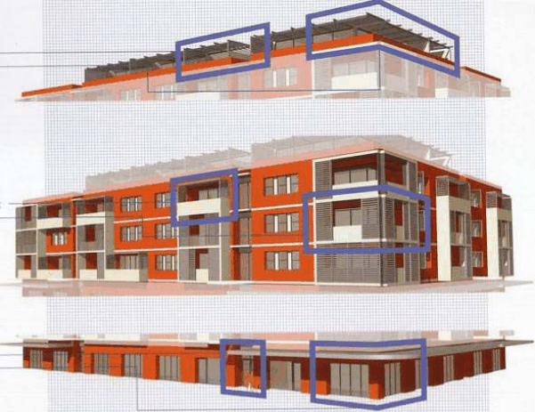

> [Picture on page 33: a picture, saved as a picture (images/part-d5-matraville-centre-page-33-1.gif, 150 dpi).]

These images from the Residential Flat Design Code indicate how a facade can clearly express a bottom, middle and top

### 4.5 Materials and Finishes

The centre currently comprises a haphazard palette of materials, finishes and colours.  New development or refurbishment should improve the overall presentation and appearance of the streetscape.

#### Objective

• To achieve a pleasant, coherent streetscape that integrates new and existing buildings incorporating quality materials and finishes.

#### Controls

i) Combine different materials and finishes to assist building articulation and modulation.  The use of face bricks and/or coloured rendered brickwork may assist to integrate new development into the existing streetscape.

ii) The following materials are considered incompatible: . Large wall tiles; . Rough textured render and or bagged finish; . Curtain walls; and . Reflective glass.

iii) Avoid large expanses of any single material to facades.

### 4.6 Mobility and Access

It is important that new development (especially commercial development) is designed to allow access for all people, including those with disabilities and declining mobility.

#### Objective

• To ensure that all residents and visitors, including wheelchair users and those with a disability, are able to easily reach and enter all publicly accessible parts of a building, including retail stores, communal areas and apartment lobbies.

#### Controls

New development and shop refurbishments:

i) Achieve building/retail/commercial entrances which are flush with the footpath/external ground level, or provide a suitably ramped alternative.

ii) Provide appropriate access and facilities as set out in the current Australian Standard AS 1428 (parts 1 & 2).

iii) Use appropriate gradients and materials, including slip resistant materials, tactile surfaces and contrasting colours.

### 4.7 Public Art

Public art brings the vision and talent of artists out of galleries and museums to the local community.  Public art integrated into private development can include paving treatments, lighting design, sculpture, fencing design, decorative elements of electrical and engineering work, elements of building design and themed landscaping and planting works.

Public art can celebrate local heritage and explore community and cultural identity. When it becomes an integral part of building design, it can also set the mood for adjacent public spaces.

Public art projects are sometimes designed to include participation by the local community in the design or making of certain elements.

#### Objectives

• To encourage artworks that are integrated into individual building design.

• To achieve a distinct character and identity for Matraville through private and public domain improvements which use art to express local identity.

• To achieve public art that evokes and celebrates such themes as exploration, recreation, local indigenous history and culture, multicultural legacies,

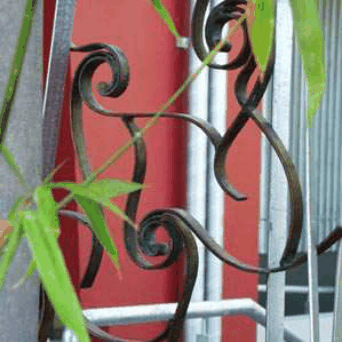

> [Picture on page 34: a picture, saved as a picture (images/part-d5-matraville-centre-page-34-43.gif, 150 dpi).]

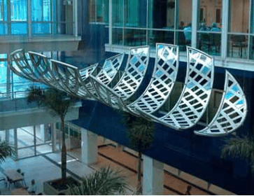

> [Picture on page 34: a picture, saved as a picture (images/part-d5-matraville-centre-page-34-44.gif, 150 dpi).]

#### Note:

Consultation with the community has identified key themes for the town centre, including local history, sport and recreation, terrace gardens, and a green town centre

#### Controls

i) For sites with frontages greater than 12 metres, and for corner sites, integrate artistic elements which are integral to  the  built  form  of  the  development e.g: paving, window treatments, canopy design, balustrading, signage and wayfinding, lighting to assist illumination levels after dark and the promotion of active uses in the public spaces.

. Create site specific artworks and designs which respond to and contribute to the site and development.

. Locate  public  art  in  areas  offering  the  public  a  free and unobstructed experience of the work.

. Submit an Arts statement which identifies the reasons for the chosen themes, and their interpretation into specific treatments with the DA.

### 4.8 Roof Forms

The maximum building height in the Matraville Centre specifically refers to the ‘underside of the topmost ceiling’ rather than the uppermost area of the roof.  This control will allow design freedom for a range of roof forms and parapets with the potential to contribute visual interest to the skyline or silhouette of the town centre.

Well.designed roofs which conceal mechanical structures such as lift overruns and service plants can sometimes create opportunities for open recreational spaces.

#### Objectives

• To add visual interest to the town centre skyline when viewed from street level or surrounding vantage points.

• To ensure that roof plant and service areas are not visible from adjoining public roads or private property.

• To ensure the roof contributes to the overall design and performance of the building.

#### Controls

i) Wholly contain lift over.runs and service plants within roof structures or roof lines.

ii) Minimise the bulk and mass of roofs and their potential for overshadowing.

iii) Design roofs to generate a visually interesting skyline and minimise apparent bulk.

iv) Relate roofs to the size and scale of the building, the building elevation, and the three dimensional building form.

v) Consider the sustainability benefits of landscaped ‘green roofs’ and appropriately shaded areas.

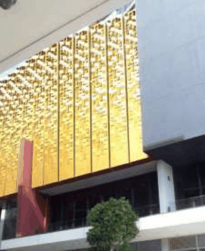

> [Picture on page 35: a picture, saved as a picture (images/part-d5-matraville-centre-page-35-43.gif, 150 dpi).]

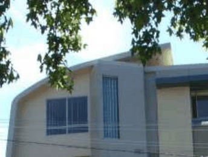

> [Picture on page 35: a picture, saved as a picture (images/part-d5-matraville-centre-page-35-44.gif, 150 dpi).]

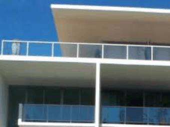

> [Picture on page 35: a picture, saved as a picture (images/part-d5-matraville-centre-page-35-45.gif, 150 dpi).]

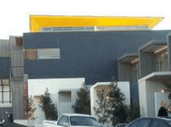

> [Picture on page 35: a picture, saved as a picture (images/part-d5-matraville-centre-page-35-46.gif, 150 dpi).]

vi) Domestic roof forms and features such as attic or dormer windows in the roof are inappropriate within the town centre context.
