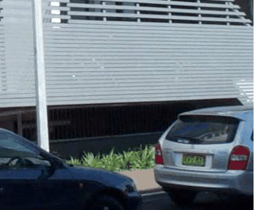

## 5 Access

### 5.1   Parking

New development within the town centre must provide adequate on.site parking. Excavation to achieve underground parking is a good solution but may be difficult on sites with a limited frontage. Above ground parking limits the capacity for sites to offer residents access to high quality open space.

Any ground level parking must be provided beneath a landscaped podium.

Integrate natural ventilation design into the façade of the building, or parking structure, treating it with appropriate features such as louvres, well.designed grilles, planting or other landscaping elements.

#### Objectives

> [Picture on page 36: a picture, saved as a picture (images/part-d5-matraville-centre-page-36-18.gif, 150 dpi).]

#### Note:

Integrate natural ventilation design into the façade of the building, or parking structure, treating it with appropriate features such as louvres, well@ designed grilles, planting or other landscaping elements

• To provide on site parking for commercial users, residents and visitors.

• To ensure that carparking access and garaging do not dominate the street or the site.

• To integrate parking facilities with the overall site planning and maximise on. site open space.

• To ensure that development makes adequate provision for service and delivery vehicles, including access circulation, manouvering, safety and headroom.

#### Controls

i) Incorporate parking within and/or beneath the building. Carparking areas may be designed as ground level parking provided that: . The roof is landscaped as a Courtyard Garden; and . The design results in building frontages level with the street.

ii) Parking provisions for cars and bicycles shall be in accordance with the Parking Section in Part B7 of the DCP.

iii) Tandem parking may be considered where these spaces are attached to the same strata title comprising a single apartment, subject to consideration of the maximum parking limit.

iv) Include natural ventilation to basement and semi. basement carparking.

v) Integrate ventilation design into the façade of the building, or parking structure, treating it with appropriate features

such as louvres, well.designed grilles, planting or other landscaping elements.

### 5.2 Vehicle Access

Vehicular access from Bunnerong Road interrupts the active streetscape which is essential to the effective functioning of a vibrant town centre.  Where alternatives such as rear lanes and side streets, exist, vehicular access for land within the town centre shall be via these alternatives.

#### Objectives

• To access sites within the town centre via driveways from side streets and rear lanes.

• To minimise the number of vehicle access points and maintain traffic flow.

• To maximise retail frontages and streetscape presentation.

• To maximise pedestrian safety.

#### Controls

i) Provide vehicle access from rear lanes and side streets.

ii) Design driveways to minimise visual impact on the street and maximise pedestrian safety.  Setback any rear lane garage doors 1 metre from the laneway alignment.

iii) Integrate water runoff management into the design of driveway ramps and entrances.

iv) Avoid locating accessways to driveways adjacent to the doors or windows of habitable rooms.

v) Design vehicular access in accordance with the current Australian Standard for ‘off.street parking (Part 1) and off. street carparking for commercial vehicles (Part 2). Refer also to the Traffic, Parking and Access Section B7 of the DCP.

vi) Internal driveways must be a minimum of 5.5 metre clear width for the first 6 metres inside the property to allow entering and exiting vehicles to pass freely. Should the driveway narrow beyond the first 6 metres, a minimum splay of 1.5 metres x 1.5 metres must be provided to allow the passing to work.
