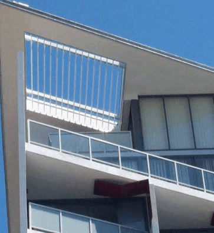
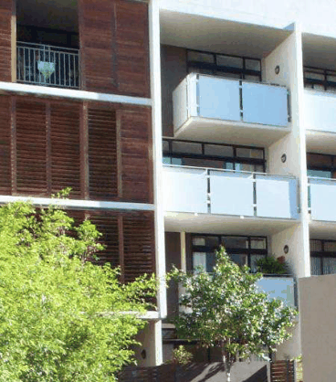

## 7 Amenity

### 7.1 Natural Daylight, Overshadowing and Solar Access

Solar access is a major determinant of personal environmental comfort.  Good passive solar design offers a resource and financial benefit by reducing the need for artificial heating and cooling.  New development must also recognise that existing adjacent buildings require reasonable access to sunlight for living spaces, and private and public open spaces.

#### Objectives

• To optimise solar access to habitable rooms and to minimise the need for artificial lighting during daylight hours.

• To minimise the impact of overshadowing on the internal and outdoor areas of neighbouring buildings.

• To retain the amenity of the public domain by maximising solar access.

#### Controls

i) Maintain sunlight access to private and public open spaces and north facing habitable rooms of adjoining development for at least 3 hours between 9am and 3pm on 21 June, where possible.

ii) Ensure that building layouts facilitate good solar access to both internal and external living spaces e.g. ideally locate living areas (including their associated balconies) to the north and east, and service areas to the south and west of the development.

iii) Maximise  any  northerly  aspect  and  optimise  the number  of  north  facing windows. Shade north facing windows with roof eaves, verandahs or balconies,awnings or other horizontal shading devices.

iv) Provide adjustable shade devices suitable for lower sun angles (e.g louvres/blinds) to openings on the eastern and western facades.

v) Incorporate appropriately designed double glazed or energy efficient glass skylights and clerestory windows to improve daylight levels wherever possible.

vi) Do not use coloured/opaque glass as a shading device.

vii) Protect roof terraces with shade cloth, planting, pergolas and/or vergolas.

viii) Ensure  that  living  spaces  of  at  least  70%  of apartments  in  any  new development receive a minimum of 3 hours of sunlight between 9am and 3pm on 21 June, unless existing overshadowing prevents this.

> [Picture on page 42: a picture, saved as a picture (images/part-d5-matraville-centre-page-42-44.gif, 150 dpi).]

> [Picture on page 42: a picture, saved as a picture (images/part-d5-matraville-centre-page-42-45.gif, 150 dpi).]

### 7.2 Natural Ventilation

Natural ventilation, the unimpeded flow of air through a building or apartment, is a vital contributor to residential amenity and a high quality living environment. The slim building envelopes required by this Plan specifically encourage development which relies as much as possible on natural, rather than mechanical, ventilation.

#### Objective

• To ensure that apartments achieve a high standard of amenity and thermal comfort by providing all habitable rooms with direct access to fresh air.

#### Controls

| i) | Ensure that all apartments are single loaded or dual aspect, to allow the direct flow of air from one side of the apartment to the other. | Note: Natural ventilation impacts on energy efficiency and forms part |
|---|---|---|
| ii) | Consider the use of crossover apartments, which minimise corridors and lift lobbies whilst providing a dual aspect and natural ventilation. | of the BASIX certification for new development |
| iii) | Maximise natural ventilation to each apartment by: |  |
| . | Locating small windows on the windward side and larger |  |
| . | windows on the leeward side of the building (utilising air pressure to draw air through the apartment). Selecting and designing windows which can be reconfigured to catch prevailing breezes, and funnel breezes into the apartments (e.g. vertical louvred and |  |
| . | casement windows). Using design solutions such as: higher level casement or |  |
| . | sash windows; and clerestory windows or operable fanlight windows (including above internal doors) to facilitate convective currents. This is particularly important in apartments with a single aspect. Minimising interruptions to airflow (e.g. corners/walls) |  |
| . | within individual apartments. Grouping rooms with similar uses together (e.g. living spaces/ sleeping spaces) to allow the apartment to be compartmentalised for efficient summer cooling or winter heating. |  |
| iv) | Consider acoustic transfer grilles with operable shutters through external and internal walls. |  |
| v) | Utilise innovative technologies (e.g. stack effect ventilation or solar chimneys) to achieve natural ventilation in non. habitable rooms and basement carparks. |  |
| vi) | Double.loaded/single aspect apartments will only be considered if specific site conditions create justifiable design difficulties and the applicant can provide appropriate verification/evidence (from suitably qualified professional) that innovative technologies will be employed to achieve natural ventilation. |  |

### 7.3 Privacy @ Acoustic

Acoustic privacy, an important contributor to the amenity of apartments, is a measure of sound insulation within and between buildings and between external and internal spaces.  Designing for acoustic privacy relates to the location and separation of buildings and the arrangement of apartments and internal spaces within apartments.

#### Objective

• To  ensure  high  levels  of  acoustic  privacy  within  and between  residential developments and associated private open space.

#### Controls

i) Construct all residential buildings so that they achieve the following internal acoustic amenity criteria, when tested in accordance with Australian Standard AS2107: 2000

ii) In naturally ventilated residential units; the repeatable maximum LAeq(1hour) should not exceed:

|  | Windows closed |  | Windows open |  |
|---|---|---|---|---|
| Sleeping areas | 10pm . 7am | 35dB(A) | 24 hours | 45dB(A) |
| Living areas | 24 hours | 45dB(A) | 24 hours | 55dB(A) |

#### Note:

Noise and vibration assessments should be prepared by consultants with experience in this field.  For a model consultant brief refer to the RMS’s Environmental Noise

#### Management Manual

iii) Where  natural  ventilation  cannot  be  achieved,  in residential units provided with mechanical ventilation, air conditioning or other complying means of ventilation (in accordance with the ventilation requirements of the Building Code Of Australia), the repeatable maximum LAeq (1hour) should not exceed:

|  | Doors and Windows closed |  |  |  |
|---|---|---|---|---|
| Sleeping areas | 10pm . 7am | 38dB(A) | 7am . 10pm | 45dB(A) |
| Living areas | 24 hours | 46dB(A) |  |  |

iv) When requested, submit a noise and vibration assessment report prepared by an appropriately qualified professional and addressing measures to minimise potential noise and vibration impacts for any proposed development. This assessment must:

. pay   regard   to   the   NSW   EPA’s Industrial Noise Policy, Chapter 174 of the NSW (DEC) Noise Control Manual and relevant Australian Standards

. incorporate  external  noise  sources  (such  as  traffic, plant  & equipment) and internal noise sources (such as mechanical ventilation)

. specify if the findings and recommendations can be achieved and detail the measures needed to achieve the required acoustic environment.

v) Maximise acoustic privacy to the site and building layout by providing adequate building separation within the development and from neighbouring buildings.

vi) Design developments to minimise noise transition between apartments by:

. locating busy, noisy areas next to each other and quieter areas next to other quiet areas, for example, living rooms next to living rooms, bedrooms with bedrooms; . locating bedrooms away from busy roads and other noise sources; . using storage or circulation zones within the apartment to buffer noise from adjacent apartments, mechanical services or corridors and lobby areas; and . minimising the amount of party (shared) walls with other apartments.

vii) Reduce noise transmission from common corridors or outside the building by providing seals at entry doors.

viii) Resolve conflicts between noise, outlook and views using design measures such as double glazing and operable screening.

ix) Comply with BCA requirements for acoustic control of airborne noise and impact of noise between apartments.

### 7.4 Privacy @ Visual

Visual privacy measures aim to protect every resident’s ability to carry out private functions within all rooms and private open spaces, without compromising the functionality of the outlook, ventilation, and solar access of those private spaces.

#### Objectives

• To provide reasonable levels of visual privacy externally and internally, during the day and night.

• To maximise outlook and views from principal rooms and private open spaces without compromising visual privacy.

#### Controls

i) Design building layouts to minimise direct overlooking of rooms and private open spaces by:

. separating communal open space, common areas and access routes from windows of rooms (particularly habitable rooms) . changing the level between ground floor apartments (including their associated private open space) and the public domain or communal open space.

ii) Maximise  visual  privacy  by  providing  the  following minimum  physical separations between buildings:

|  | Distance |
|---|---|
| Between habitable rooms | 12 metres |
| Between habitable room and balconies/non.habitable | 9 metres |
| rooms Between non.habitable rooms | 6 metres |

iii) Increase privacy without compromising amenity by:

. offsetting windows of apartments in new development to windows in adjacent development; . recessing  balconies  and/or  providing  vertical  fins between adjacent balconies; . using solid or semi.solid balustrades to balconies; . using louvres or screen panels to windows and/or balconies; . providing landscape screening; . incorporating planter boxes into walls or balustrades to increase the visual separation between areas; and/or . utilising pergolas or shading devices to limit overlooking of lower apartments or private open space.

### 7.5 Safety & Security

The design of buildings and spaces has an impact on perceptions of safety and security, as well as on actual opportunities for crime. Development should provide safe ground level entry and exit at all times of day and night, enable natural surveillance, clearly define public and private ownership, control access to the building and be easily maintained to enhance feelings of territoriality.

#### Objectives

• To ensure that the development is safe and secure for residents and visitors, and contributes to the safety of the town centre.

• To maximise natural surveillance . the ability to overlook the street and footpath from windows or balconies.

• To  ensure  that  the  building  and  the  site  can  be cleaned  and  easily maintained.

• To create entrances which provide an identifiable and desirable residential amenity.

#### Controls

#### Note:

‘Safer by Design’ is an accepted Crime Prevention principle that physical environments can be designed to positively influence human behaviour.

The NSW Police Service provides ‘Safer by Design’ training and advice, based on the strategies of Crime Prevention Through Environmental Design (CPTED). For more information contact NSW Police Service Safer by Design Team or go to www.police.nsw.gov.au

i) Design buildings to clearly define the transition from public through to private space.

ii) Ensure that the safety of individual apartments is maximised by design that does not allow access from the balconies, roofs, windows, or awnings of its own or neighbouring buildings.

iii) Orientate entrances towards the public street and provide clearly identifiable, sheltered, well lit and safe spaces to enter the building, meet and collect mail.

iv) Provide direct and well.lit access between carparks and apartments, between carparks and lift lobbies, and to all apartment entrances.

v) Provide clear lines of sight between one circulation space and the next.

vi) Provide separate entrances, where possible, for pedestrians and vehicles, commercial and residential occupants, and ground floor apartments.

vii) Avoid blind or dark alcoves which might conceal intruders, especially in areas near lifts, stairwells, and entries and within carparks.

viii) Ensure that public and common areas achieve lighting levels sufficient for people to recognise an approaching person’s face 10.15 metres away. Vandal proof fittings should be used wherever lights are positioned within reach.

ix) Consider audio and video intercom and/or key card access systems.

x) Provide for easy maintenance and cleaning by: designing windows that can be cleaned from inside the building; using manually operated (rather than mechanical) systems such as blinds, sun shades, pergolas and curtains.

xi) Submit a formal Crime Risk Assessment with every DA comprising 20 or more new apartments.
