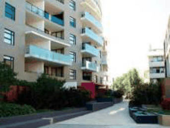
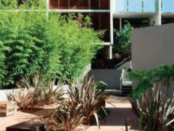

## 8 Site Design

### 8.1 Courtyard Gardens & Other Landscaped Open Space

Landscaping can contribute to the character and visual quality of the town centre. This section identifies Courtyard Gardens as communal open space for new residents, to provide appropriate privacy and overshadowing separation between buildings.

Some sites may be able to accommodate deep soil zones (areas of natural ground with relatively natural soil profiles retained within a development).  Deep soil zones promote the healthy growth of large canopy trees, protect existing mature trees, and reduce stormwater runoff by allowing rainwater to infiltrate the water table.

Refer to Part B . General controls for requirements for landscaping applying to all development. The following objectives and controls apply to Matraville Centre in addition to the general controls.

#### Objective

• To ensure access to areas of communal open space of sufficient size and quality to enhance the development’s liveability.

> [Picture on page 47: a picture, saved as a picture (images/part-d5-matraville-centre-page-47-40.gif, 150 dpi).]

> [Picture on page 47: a picture, saved as a picture (images/part-d5-matraville-centre-page-47-41.gif, 150 dpi).]

#### Controls

i) Provide a landscaped courtyard garden with a minimum courtyard depth of 12 metres. Courtyard gardens should not be fragmented into multiple spaces.

ii) Demonstrate that courtyard gardens and other landscaped areas are designed as a focus of the development and a landscape buffer between buildings.

iii) Reduce  glare  and  noise  transference  through  a careful  balance  of  hard surfaces and soft landscaping.

iv) At property boundaries, use soft landscape treatment to supplement fencing.

### 8.2 Service and Utilities

Adequate consideration needs to be given to both existing and proposed service authority assets within the town centre.

#### Objectives

• To enhance the visual amenity of service provision to new development.

• To  ensure  essential  services  and  utilities  meet  the demands  of  new development.

#### Controls

i) Where the cost of the works exceeds $2 million, meet all costs associated with replacing overhead wires with underground cables in the vicinity of the development site.

ii) Where the costs of the works exceeds $1 million up to $2 million, meet all costs associated with replacing overhead wires with Aerial Bundled Cables in the vicinity of the development site.

iii) To achieve an active and safe street frontage in laneways, applicants may be required to meet all costs associated with the installation of services such as street lighting.

### Definitions

Acoustic Privacy refers to the measure of sound between dwellings, and between external and internal spaces. Apartment (synonymous with ‘dwelling’ as defined in Randwick City Council’s LEP

2012\) means a room or number of rooms occupied or used or so constructed or adapted as to be capable of being occupied or used as a separate residence. Articulation means three dimensional modelling at the periphery of the building, including any changes in facade alignment, balconies, bay windows and sun shading devices. Building Envelope means a three dimensional shape within which a development must

fit.  It defines the limits for the siting and height of any buildings. Building Footprint means the area of land measured at finished ground level that is enclosed by the external walls of a building. Cantilever means a horizontal projection from a building, (e.g. step, balcony, beam, awning, or canopy) that is without external bracing and appears to be self.supporting Cross over apartments are apartments with two opposite aspects and with a change in level between one side of the building and the other. Cross through apartments are apartments on one level with two opposite aspects. Dual aspect apartments are apartments which have at least two major external walls facing in different directions, including corner, cross over and cross through apartments Environmentally Sustainable Development is development that uses, conserves and enhances the community’s resources so that ecological processes are maintained and the total quality of life, now and in the future, can be increased. Glass to glass dimension is the dimension between the inside faces of windows on the opposite external walls of a building. Habitable room or space means a room used for normal domestic activities, and includes:

• a bedroom, living room, lounge room, music room, television room, kitchen, dining room, sewing room, study, playroom, family room and sunroom but excludes:

• a  bathroom,  water  closet,  pantry,  walkin  wardrobe,  corridor,  hallway,  lobby, photographic darkroom, clothes drying room, and other spaces of a specialised nature occupied neither frequently nor for extended periods. Juliet balcony means a small projecting balcony, generally ornamental or only large enough for one person standing. Lot or allotment refers to an individual parcel of sub.divided land. Mezzanine means the second storey of an apartment, fully or partially open to a void (double height) space shared by both storeys Public Open Space means land used, or intended for use, for recreational purposes by the public. Storey means a floor within a building, but not including:

•    a roof or part of a roof, used as an uncovered garden, terrace or deck;

•    useable or habitable roof space; or

•    semi.basement or basement parking. SEPP means State Environmental Planning Policy. Soffit means the underside of a part or member of a building extending out from the plane of the building walls. Wintergarden means a glass.enclosed garden area for use during all seasons of the year.
